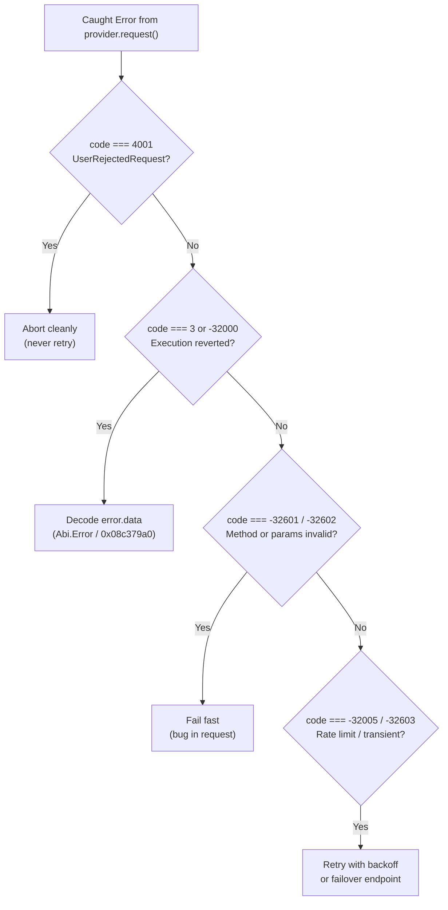

Voltaire providers reject `request()` promises with errors matching the EIP-1193 / JSON-RPC 2.0 shape `{ code: number, message: string, data?: unknown }`. `@tevm/voltaire/provider` exports `ProviderRpcError`, `EIP1193ErrorCode`, `JsonRpcErrorCode`, and `ProviderRpcErrorCode`.

Source: [ProviderRpcError.ts](https://github.com/evmts/voltaire/blob/main/packages/voltaire-ts/src/provider/events/ProviderRpcError.ts), [types.ts](https://github.com/evmts/voltaire/blob/main/packages/voltaire-ts/src/provider/types.ts).



## Error Class and Constants

```typescript
import {
  EIP1193ErrorCode,
  JsonRpcErrorCode,
  ProviderRpcError,
  type RpcError,
} from '@tevm/voltaire/provider';

const err = new ProviderRpcError(
  EIP1193ErrorCode.UserRejectedRequest,
  'User rejected signature',
  { method: 'personal_sign' },
);

console.log(err.name);    // 'ProviderRpcError'
console.log(err.code);    // 4001
console.log(err.message); // 'User rejected signature'
console.log(err.data);    // { method: 'personal_sign' }
```

<Note>
`HttpProvider` throws plain `RpcError` objects (`{ code, message, data? }`) directly from JSON-RPC responses and HTTP failures rather than `instanceof ProviderRpcError`. Always check error properties with a type guard (`isRpcError`) instead of relying solely on `instanceof`.
</Note>

```typescript
import type { RpcError } from '@tevm/voltaire/provider';

export function isRpcError(error: unknown): error is RpcError {
  return (
    typeof error === 'object' &&
    error !== null &&
    'code' in error &&
    typeof (error as { code: unknown }).code === 'number' &&
    'message' in error &&
    typeof (error as { message: unknown }).message === 'string'
  );
}
```

## Error Code Reference

### JSON-RPC 2.0 Codes (`JsonRpcErrorCode`)

| Code | Exported Constant | Meaning | Retryable |
| --- | --- | --- | --- |
| `-32700` | `JsonRpcErrorCode.ParseError` | Malformed JSON sent to server | No |
| `-32600` | `JsonRpcErrorCode.InvalidRequest` | Request object fails schema | No |
| `-32601` | `JsonRpcErrorCode.MethodNotFound` | Node does not support method | No |
| `-32602` | `JsonRpcErrorCode.InvalidParams` | Wrong parameter types or count | No |
| `-32603` | `JsonRpcErrorCode.InternalError` | Node internal failure, HTTP non-2xx, or timeout | Conditional |

### EIP-1193 Wallet & Provider Codes (`EIP1193ErrorCode`)

| Code | Exported Constant | Meaning | Retryable |
| --- | --- | --- | --- |
| `4001` | `EIP1193ErrorCode.UserRejectedRequest` | User declined in wallet UI | No |
| `4100` | `EIP1193ErrorCode.Unauthorized` | Account/method not authorized | No |
| `4200` | `EIP1193ErrorCode.UnsupportedMethod` | Provider does not implement method | No |
| `4900` | `EIP1193ErrorCode.Disconnected` | Disconnected from all chains | Yes (after reconnect) |
| `4901` | `EIP1193ErrorCode.ChainDisconnected` | Disconnected from requested chain | Yes (after switch) |

### EIP-1474 Ethereum Execution Codes

| Code | Meaning | Typical Cause |
| --- | --- | --- |
| `3` | Execution reverted | Contract `revert` / `require` (revert bytes in `error.data`) |
| `-32000` | Invalid input / execution error | Execution revert, insufficient funds, nonce too low, or bad gas |
| `-32001` | Resource not found | Missing block, header, or transaction |
| `-32002` | Resource unavailable | Node still syncing or pruned state |
| `-32003` | Transaction rejected | Mempool rejected transaction |
| `-32004` | Method not supported | Recognized but disabled RPC |
| `-32005` | Limit exceeded | Rate limit or block-range cap exceeded |

## Handling Contract Reverts

Contract reverts surface with `code === 3` or `code === -32000`, often carrying ABI-encoded revert bytes in `error.data` (for example `0x08c379a0...` for `Error(string)` or a 4-byte custom error selector):

```typescript
import { Rpc } from '@tevm/voltaire/jsonrpc';

try {
  await provider.request(
    Rpc.Eth.CallRequest({ to: contractAddress, data: calldata }, 'latest'),
  );
} catch (err) {
  if (isRpcError(err) && (err.code === 3 || err.code === -32000)) {
    console.error('Contract reverted:', err.message, 'data:', err.data);
  } else {
    throw err;
  }
}
```

## Retry Classification with `retryWithBackoff`

Combine `isRpcError` with `retryWithBackoff` from `@tevm/voltaire/utils` so permanent errors fail immediately while rate limits (`-32005`) and transient server failures (`-32603`, `-32002`) back off exponentially:

```typescript
import { EIP1193ErrorCode, JsonRpcErrorCode } from '@tevm/voltaire/provider';
import { retryWithBackoff } from '@tevm/voltaire/utils';

const NON_RETRYABLE = new Set<number>([
  JsonRpcErrorCode.ParseError,
  JsonRpcErrorCode.InvalidRequest,
  JsonRpcErrorCode.MethodNotFound,
  JsonRpcErrorCode.InvalidParams,
  EIP1193ErrorCode.UserRejectedRequest,
  EIP1193ErrorCode.Unauthorized,
  EIP1193ErrorCode.UnsupportedMethod,
  3, // Execution reverted
]);

export function requestWithRetry<T>(fn: () => Promise<T>): Promise<T> {
  return retryWithBackoff(fn, {
    maxRetries: 4,
    initialDelay: 500,
    factor: 2,
    maxDelay: 10_000,
    jitter: true,
    shouldRetry: (error) => {
      if (!isRpcError(error)) return true; // Network / fetch errors
      if (NON_RETRYABLE.has(error.code)) return false;
      if (error.code === -32000 && error.message.toLowerCase().includes('revert')) {
        return false;
      }
      return true;
    },
  });
}
```

## Related

- [Retry Utilities](/utils/retry) — `retryWithBackoff` options and jitter behavior
- [Provider Fallback Guide](/guides/provider-fallback) — Failing over across multiple RPC endpoints
- [Rate Limiting Guide](/guides/rate-limiting) — Preventing `-32005` throttling client-side
- [JSON-RPC Error Primitive](/jsonrpc/json-rpc-error) — `JsonRpcError` reference
