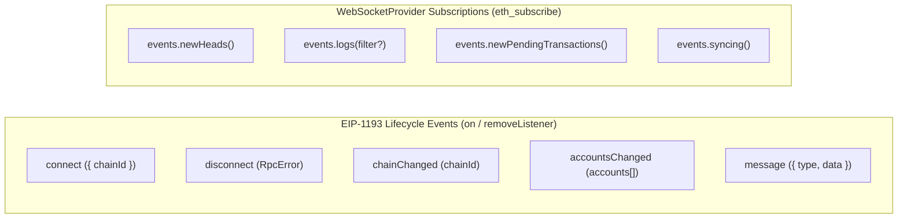

Voltaire providers expose the standard EIP-1193 event emitter (`on` and `removeListener`) for connection and wallet state changes. `WebSocketProvider` additionally provides `eth_subscribe` streams for live blockchain data.



## EIP-1193 Lifecycle Events

| Event | Payload Type | Emitted When |
| --- | --- | --- |
| `connect` | `{ chainId: string }` | Provider connects to a chain (hex chain ID, e.g. `'0x1'`) |
| `disconnect` | `RpcError` (`{ code, message, data? }`) | Provider loses connection to the RPC endpoint |
| `chainChanged` | `string` | Active chain changes (hex chain ID) |
| `accountsChanged` | `string[]` | Authorized accounts change (empty array on wallet disconnect) |
| `message` | `{ type: string; data: unknown }` | Provider delivers subscription payloads (`type: 'eth_subscription'`) or custom messages |

<Note>
`HttpProvider` is stateless and implements `on` and `removeListener` strictly for EIP-1193 interface compatibility; it does not emit lifecycle events. Use `WebSocketProvider` for stateful connections or `EventStream` / `BlockStream` for HTTP polling.
</Note>

### Registering and Removing Listeners

Always store the listener reference so `removeListener` can detach the exact function:

```typescript
import type { ProviderConnectInfo, RpcError } from '@tevm/voltaire/provider';

const onAccounts = (accounts: string[]) => {
  console.log('Active account:', accounts[0] ?? 'disconnected');
};

const onChain = (chainId: string) => {
  console.log('Chain ID:', Number.parseInt(chainId, 16));
};

const onConnect = (info: ProviderConnectInfo) => {
  console.log('Connected:', info.chainId);
};

const onDisconnect = (error: RpcError) => {
  console.error('Disconnected:', error.code, error.message);
};

provider
  .on('accountsChanged', onAccounts)
  .on('chainChanged', onChain)
  .on('connect', onConnect)
  .on('disconnect', onDisconnect);

// Detach when tearing down
provider
  .removeListener('accountsChanged', onAccounts)
  .removeListener('chainChanged', onChain)
  .removeListener('connect', onConnect)
  .removeListener('disconnect', onDisconnect);
```

### One-Time Listener Pattern

`Provider` and `TypedProvider` define `on` and `removeListener` (matching EIP-1193). Implement one-shot listeners by removing the handler inside itself:

```typescript
function onceConnect(provider: { on: Function; removeListener: Function }): Promise<string> {
  return new Promise((resolve) => {
    const handler = (info: { chainId: string }) => {
      provider.removeListener('connect', handler);
      resolve(info.chainId);
    };
    provider.on('connect', handler);
  });
}
```

## WebSocket Pub/Sub Subscriptions

`WebSocketProvider` exposes native `eth_subscribe` feeds via `provider.events` as `AsyncGenerator` iterables. Breaking out of `for await` triggers `eth_unsubscribe` automatically.

```typescript
import { WebSocketProvider } from '@tevm/voltaire/provider';

const ws = new WebSocketProvider({
  url: 'wss://eth.llamarpc.com',
  reconnect: true,
  reconnectDelay: 5000,
});

await ws.connect();

// Stream new block headers
for await (const header of ws.events.newHeads()) {
  console.log('New block:', header);
}
```

### Filtered Log Subscriptions

```typescript
for await (const log of ws.events.logs({
  address: '0xA0b86991c6218b36c1d19D4a2e9Eb0cE3606eB48',
  topics: ['0xddf252ad1be2c89b69c2b068fc378daa952ba7f163c4a11628f55a4df523b3ef'],
})) {
  console.log('USDC Transfer log:', log);
}
```

### Listening to Raw `eth_subscription` Messages

When consuming an external EIP-1193 provider (such as a browser wallet or custom WebSocket wrapper), subscription notifications arrive on the `message` event:

```typescript
provider.on('message', (msg) => {
  if (msg.type === 'eth_subscription') {
    const payload = msg.data as { subscription: string; result: unknown };
    console.log(payload.subscription, payload.result);
  }
});
```

## React Cleanup Pattern

```typescript
import { useEffect, useState } from 'react';
import type { EIP1193Provider } from '@tevm/voltaire/provider';

export function useChainId(provider: EIP1193Provider): number | null {
  const [chainId, setChainId] = useState<number | null>(null);

  useEffect(() => {
    let active = true;

    provider
      .request({ method: 'eth_chainId', params: [] })
      .then((hex) => {
        if (active) setChainId(Number.parseInt(hex as string, 16));
      })
      .catch(() => {});

    const onChainChanged = (hex: string) => setChainId(Number.parseInt(hex, 16));
    provider.on('chainChanged', onChainChanged);

    return () => {
      active = false;
      provider.removeListener('chainChanged', onChainChanged);
    };
  }, [provider]);

  return chainId;
}
```

## Related

- [Getting Started](/jsonrpc-provider/getting-started) — Configuring `WebSocketProvider`
- [Contract Events](/contract/events) — HTTP-compatible `EventStream` with dynamic chunking
- [EIP-6963 Discovery](/jsonrpc-provider/eip6963) — Discovering browser wallet providers
- [WebSocket Provider Skill](/skills/websocket-provider) — Copyable custom WebSocket wrapper
