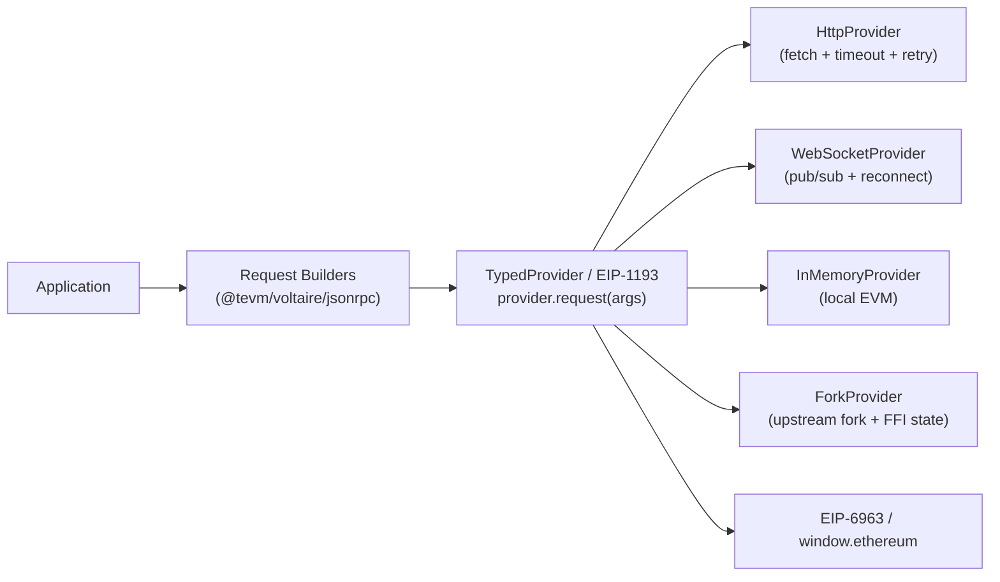

`@tevm/voltaire/provider` provides EIP-1193 provider implementations (`HttpProvider`, `WebSocketProvider`, `InMemoryProvider`, `ForkProvider`), `TypedProvider<TRpcSchema>`, and EIP-6963 wallet discovery. `@tevm/voltaire/jsonrpc` pairs with it by exporting request builders (`Rpc.Eth.*`, `Rpc.Wallet.*`, `Rpc.Anvil.*`, `Rpc.Hardhat.*`, `debug`, `engine`) generated from the Ethereum OpenRPC specification.

<Note>
Looking for ethers v6 or viem APIs? Copy the [ethers-provider](/skills/ethers-provider) or [viem-publicclient](/skills/viem-publicclient) Skill built on top of this interface.
</Note>



## Provider Implementations

All providers implement the EIP-1193 interface (`request`, `on`, `removeListener`) and throw `RpcError` objects on failure.

| Provider | Export | Transport | Events / Subscriptions | Typical Use |
| --- | --- | --- | --- | --- |
| `HttpProvider` | `@tevm/voltaire/provider` | HTTP `POST` (`fetch`) | Stateless (`on`/`removeListener` no-op) | Server-side & browser RPC calls |
| `WebSocketProvider` | `@tevm/voltaire/provider` | WebSocket (`wss://`) | `connect`, `disconnect`, `message`, `events.*` async generators | Real-time `newHeads`, `logs`, pending txs |
| `InMemoryProvider` | `@tevm/voltaire/provider` | Local Voltaire EVM | In-process state & mining (`auto`/`interval`/`manual`) | Deterministic unit tests |
| `ForkProvider` | `@tevm/voltaire/provider` | Local FFI state + upstream RPC | Reads forked block state, writes locally | Mainnet fork testing & simulation |
| `fromEvm` | `@tevm/voltaire/provider` | Custom `Host`/EVM adapter | Custom | Embedding Voltaire EVM behind EIP-1193 |
| `EIP6963` | `@tevm/voltaire/provider` | Browser `window` events | Provider discovery (`subscribe`, `getProviders`) | Multi-wallet browser dapps |

## Quick Example

```typescript
import { Address } from '@tevm/voltaire/Address';
import { Rpc } from '@tevm/voltaire/jsonrpc';
import { HttpProvider } from '@tevm/voltaire/provider';

const provider = new HttpProvider({
  url: 'https://eth.llamarpc.com',
  timeout: 15_000,
  retry: 3,
  retryDelay: 1000,
});

const account = Address('0x742d35Cc6634C0532925a3b844Bc9e7595f0bEb0');

const [blockHex, balanceHex] = await Promise.all([
  provider.request(Rpc.Eth.BlockNumberRequest()) as Promise<string>,
  provider.request(Rpc.Eth.GetBalanceRequest(account, 'latest')) as Promise<string>,
]);

console.log('Block:', BigInt(blockHex));
console.log('Balance (wei):', BigInt(balanceHex));
```

## Core Interface

```typescript
import type { EIP1193EventMap, RpcSchema, TypedProvider, VoltaireRpcSchema } from '@tevm/voltaire/provider';

// Narrowed to Voltaire's built-in OpenRPC schema
type VoltaireProvider = TypedProvider<VoltaireRpcSchema, EIP1193EventMap>;

// Any custom RpcSchema
type CustomProvider<TSchema extends RpcSchema> = TypedProvider<TSchema>;
```

Source files in the repository:
[Provider.ts](https://github.com/evmts/voltaire/blob/main/packages/voltaire-ts/src/provider/Provider.ts),
[HttpProvider.ts](https://github.com/evmts/voltaire/blob/main/packages/voltaire-ts/src/provider/HttpProvider.ts),
[WebSocketProvider.ts](https://github.com/evmts/voltaire/blob/main/packages/voltaire-ts/src/provider/WebSocketProvider.ts),
[InMemoryProvider.ts](https://github.com/evmts/voltaire/blob/main/packages/voltaire-ts/src/provider/InMemoryProvider.ts),
[ForkProvider.ts](https://github.com/evmts/voltaire/blob/main/packages/voltaire-ts/src/provider/ForkProvider.ts).

## Documentation Map

<CardGroup cols={2}>
  <Card title="Getting Started" icon="rocket" href="/jsonrpc-provider/getting-started">
    Instantiate HTTP, WebSocket, InMemory, and Fork providers and execute requests.
  </Card>
  <Card title="Method API" icon="code" href="/jsonrpc-provider/method-api">
    Request builder conventions across `eth`, `wallet`, `debug`, `engine`, `anvil`, and `hardhat`.
  </Card>
  <Card title="Type System" icon="shield" href="/jsonrpc-provider/type-system">
    `RpcSchema`, `VoltaireRpcSchema`, `TypedProvider`, and schema overrides.
  </Card>
  <Card title="Events" icon="rss" href="/jsonrpc-provider/events">
    EIP-1193 lifecycle events and `WebSocketProvider` pub/sub streams.
  </Card>
  <Card title="Error Handling" icon="triangle-exclamation" href="/jsonrpc-provider/error-handling">
    `ProviderRpcError`, JSON-RPC 2.0, EIP-1193, and EIP-1474 error codes.
  </Card>
  <Card title="Comparison" icon="scale-balanced" href="/jsonrpc-provider/comparison">
    Tradeoffs versus raw EIP-1193, ethers.js, and viem.
  </Card>
</CardGroup>

## Method Namespaces

- [eth Methods](/jsonrpc-provider/eth-methods) — Blocks, state, calls, transactions, fees, and logs
- [wallet Methods](/jsonrpc-provider/wallet-methods) — EIP-3326 chain switching, EIP-747 watchAsset, permissions
- [debug Methods](/jsonrpc-provider/debug-methods) — Execution tracing and raw block/header retrieval
- [engine Methods](/jsonrpc-provider/engine-methods) — Consensus-layer Engine API payloads and forkchoice
- [anvil Methods](/jsonrpc-provider/anvil-methods) and [hardhat Methods](/jsonrpc-provider/hardhat-methods) — Local node state manipulation
- [EIP-6963 Discovery](/jsonrpc-provider/eip6963) — Multi-wallet discovery in browsers
