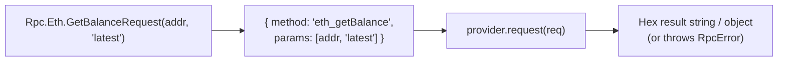

`@tevm/voltaire/jsonrpc` exports pure request builder functions that construct EIP-1193 `RequestArguments` objects (`{ method, params }`) without performing I/O. Pass the returned object to any EIP-1193 `provider.request()`.

Source: [packages/voltaire-ts/src/jsonrpc/index.ts](https://github.com/evmts/voltaire/blob/main/packages/voltaire-ts/src/jsonrpc/index.ts).



## Namespaces

Import either the grouped `Rpc` namespace or individual tree-shakeable namespace modules from `@tevm/voltaire/jsonrpc`:

| Namespace | Grouped Access | Direct Import | Scope |
| --- | --- | --- | --- |
| `eth` | `Rpc.Eth.*` | `import { eth } from '@tevm/voltaire/jsonrpc'` | Standard Ethereum execution methods |
| `wallet` | `Rpc.Wallet.*` | `import { wallet } from '@tevm/voltaire/jsonrpc'` | EIP-3326, EIP-747, EIP-2255 wallet methods |
| `anvil` | `Rpc.Anvil.*` | `import { anvil } from '@tevm/voltaire/jsonrpc'` | Foundry Anvil test node RPCs |
| `hardhat` | `Rpc.Hardhat.*` | `import { hardhat } from '@tevm/voltaire/jsonrpc'` | Hardhat Network test node RPCs |
| `web3` | `Rpc.Web3.*` | `import { web3 } from '@tevm/voltaire/jsonrpc'` | `web3_clientVersion`, `web3_sha3` |
| `net` | `Rpc.Net.*` | `import { net } from '@tevm/voltaire/jsonrpc'` | `net_version`, `net_listening`, `net_peerCount` |
| `txpool` | `Rpc.Txpool.*` | `import { txpool } from '@tevm/voltaire/jsonrpc'` | `txpool_status`, `txpool_content`, `txpool_inspect` |
| `debug` | — | `import { debug } from '@tevm/voltaire/jsonrpc'` | Tracing and raw RLP block/header RPCs |
| `engine` | — | `import { engine } from '@tevm/voltaire/jsonrpc'` | Consensus-layer Engine API |

## State and Account Reads

```typescript
import { Address } from '@tevm/voltaire/Address';
import { Rpc } from '@tevm/voltaire/jsonrpc';

const addr = Address('0x742d35Cc6634C0532925a3b844Bc9e7595f0bEb0');

const [blockNum, balance, nonce, code, slot0] = await Promise.all([
  provider.request(Rpc.Eth.BlockNumberRequest()),
  provider.request(Rpc.Eth.GetBalanceRequest(addr, 'latest')),
  provider.request(Rpc.Eth.GetTransactionCountRequest(addr, 'latest')),
  provider.request(Rpc.Eth.GetCodeRequest(addr, 'latest')),
  provider.request(Rpc.Eth.GetStorageAtRequest(addr, '0x0', 'latest')),
]);
```

## Calls, Gas, and Transactions

```typescript
import { Rpc } from '@tevm/voltaire/jsonrpc';

// Read-only execution
const callResult = await provider.request(
  Rpc.Eth.CallRequest(
    {
      to: '0xA0b86991c6218b36c1d19D4a2e9Eb0cE3606eB48',
      data: '0x18160ddd',
    },
    'latest',
  ),
);

// Gas estimation
const gasHex = await provider.request(
  Rpc.Eth.EstimateGasRequest({
    from: '0x742d35Cc6634C0532925a3b844Bc9e7595f0bEb0',
    to: '0xA0b86991c6218b36c1d19D4a2e9Eb0cE3606eB48',
    data: '0xa9059cbb...',
  }),
);

// Broadcast RLP-encoded signed transaction
const txHash = await provider.request(
  Rpc.Eth.SendRawTransactionRequest('0x02f8...'),
);

// Fetch transaction and receipt
const tx = await provider.request(Rpc.Eth.GetTransactionByHashRequest(txHash as string));
const receipt = await provider.request(Rpc.Eth.GetTransactionReceiptRequest(txHash as string));
```

## Blocks and Logs

```typescript
import { Rpc } from '@tevm/voltaire/jsonrpc';

// Full block with transaction objects (second arg: hydrated boolean)
const latestBlock = await provider.request(
  Rpc.Eth.GetBlockByNumberRequest('latest', true),
);

// Block receipts in one call (EIP-1474 / Geth / Reth / Nethermind)
const receipts = await provider.request(Rpc.Eth.GetBlockReceiptsRequest('latest'));

// Filter logs by address and topic0
const logs = await provider.request(
  Rpc.Eth.GetLogsRequest({
    fromBlock: '0x121eac0',
    toBlock: '0x121eb24',
    address: '0xA0b86991c6218b36c1d19D4a2e9Eb0cE3606eB48',
    topics: ['0xddf252ad1be2c89b69c2b068fc378daa952ba7f163c4a11628f55a4df523b3ef'],
  }),
);
```

## Block Tags

Methods accepting a block specifier take any EIP-1898 `BlockTag` or hex-encoded block number:

| Tag | Meaning |
| --- | --- |
| `'latest'` | Most recent canonical block |
| `'safe'` | Latest justified PoS checkpoint block |
| `'finalized'` | Latest finalized PoS checkpoint block (irreversible without slashing) |
| `'pending'` | Pending block including mempool transactions |
| `'earliest'` | Genesis block (`0x0`) |
| `` `0x${string}` `` | Explicit hex block height (for example `'0x121eac0'`) |

## Wallet, Debug, and Testing Namespaces

```typescript
import { debug, Rpc } from '@tevm/voltaire/jsonrpc';

// EIP-3326 chain switch (browser wallets)
await walletProvider.request(Rpc.Wallet.SwitchEthereumChainRequest('0x1'));

// Anvil local node manipulation
await anvilProvider.request(Rpc.Anvil.AnvilImpersonateAccountRequest('0xd8dA6BF26964aF9D7eEd9e03E53415D37aA96045'));
await anvilProvider.request(Rpc.Anvil.AnvilMineRequest('0x1'));

// Debug raw block retrieval
const rawBlockRlp = await nodeProvider.request(debug.GetRawBlockRequest('latest'));
```

## Related

- [eth Methods](/jsonrpc-provider/eth-methods) — Full `eth_*` reference
- [wallet Methods](/jsonrpc-provider/wallet-methods) — Browser wallet RPCs
- [debug Methods](/jsonrpc-provider/debug-methods) — Debug namespace
- [engine Methods](/jsonrpc-provider/engine-methods) — Consensus Engine API
- [Type System](/jsonrpc-provider/type-system) — Compile-time request/return typing with `TypedProvider`
