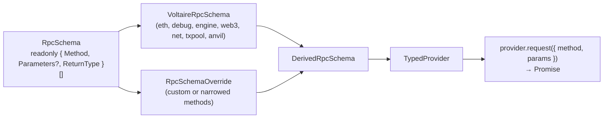

`@tevm/voltaire/provider` types JSON-RPC calls at compile time through `RpcSchema` and `TypedProvider<TRpcSchema, TEventMap>`. Every method name, parameter tuple, and return type is resolved from a declarative schema tuple without runtime overhead.

Source: [RpcSchema.ts](https://github.com/evmts/voltaire/blob/main/packages/voltaire-ts/src/provider/RpcSchema.ts), [TypedProvider.ts](https://github.com/evmts/voltaire/blob/main/packages/voltaire-ts/src/provider/TypedProvider.ts), [VoltaireRpcSchema.ts](https://github.com/evmts/voltaire/blob/main/packages/voltaire-ts/src/provider/schemas/VoltaireRpcSchema.ts).



## Core Schema Types

`RpcSchema` is a readonly array of `{ Method, Parameters?, ReturnType }` entries:

```typescript
export type RpcSchema = readonly {
  Method: string;
  Parameters?: unknown;
  ReturnType: unknown;
}[];

export type RpcMethodNames<TSchema extends RpcSchema> = TSchema[number]['Method'];

export type RpcMethodParameters<
  TSchema extends RpcSchema,
  TMethod extends RpcMethodNames<TSchema>,
> = Extract<TSchema[number], { Method: TMethod }>['Parameters'];

export type RpcMethodReturnType<
  TSchema extends RpcSchema,
  TMethod extends RpcMethodNames<TSchema>,
> = Extract<TSchema[number], { Method: TMethod }>['ReturnType'];
```

## Using `TypedProvider` with `VoltaireRpcSchema`

`VoltaireRpcSchema` bundles method definitions across `eth`, `debug`, `engine`, `web3`, `net`, `txpool`, and `anvil`. Typing a provider against `VoltaireRpcSchema` infers exact parameter tuples and return types for `provider.request(...)`:

```typescript
import {
  HttpProvider,
  type EIP1193EventMap,
  type TypedProvider,
  type VoltaireRpcSchema,
} from '@tevm/voltaire/provider';

type VoltaireProvider = TypedProvider<VoltaireRpcSchema, EIP1193EventMap>;

const provider = new HttpProvider('https://eth.llamarpc.com') as unknown as VoltaireProvider;

// Return type inferred as Promise<string>
const blockNumber = await provider.request({
  method: 'eth_blockNumber',
  params: [],
});

// Return type inferred as Promise<string>
const balance = await provider.request({
  method: 'eth_getBalance',
  params: ['0x742d35Cc6634C0532925a3b844Bc9e7595f0bEb0', 'latest'],
});

// Compile error: wrong parameter tuple for eth_getBalance
// await provider.request({ method: 'eth_getBalance', params: [123] });
```

## Extending or Overriding a Schema

Use `DerivedRpcSchema<TBase, TOverride>` to add vendor-specific RPC methods (such as Alchemy, Flashbots, or L2 sequencers) while retaining all methods in `VoltaireRpcSchema`:

```typescript
import type {
  DerivedRpcSchema,
  RpcSchema,
  TypedProvider,
  VoltaireRpcSchema,
} from '@tevm/voltaire/provider';

type CustomMethods = readonly [
  {
    Method: 'eth_sendBundle';
    Parameters: [
      {
        txs: string[];
        blockNumber: string;
        minTimestamp?: number;
        maxTimestamp?: number;
      },
    ];
    ReturnType: { bundleHash: string };
  },
];

type FlashbotsSchema = DerivedRpcSchema<VoltaireRpcSchema, CustomMethods>;
type FlashbotsProvider = TypedProvider<FlashbotsSchema>;

async function submitBundle(provider: FlashbotsProvider, txs: string[], blockNumber: string) {
  // Typed as Promise<{ bundleHash: string }>
  return provider.request({
    method: 'eth_sendBundle',
    params: [{ txs, blockNumber }],
  });
}
```

## State and Block Overrides

`@tevm/voltaire/provider` exports `StateOverride` and `BlockOverrides` for typed `eth_call` and `eth_estimateGas` simulations:

```typescript
import type { BlockOverrides, StateOverride } from '@tevm/voltaire/provider';

const stateOverride: StateOverride = {
  '0x742d35Cc6634C0532925a3b844Bc9e7595f0bEb0': {
    balance: '0x56bc75e2d63100000', // Override account balance to 100 ETH
  },
};

const blockOverrides: BlockOverrides = {
  baseFee: '0x3b9aca00', // 1 gwei
};
```

## OpenRPC Base Types (`@tevm/voltaire/jsonrpc`)

`@tevm/voltaire/jsonrpc` re-exports the base JSON-RPC wire types used by request builders:

| Type | Representation | Purpose |
| --- | --- | --- |
| `Quantity` | Hex-encoded unsigned integer (`0x0`, `0x10`) | Balances, block numbers, gas, nonces |
| `Data` | Even-length hex byte string | Calldata, bytecode, storage values |
| `Hash` | 32-byte hex hash | Block hashes, transaction hashes, topic hashes |
| `BlockTag` | `'latest' \| 'earliest' \| 'pending' \| 'safe' \| 'finalized'` | Named block references |
| `BlockSpec` | `BlockTag \| Quantity \| { blockHash }` | Block argument to state queries |
| `Block` | JSON-RPC block header/body object | Return type of `eth_getBlockBy*` |

## Exported Types Summary

| Symbol | Module | Role |
| --- | --- | --- |
| `Provider` | `@tevm/voltaire/provider` | Minimal EIP-1193 interface (`request`, `on`, `removeListener`) |
| `TypedProvider<TSchema, TEventMap>` | `@tevm/voltaire/provider` | Schema-parameterized EIP-1193 interface |
| `EIP1193Provider` | `@tevm/voltaire/provider` | Alias for `TypedProvider<RpcSchema, EIP1193EventMap>` |
| `VoltaireRpcSchema` | `@tevm/voltaire/provider` | Built-in OpenRPC schema across all standard namespaces |
| `DerivedRpcSchema` | `@tevm/voltaire/provider` | Merges base schema with custom method overrides |
| `RequestArguments` | `@tevm/voltaire/provider` | `{ readonly method: string; readonly params?: readonly unknown[] \| object }` |
| `RpcError` | `@tevm/voltaire/provider` | `{ code: number; message: string; data?: unknown }` |

## Related

- [Method API](/jsonrpc-provider/method-api) — Request builder functions
- [Error Handling](/jsonrpc-provider/error-handling) — `ProviderRpcError` and code tables
- [Branded Types](/concepts/branded-types) — Zero-overhead nominal typing in Voltaire
