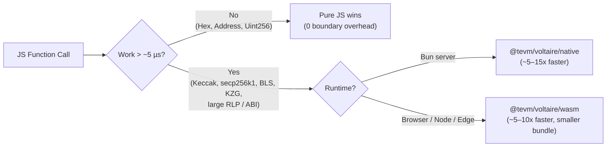

Crossing from JavaScript into WebAssembly or native C FFI carries a fixed call overhead (~1–10 µs). Choosing the fastest backend depends on whether the computation exceeds that boundary cost.



## Relative Speed by Workload

Exact numbers depend on CPU architecture and payload size; run `pnpm --filter @tevm/voltaire run test` or the `benchmark/` suite in this repository on your target hardware.

| Operation | Pure TS (`@tevm/voltaire`) | WASM (`/wasm`) | Native FFI (`/native`, Bun) | Recommended |
| --- | --- | --- | --- | --- |
| `Keccak256` (32 B – 1 KB) | 1x | ~5–10x | ~10–13x | WASM or Native |
| `Secp256k1` sign / recover | 1x | ~6–8x | ~12–15x | WASM or Native |
| `Bls12381` / `BN254` pairings | 1x | ~10x+ | ~20x+ | WASM or Native |
| `KZG` blob commitment / proof | — | Supported | Fastest | WASM or Native |
| `Rlp` / `Abi` large payloads | 1x | ~1.2–2x | ~1.5–3x | JS (small) / WASM (large) |
| `Address` / `Hex` / `Uint` ops | 1x | Slower on tiny inputs | Slower on tiny inputs | Pure TS |

## Why WASM Shrinks Crypto Bundles

Pure-JavaScript elliptic curve and hash libraries carry large lookup tables and BigInt polyfills (50–100 KB minified). Compiled Zig WASM modules pack tight integer instructions into compact binaries:

- `ReleaseSmall` (default published WASM) optimizes binary size while staying substantially faster than pure JS for hashing and elliptic curves.
- `ReleaseFast` (build from source via `zig build`) unrolls loops and enables SIMD where available for maximum server throughput. See [WASM Build Modes](/dev/wasm).

## Avoiding Hidden Overhead

1. **Keep values as bytes inside hot loops.** Construct `Address`, `Hash`, and `Hex` once at API boundaries and operate on `Uint8Array` internally. Repeated hex-string encoding/decoding dominates small loops.
2. **Batch across the FFI/WASM boundary.** Hashing 1,000 items in a single batch call pays the boundary crossing once instead of 1,000 times.
3. **Import subpaths for browser bundles.** `import { Address } from '@tevm/voltaire/Address'` or `@tevm/voltaire/Address/functional` lets your bundler drop every unused primitive.

## Switching Backends Without Code Changes

All three entrypoints satisfy the same TypeScript interface:

```typescript
// Pure TypeScript (default)
import { Keccak256, Secp256k1 } from '@tevm/voltaire';

// WebAssembly (Browser, Node, Bun, Deno)
import { Keccak256, Secp256k1 } from '@tevm/voltaire/wasm';

// Native FFI (Bun)
import { Keccak256, Secp256k1 } from '@tevm/voltaire/native';
```

See [Runtimes & WASM](/concepts/runtimes-and-wasm) for per-module imports and runtime caveats (such as `HDWallet` native/JS requirements).
