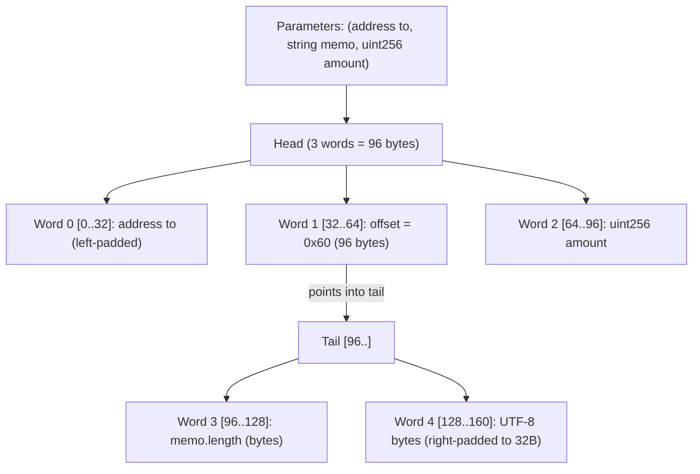

The Ethereum Contract ABI defines a deterministic binary wire format for calling smart contract functions, decoding return data, encoding custom revert errors, and indexing event logs. Every value aligns to 32-byte (256-bit) EVM words.

## Head / Tail Encoding Model

A tuple of $k$ parameters serializes into two contiguous regions: a fixed-width **head** of $k$ 32-byte slots, followed by a variable-width **tail** holding all dynamic payloads.



- **Static types** (`uintN`, `intN`, `address`, `bool`, `bytes1`–`bytes32`, fixed arrays `T[M]` of static `T`, tuples of static fields) encode directly in their head slot.
- **Dynamic types** (`bytes`, `string`, `T[]`, `T[M]` of dynamic `T`, tuples containing any dynamic field) store a 32-byte big-endian byte offset in their head slot measured from the start of the enclosing tuple's head (byte 4 for function calldata).

## Word Padding Rules

| ABI Type | Alignment | Padding Byte |
| --- | --- | --- |
| `uintN` (`N` = 8..256) | Right-aligned (left-padded) | `0x00` |
| `intN` (`N` = 8..256) | Right-aligned (left-padded) | Sign-extended (`0x00` if $\ge 0$, `0xff` if $< 0$) |
| `address` | Right-aligned (12 leading zeros + 20 bytes) | `0x00` |
| `bool` | Right-aligned (`0x00...00` or `0x00...01`) | `0x00` |
| `bytes1`–`bytes32` | Left-aligned (right-padded) | `0x00` |
| `bytes` / `string` | 32-byte length prefix + left-aligned payload | `0x00` to next 32-byte boundary |

## Canonical Signatures & Selectors

Selectors hash the **canonical signature** with no spaces, no parameter names, and explicit bit widths (`uint` becomes `uint256`, `int` becomes `int256`, tuples expand recursively to `(T1,T2,...)`).

| Kind | Formula | Length |
| --- | --- | --- |
| Function selector | `keccak256("transfer(address,uint256)")[0:4]` | `4` bytes (`0xa9059cbb`) |
| Custom error selector | `keccak256("InsufficientBalance(uint256,uint256)")[0:4]` | `4` bytes |
| Standard revert `Error(string)` | `keccak256("Error(string)")[0:4]` | `0x08c379a0` |
| Panic revert `Panic(uint256)` | `keccak256("Panic(uint256)")[0:4]` | `0x4e487b71` |
| Event topic 0 | `keccak256("Transfer(address,address,uint256)")` | `32` bytes (full hash) |

## Event Log Layout

For a non-anonymous event:
- `topics[0]` is the full 32-byte Keccak-256 hash of the canonical event signature.
- Up to 3 `indexed` parameters occupy `topics[1]`..`topics[3]`:
  - Static indexed types encode as their standard 32-byte word.
  - Dynamic indexed types (`string`, `bytes`, arrays, structs) store `keccak256(encodedValue)` — the original plaintext is **not** recoverable from the topic alone.
- All non-indexed parameters ABI-encode as a single tuple into `log.data`.

```typescript
import { Abi, Selector } from '@tevm/voltaire';

const sel = Selector.fromSignature('transfer(address,uint256)');
Selector.toHex(sel); // "0xa9059cbb"

const encoded = Abi.encodeParameters(
  [{ type: 'string' }, { type: 'uint256' }],
  ['hello', 7n],
);
// Word 0: 0x00..40 (offset 64)
// Word 1: 0x00..07 (uint256 7)
// Word 2: 0x00..05 (string length 5)
// Word 3: 0x68656c6c6f00..00 ("hello" right-padded)
```

## Related

- [ABI Reference](/primitives/abi) — Full `Abi` class and sub-namespace API
- [Selector](/primitives/selector) — 4-byte function/error selector primitive
- [EventLog](/primitives/eventlog) — Event log filtering and matching
