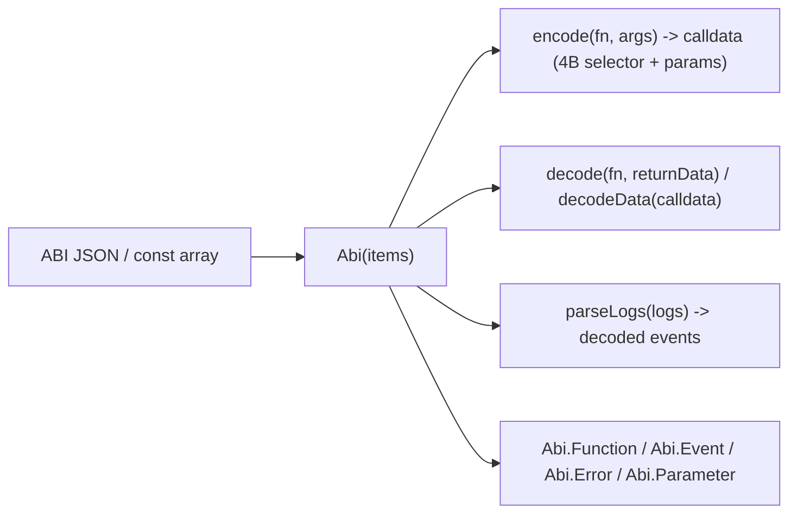

`Abi` is a callable `Array` subclass holding Ethereum contract ABI items (`function`, `event`, `error`, `constructor`, `fallback`, `receive`). It encodes calldata, decodes return values and revert errors, parses event logs, and checks 4-byte selector collisions.



## Quick Start

```typescript
import { Abi } from '@tevm/voltaire';

const erc20Abi = [
  {
    type: 'function',
    name: 'transfer',
    stateMutability: 'nonpayable',
    inputs: [
      { name: 'to', type: 'address' },
      { name: 'amount', type: 'uint256' },
    ],
    outputs: [{ name: '', type: 'bool' }],
  },
  {
    type: 'event',
    name: 'Transfer',
    inputs: [
      { name: 'from', type: 'address', indexed: true },
      { name: 'to', type: 'address', indexed: true },
      { name: 'value', type: 'uint256', indexed: false },
    ],
  },
] as const;

const abi = Abi(erc20Abi);

// Encode function calldata (4-byte selector + 64-byte args)
const calldata = abi.encode('transfer', [
  '0x742d35cc6634c0532925a3b844bc9e7595f0beb0',
  1_000_000n,
]);

// Decode calldata by selector lookup
const decodedCall = abi.decodeData(calldata);
// { name: 'transfer', params: [...] }

// Standalone parameter encoding without a function selector
const encoded = Abi.encodeParameters(
  [{ type: 'address' }, { type: 'uint256' }],
  ['0x742d35cc6634c0532925a3b844bc9e7595f0beb0', 42n],
);
const values = Abi.decodeParameters(
  [{ type: 'address' }, { type: 'uint256' }],
  encoded,
);
```

Import from `@tevm/voltaire` or `@tevm/voltaire/Abi`.

## Calldata Wire Layout

| Offset | Size | Field |
| --- | --- | --- |
| `0` | `4` bytes | Function selector: `keccak256(canonicalSignature)[0:4]` |
| `4` | `32 * k` bytes | Head words: static values inline, dynamic values store byte offset from byte `4` |
| `4 + 32 * k` | variable | Tail section: length-prefixed dynamic payloads padded to 32-byte multiples |

## API Reference

### Constructor & Lookup

| Method | Signature | Description |
| --- | --- | --- |
| `Abi` / `Abi.from` | `(items: readonly Item[]) => Abi` | Create an `Abi` instance (inherits `Array.prototype`) |
| `abi.getItem` / `Abi.getItem` | `(name: string, type?: ItemTypeName) => Item \| undefined` | Find item by name and optional kind |
| `abi.getFunction` | `(name: string) => FunctionItem \| undefined` | Lookup function item |
| `abi.getEvent` | `(name: string) => EventItem \| undefined` | Lookup event item |
| `abi.getError` | `(name: string) => ErrorItem \| undefined` | Lookup custom error item |
| `abi.getConstructor` | `() => ConstructorItem \| undefined` | Lookup constructor item |
| `abi.getFallback` / `abi.getReceive` | `() => Item \| undefined` | Lookup fallback or receive handler |

### Encoding, Decoding & Diagnostics

| Method | Signature | Description |
| --- | --- | --- |
| `abi.encode` / `Abi.encode` | `(functionName: string, args: unknown[]) => Uint8Array` | Encode 4-byte selector + ABI parameters |
| `abi.decode` / `Abi.decode` | `(functionName: string, data: Uint8Array) => unknown[]` | Decode function return bytes |
| `abi.decodeData` / `Abi.decodeData` | `(data: Uint8Array) => { name: string; params: unknown[] }` | Identify function by selector and decode input args |
| `abi.parseLogs` / `Abi.parseLogs` | `(logs: readonly RawLog[]) => DecodedLog[]` | Match `topics[0]` and decode indexed + unindexed event fields |
| `Abi.encodeParameters` | `(params: readonly Parameter[], values: readonly unknown[]) => Uint8Array` | Encode raw parameter tuple (no selector) |
| `Abi.decodeParameters` | `(params: readonly Parameter[], data: Uint8Array) => unknown[]` | Decode raw parameter tuple (no selector) |
| `abi.format` / `Abi.format` | `() => string[]` | Format items as human-readable Solidity signatures |
| `abi.formatWithArgs` | `(args: Record<string, unknown[]>) => string[]` | Format signatures with concrete argument values |
| `abi.hasSelectorCollisions` | `() => boolean` | Detect duplicate 4-byte function selectors |
| `abi.findSelectorCollisions` | `() => Collision[]` | Return colliding selector groups |

### Sub-Namespaces

| Sub-namespace | Purpose |
| --- | --- |
| `Abi.Function` | Single-function selector derivation, encoding, and decoding |
| `Abi.Event` | Event topic-0 derivation, indexed topic encoding, and log decoding |
| `Abi.Error` | Custom error selectors (`Error(string)`, `Panic(uint256)`, custom errors) |
| `Abi.Constructor` | Deployment constructor argument encoding |
| `Abi.Item` | Type guards and canonical signature formatting |
| `Abi.Parameter` | Single parameter validation and type utilities |

## Related

- [ABI Fundamentals](/primitives/abi/fundamentals) — Head/tail layout, canonical signatures, and dynamic offsets
- [Selector](/primitives/selector) — 4-byte function and error selectors
- [EventLog](/primitives/eventlog) — Raw Ethereum execution logs (`address`, `topics`, `data`)
