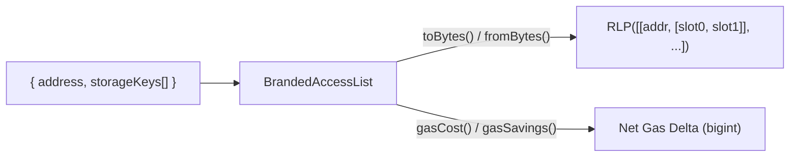

`AccessList` (`BrandedAccessList`) is an immutable array of `{ address: AddressType; storageKeys: readonly HashType[] }` tuples defined by EIP-2930. Declaring addresses and storage slots upfront pre-warms them before EVM execution, trading cold-access penalties for discounted upfront gas.



## Gas Economics (EIP-2929 / EIP-2930)

| Constant | Gas | Description |
| --- | --- | --- |
| `AccessList.ADDRESS_COST` | `2400n` | Upfront cost per access list address |
| `AccessList.STORAGE_KEY_COST` | `1900n` | Upfront cost per access list storage key |
| `AccessList.COLD_ACCOUNT_ACCESS_COST` | `2600n` | Cold account access during execution |
| `AccessList.COLD_STORAGE_ACCESS_COST` | `2100n` | Cold `SLOAD` during execution |
| `AccessList.WARM_STORAGE_ACCESS_COST` | `100n` | Warm `SLOAD` / account access after pre-warming |

Pre-warming saves `100` gas per accessed address (`2600 - (2400 + 100)`) and `100` gas per accessed storage slot (`2100 - (1900 + 100)`), and breaks cross-contract `2300`-gas stipend failures introduced by Berlin.

## Quick Start

```typescript
import { AccessList, Address, Hash } from '@tevm/voltaire';

const contract = Address('0x742d35cc6634c0532925a3b844bc9e7595f0beb0');
const slot0 = Hash.ZERO;

let list = AccessList.create();
list = AccessList.withAddress(list, contract);
list = AccessList.withStorageKey(list, contract, slot0);

AccessList.gasCost(list);       // 4300n (2400 + 1900)
AccessList.gasSavings(list);    // net savings when accessed
AccessList.hasSavings(list);    // true

const encoded = AccessList.toBytes(list);
const decoded = AccessList.fromBytes(encoded);
```

Import from `@tevm/voltaire` or `@tevm/voltaire/AccessList`.

## API Reference

| Category | Method | Signature |
| --- | --- | --- |
| Construction | `create` | `() => BrandedAccessList` |
| | `from` | `(value: readonly Item[] \| Uint8Array) => BrandedAccessList` |
| | `fromBytes` | `(bytes: Uint8Array) => BrandedAccessList` |
| Encoding | `toBytes` | `(list: BrandedAccessList) => Uint8Array` |
| Building | `withAddress` | `(list: BrandedAccessList, address: AddressType) => BrandedAccessList` |
| | `withStorageKey` | `(list: BrandedAccessList, address: AddressType, storageKey: HashType) => BrandedAccessList` |
| | `merge` | `(...accessLists: BrandedAccessList[]) => BrandedAccessList` |
| | `deduplicate` | `(list: BrandedAccessList) => BrandedAccessList` |
| Querying | `includesAddress` | `(list: BrandedAccessList, address: AddressType) => boolean` |
| | `includesStorageKey` | `(list: BrandedAccessList, address: AddressType, storageKey: HashType) => boolean` |
| | `keysFor` | `(list: BrandedAccessList, address: AddressType) => readonly HashType[] \| undefined` |
| | `addressCount` / `storageKeyCount` | `(list: BrandedAccessList) => number` |
| | `isEmpty` | `(list: BrandedAccessList) => boolean` |
| Gas & Validation | `gasCost` / `gasSavings` | `(list: BrandedAccessList) => bigint` |
| | `hasSavings` | `(list: BrandedAccessList) => boolean` |
| | `is` / `isItem` | `(value: unknown) => boolean` |
| | `assertValid` | `(list: BrandedAccessList) => void` |

## Edge Cases

- Duplicate addresses or storage keys in an access list are valid on-chain per EIP-2930, but pay upfront gas twice; call `AccessList.deduplicate(list)` before signing.
- `gasSavings` assumes every listed address and slot is actually touched during execution; unused entries waste `2400` / `1900` gas each.

## Related

- [Transaction](/primitives/transaction) — Type `0x01`–`0x04` transactions carrying `accessList`
- [GasConstants](/primitives/gasconstants) — EIP-2929 cold/warm opcode gas schedule
- [RLP](/primitives/rlp) — Underlying list serialization
