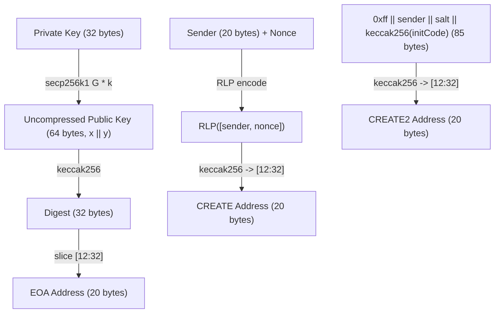

An Ethereum address is the rightmost 20 bytes (160 bits) of a 32-byte Keccak-256 hash. Every account on Ethereum — whether an externally owned account (EOA) or a smart contract — shares this single 20-byte namespace.

## Derivation Pipelines



### EOA Derivation

1. Multiply the secp256k1 generator point $G$ by the 32-byte private key scalar $k$.
2. Serialize the affine coordinates $(x, y)$ as 64 big-endian bytes without the `0x04` uncompressed prefix.
3. Compute `hash = keccak256(pubkey)` (32 bytes).
4. Take the last 20 bytes: `hash.slice(12, 32)`.

```typescript
import { Address, Secp256k1 } from '@tevm/voltaire';
import { PrivateKey } from '@tevm/voltaire/PrivateKey';

const privateKey = PrivateKey.from('0x' + '11'.repeat(32));
const publicKey = Secp256k1.derivePublicKey(privateKey); // 64 bytes
const fromPub = Address.fromPublicKey(publicKey);
const fromPriv = Address.fromPrivateKey(privateKey);

Address.equals(fromPub, fromPriv); // true
```

## EIP-55 Checksum Encoding

Hex addresses carry no built-in error detection. EIP-55 encodes a 40-nibble checksum directly in the capitalization of alphabetic hex characters (`a`–`f`), preserving backwards compatibility with case-insensitive parsers.

Algorithm for a lowercase 40-character hex body `hex` (without `0x`):
1. Compute `digest = hex(keccak256(ascii(hex)))`.
2. For each character index `i` in `0..39`:
   - If `hex[i]` is `'a'`–`'f'` and nibble `digest[i] >= 8`, emit uppercase `hex[i]`.
   - Otherwise emit lowercase `hex[i]`.

```typescript
import { Address } from '@tevm/voltaire';

const raw = '0x5aaeb6053f3e94c9b9a09f33669435e7ef1beaed';
const addr = Address.fromHex(raw);
const checksummed = Address.toChecksummed(addr);
// "0x5aAeb6053F3E94C9b9A09f33669435E7Ef1BeAed"

Address.isValidChecksum(checksummed); // true
Address.isValidChecksum(raw);         // true (all-lowercase is non-checksummed valid)
Address.isValidChecksum('0x5aaeb6053F3E94C9b9A09f33669435E7Ef1BeAed'); // false
```

<Note>
All-lowercase and all-uppercase addresses pass `isValid` because they signal an unchecksummed representation. Mixed-case strings must match EIP-55 on every alphabetic character; otherwise `isValidChecksum` returns `false` and `Address.assert(value, { strict: true })` throws `InvalidChecksumError`.
</Note>

## Deterministic Contract Addresses

### CREATE (Nonce-Dependent)

Contract creation via `CREATE` opcode or deployment transaction computes:

$$\text{address} = \text{keccak256}(\text{RLP}([\text{sender}, \text{nonce}]))[12..32]$$

Nonce `0` encodes as empty bytes `0x80` in RLP, not `0x00`.

### CREATE2 (EIP-1014, Content-Addressed)

`CREATE2` hashes a fixed 85-byte preimage independent of sender nonce:

| Offset | Size | Field | Value |
| --- | --- | --- | --- |
| `0` | `1` byte | Domain prefix | `0xff` (cannot collide with RLP list prefix `0xc0`–`0xff` of length 21–29) |
| `1` | `20` bytes | Deployer | Sender contract address |
| `21` | `32` bytes | Salt | Arbitrary 32-byte value |
| `53` | `32` bytes | Init code hash | `keccak256(initCode)` |

Because the `0xff` prefix can never match the RLP length prefix of `[sender, nonce]`, `CREATE` and `CREATE2` address spaces are domain-separated.

## Reserved Addresses

| Address | Meaning |
| --- | --- |
| `0x0000000000000000000000000000000000000000` | Zero address (`Address.zero()`): contract creation target (`to: null`), burn sink, uninitialized default |
| `0x0000000000000000000000000000000000000001`–`0x...000a` | Execution layer precompiles (`ecRecover`, `SHA-256`, `RIPEMD-160`, `identity`, `modexp`, `ecAdd`, `ecMul`, `ecPairing`, `blake2f`, `pointEval`) |
| `0x000000000000000000000000000000000000000b`–`0x...0011` | Pectra BLS12-381 precompiles (EIP-2537) |

## Error Handling

All `Address` constructors and parsers fail fast with subclasses of `PrimitiveError`:

```typescript
import { Address, InvalidAddressLengthError, InvalidHexFormatError } from '@tevm/voltaire';

try {
  Address.fromHex('0x1234');
} catch (err) {
  if (err instanceof InvalidAddressLengthError) {
    // err.code === "INVALID_ADDRESS_LENGTH"
  }
}
```

## Related

- [Address Reference](/primitives/address) — Complete method signatures and error table
- [RLP Fundamentals](/primitives/rlp/fundamentals) — Encoding rules used by `CREATE`
- [Bytecode](/primitives/bytecode) — Contract `initCode` and runtime code
