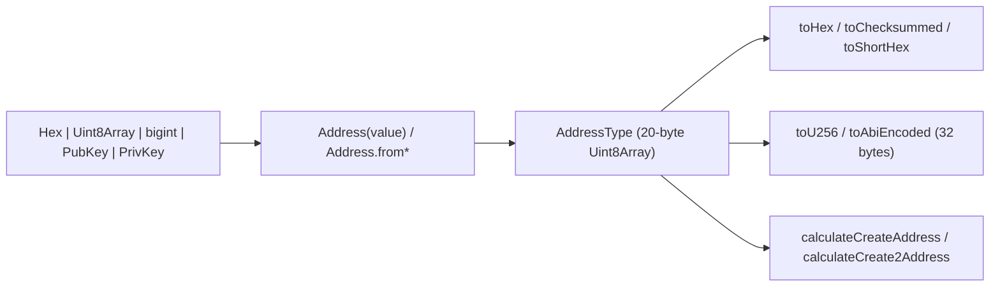

An `Address` (`AddressType`) is a branded 20-byte `Uint8Array` representing an Ethereum externally owned account (EOA) or contract account. Construction validates input length and hex format immediately; invalid inputs throw typed errors.



## Quick Start

```typescript
import { Address, Keccak256, Rlp } from '@tevm/voltaire';

const addr = Address('0x742d35cc6634c0532925a3b844bc9e7595f0beb0');
Address.toChecksummed(addr); // "0x742d35Cc6634C0532925a3b844Bc9e7595f0bEb0"
Address.toShortHex(addr);    // "0x742d...beb0"
Address.isZero(addr);        // false

// Instance API with injected crypto for tree-shaking
const withCrypto = Address(addr, {
  keccak256: Keccak256.hash,
  rlpEncode: Rlp.encode,
});
withCrypto.toChecksummed();
withCrypto.calculateCreateAddress(0n);
```

Import from `@tevm/voltaire` or the subpath `@tevm/voltaire/Address` (or `@tevm/voltaire/Address/functional` for standalone tree-shakeable functions).

## Representation & Layout

| Offset | Size | Field | Invariant |
| --- | --- | --- | --- |
| `0` | `20` bytes | Account identifier | Last 20 bytes of `keccak256(uncompressedPubKey)` for EOAs |

ABI encoding left-pads an `Address` with 12 zero bytes into a 32-byte word:

| Offset | Size | Field | Value |
| --- | --- | --- | --- |
| `0` | `12` bytes | Padding | `0x00` repeated 12 times (must be zero on decode) |
| `12` | `20` bytes | Address | Raw 20-byte account address |

Constants: `Address.SIZE === 20`.

## API Reference

### Constructors

| Method | Signature | Description |
| --- | --- | --- |
| `Address` | `(value: number \| bigint \| string \| Uint8Array, crypto?: AddressCrypto) => BaseAddress` | Canonical constructor; accepts hex, bytes, or integer |
| `Address.fromHex` | `(value: string, crypto?: AddressCrypto) => AddressType` | Parse 40-char `0x`-prefixed hex string |
| `Address.fromBytes` | `(value: Uint8Array) => AddressType` | Wrap a 20-byte `Uint8Array` |
| `Address.fromNumber` | `(value: number \| bigint) => AddressType` | Convert unsigned integer, left-padded to 20 bytes |
| `Address.fromBase64` | `(value: string) => AddressType` | Decode Base64 string representing 20 bytes |
| `Address.fromPublicKey` | `(publicKey: Uint8Array) \| (x: bigint, y: bigint) => AddressType` | Derive `keccak256(pubkey)[12:32]` from 64-byte uncompressed secp256k1 key |
| `Address.fromPrivateKey` | `(value: Uint8Array) => AddressType` | Derive secp256k1 public key then address from 32-byte key |
| `Address.fromAbiEncoded` | `(value: Uint8Array) => AddressType` | Extract bytes `[12:32]` from a 32-byte ABI word; rejects non-zero padding |
| `Address.of` | `(...items: number[]) => AddressType` | Construct from exactly 20 byte values |
| `Address.zero` | `() => AddressType` | Return `0x0000000000000000000000000000000000000000` |

### Conversions

| Method | Signature | Output |
| --- | --- | --- |
| `Address.toHex` | `(addr: AddressType) => HexType` | Lowercase `0x`-prefixed 42-char string |
| `Address.toChecksummed` | `(addr: AddressType) => string` | EIP-55 mixed-case hex string |
| `Address.toLowercase` | `(addr: AddressType) => string` | Lowercase `0x`-prefixed hex |
| `Address.toUppercase` | `(addr: AddressType) => string` | Uppercase `0x`-prefixed hex |
| `Address.toShortHex` | `(addr: AddressType, startLength?: number, endLength?: number) => string` | Truncated hex (defaults `6` and `4`) |
| `Address.toBytes` | `(addr: AddressType) => Uint8Array` | Raw 20-byte `Uint8Array` |
| `Address.toU256` | `(addr: AddressType) => bigint` | Big-endian unsigned integer (`0n` to `2n**160n - 1n`) |
| `Address.toAbiEncoded` | `(addr: AddressType) => Uint8Array` | 32-byte word with 12 leading zero bytes |

### Validation, Comparison & Collections

| Method | Signature | Behavior |
| --- | --- | --- |
| `Address.is` | `(value: unknown) => value is AddressType` | Type guard for branded `AddressType` |
| `Address.isValid` | `(value: string \| Uint8Array) => boolean` | Check valid 20-byte address format |
| `Address.isValidChecksum` | `(value: string) => boolean` | Verify EIP-55 checksum casing |
| `Address.assert` | `(value: unknown, options?: { strict?: boolean }) => void` | Throw `InvalidAddressError` or `InvalidChecksumError` on failure |
| `Address.isZero` | `(addr: AddressType) => boolean` | True if all 20 bytes are `0x00` |
| `Address.equals` | `(a: AddressType, b: AddressType) => boolean` | Byte-wise equality |
| `Address.compare` | `(a: AddressType, b: AddressType) => number` | Lexicographic comparison (`-1`, `0`, `1`) |
| `Address.lessThan` | `(a: AddressType, b: AddressType) => boolean` | Lexicographic `<` |
| `Address.greaterThan` | `(a: AddressType, b: AddressType) => boolean` | Lexicographic `>` |
| `Address.clone` | `(addr: AddressType) => AddressType` | Copy into a new 20-byte `AddressType` |
| `Address.sortAddresses` | `(addrs: AddressType[]) => AddressType[]` | Return new lexicographically sorted array |
| `Address.deduplicateAddresses` | `(addrs: AddressType[]) => AddressType[]` | Return new array without duplicates |

### Contract Deployment Addresses

| Method | Formula |
| --- | --- |
| `Address.calculateCreateAddress(sender, nonce)` | `keccak256(rlp([sender, nonce]))[12:32]` |
| `Address.calculateCreate2Address(sender, salt, initCode)` | `keccak256(0xff \|\| sender \|\| salt \|\| keccak256(initCode))[12:32]` |

```typescript
import { Address, Bytecode, Hash } from '@tevm/voltaire';

const deployer = Address('0x742d35cc6634c0532925a3b844bc9e7595f0beb0');
const created = Address.calculateCreateAddress(deployer, 0n);

const salt = Hash.ZERO;
const initCode = Bytecode('0x6080604052');
const created2 = Address.calculateCreate2Address(deployer, salt, initCode);
```

<Note>
Instance methods `toChecksummed()`, `calculateCreateAddress()`, and `calculateCreate2Address()` require passing `{ keccak256 }` (and `rlpEncode` for `CREATE`) to `Address(value, crypto)`. Static methods (`Address.toChecksummed(addr)`, etc.) include built-in defaults.
</Note>

## Errors & Edge Cases

| Error | Condition |
| --- | --- |
| `InvalidHexFormatError` | Missing `0x` prefix or malformed hex input |
| `InvalidHexStringError` | Non-hex characters outside `0-9`, `a-f`, `A-F` |
| `InvalidAddressLengthError` | Decoded byte length is not `20`, or public key is not `64` bytes |
| `InvalidAbiEncodedPaddingError` | First 12 bytes of 32-byte ABI input contain a non-zero byte |
| `InvalidChecksumError` | Strict EIP-55 checksum check fails |
| `InvalidValueError` | Negative nonce, invalid private key, or missing crypto dependency on instance |

## Related

- [Address Fundamentals](/primitives/address/fundamentals) — EOA derivation, EIP-55 algorithm, and `CREATE` / `CREATE2` mechanics
- [Hash](/primitives/hash) — 32-byte Keccak-256 digests used in derivation and salts
- [PublicKey](/primitives/public-key) — 64-byte uncompressed secp256k1 keys
- [Hex](/primitives/hex) — General hex encoding and slicing
