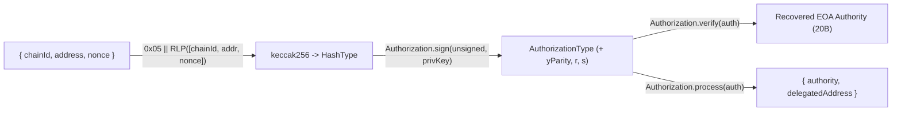

`Authorization` (`AuthorizationType`) represents a signed EIP-7702 authorization tuple `{ chainId, address, nonce, yParity, r, s }` that delegates an externally owned account's code to a smart contract address during a Type `0x04` transaction.



## Signing Preimage & Constants

The signing digest is `keccak256(0x05 || rlp([chainId, address, nonce]))`. Setting `chainId = 0n` authorizes delegation across all EVM chains (cross-chain replayable).

| Constant | Value | Meaning |
| --- | --- | --- |
| `Authorization.MAGIC_BYTE` | `0x05` | EIP-7702 domain separation prefix |
| `Authorization.PER_AUTH_BASE_COST` | `12500n` | Base gas cost per authorization tuple |
| `Authorization.PER_EMPTY_ACCOUNT_COST` | `25000n` | Additional gas when authority account is empty |
| `Authorization.SECP256K1_N` | curve order $N$ | Upper bound for valid signature scalars |
| `Authorization.SECP256K1_HALF_N` | $N / 2$ | EIP-2 low-`s` malleability ceiling |

## Quick Start

```typescript
import { Address, Authorization } from '@tevm/voltaire';
import { PrivateKey } from '@tevm/voltaire/PrivateKey';

const delegate = Address('0x742d35cc6634c0532925a3b844bc9e7595f0beb0');
const privKey = PrivateKey.from('0x' + '22'.repeat(32));

const unsigned = {
  chainId: 1n,
  address: delegate,
  nonce: 0n,
};

const auth = Authorization.sign(unsigned, privKey);
Authorization.validate(auth);

const authority = Authorization.verify(auth); // EOA address matching privKey
const { delegatedAddress } = Authorization.process(auth);
const gas = Authorization.calculateGasCost([auth], 1);
```

Import from `@tevm/voltaire` or `@tevm/voltaire/Authorization`.

## API Reference

| Method | Signature | Description |
| --- | --- | --- |
| `Authorization.hash` | `(unsigned: UnsignedAuthorization) => HashType` | Compute EIP-7702 signing hash (`0x05 \|\| RLP`) |
| `Authorization.sign` | `(unsigned: UnsignedAuthorization, privateKey: Uint8Array) => AuthorizationType` | Sign tuple with secp256k1 (low-`s` normalized) |
| `Authorization.verify` | `(auth: AuthorizationType) => AddressType` | Recover signing EOA authority address |
| `Authorization.validate` | `(auth: AuthorizationType) => void` | Assert valid `chainId`, `nonce`, non-zero `address`, `yParity` (`0`/`1`), and low-`s` |
| `Authorization.process` | `(auth: AuthorizationType) => { authority: AddressType; delegatedAddress: AddressType }` | Validate and extract authority -> delegate mapping |
| `Authorization.processAll` | `(authList: AuthorizationType[]) => Array<{ authority; delegatedAddress }>` | Batch process authorization list |
| `Authorization.getGasCost` | `(auth: AuthorizationType, isEmpty: boolean) => bigint` | Gas cost for a single tuple |
| `Authorization.calculateGasCost` | `(authList: AuthorizationType[], emptyAccounts: number) => bigint` | Aggregate gas cost for authorization list |
| `Authorization.isItem` / `isUnsigned` | `(value: unknown) => boolean` | Runtime type guards |
| `Authorization.format` | `(auth) => string` | Human-readable summary |
| `Authorization.equals` / `equalsAuth` | Equality checks for addresses and authorization tuples |

Tree-shakeable dependency-injected factories: `Authorization.Hash`, `Authorization.Sign`, and `Authorization.Verify`.

## Validation Rules

- `s` must satisfy `0 < s <= SECP256K1_HALF_N` (strict EIP-2 low-`s`; high-`s` signatures are rejected).
- `yParity` must be `0` or `1`.
- Delegating to `Address.zero()` clears an existing EOA delegation indicator (`0xef0100 || address`).

## Related

- [Transaction](/primitives/transaction) — Type `0x04` EIP-7702 transactions
- [Signature](/primitives/signature) — secp256k1 signature encoding and low-`s` normalization
- [RLP](/primitives/rlp) — Tuple serialization
