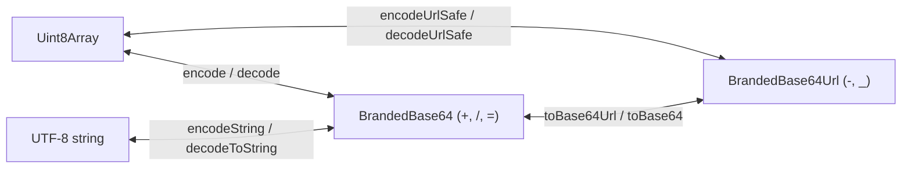

`Base64` provides branded RFC 4648 standard (`+`, `/`, `=`) and URL-safe (`-`, `_`, unpadded) Base64 strings (`BrandedBase64`, `BrandedBase64Url`) with UTF-8 string and `Uint8Array` conversions.



## Quick Start

```typescript
import { Base64 } from '@tevm/voltaire';

const encoded = Base64.encode(new Uint8Array([0xde, 0xad, 0xbe, 0xef]));
// "3q2+7w=="

const decoded = Base64.decode(encoded);
// Uint8Array([0xde, 0xad, 0xbe, 0xef])

const urlSafe = Base64.encodeUrlSafe(decoded);
// "3q2-7w"

const text = Base64.encodeString('voltaire');
Base64.decodeToString(text); // "voltaire"
```

Import from `@tevm/voltaire` or `@tevm/voltaire/Base64`.

## Standard vs URL-Safe Alphabets

| Variant | Index 62 | Index 63 | Padding | Branded Type |
| --- | --- | --- | --- | --- |
| Standard (RFC 4648 §4) | `+` | `/` | `=` to 4-char multiple | `BrandedBase64` |
| URL-Safe (RFC 4648 §5) | `-` | `_` | Omitted | `BrandedBase64Url` |

## API Reference

| Category | Standard | URL-Safe | Description |
| --- | --- | --- | --- |
| Construct & Validate | `from(s)` | `fromUrlSafe(s)` | Validate and brand string |
| Encode bytes | `encode(bytes)` | `encodeUrlSafe(bytes)` | Encode `Uint8Array` |
| Encode UTF-8 | `encodeString(str)` | `encodeStringUrlSafe(str)` | Encode UTF-8 text |
| Decode to bytes | `decode(b64)` | `decodeUrlSafe(b64u)` | Decode to `Uint8Array` |
| Decode to UTF-8 | `decodeToString(b64)` | `decodeUrlSafeToString(b64u)` | Decode to UTF-8 string |
| Convert branded | `toBytes(b64)`, `toString(b64)` | `toBytesUrlSafe(b64u)`, `toStringUrlSafe(b64u)` | Extract bytes or text |
| Alphabet conversion | `toBase64(b64u)` | `toBase64Url(b64)` | Convert between standard and URL-safe |
| Validation | `isValid(s)` | `isValidUrlSafe(s)` | Boolean format validation |
| Size math | `calcEncodedSize(byteLen)` | `calcDecodedSize(encodedLen)` | Exact buffer length calculation |

## Size Formula

- Encoded standard length: `4 * Math.ceil(byteLen / 3)`.
- Every 3 input bytes map to 4 Base64 characters (33% expansion).

## Related

- [Hex](/primitives/hex) — Hexadecimal string encoding
- [Bytes](/primitives/bytes) — Raw byte arrays
- [Address](/primitives/address) — Includes `Address.fromBase64`
