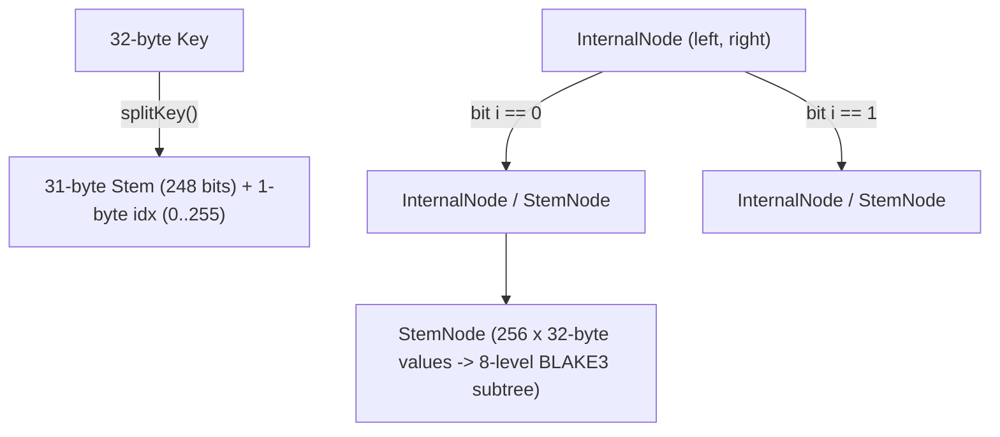

`BinaryTree` (`BinaryTreeType`) implements the EIP-7864 unified binary state tree: a single Merkle tree replacing Ethereum's separate account and storage Merkle Patricia Tries by mapping 32-byte keys into a 31-byte binary stem (248 bits) and a 1-byte leaf index (`0..255`), hashed with BLAKE3.



## Key Layout (32 Bytes)

| Offset | Size | Field | Purpose |
| --- | --- | --- | --- |
| `0` | `31` bytes | `stem` | Path bits (`0..247`) selecting left (`0`) or right (`1`) branches |
| `31` | `1` byte | `idx` | Subtree slot (`0..255`) inside the `StemNode` |

Grouping 256 consecutive slots under one `StemNode` keeps account headers, code chunks, and adjacent storage slots co-located in the same witness branch.

## Quick Start

```typescript
import { Address, BinaryTree } from '@tevm/voltaire';

let tree = BinaryTree.init();

const addr = Address('0x742d35cc6634c0532925a3b844bc9e7595f0beb0');
const key = BinaryTree.addressToKey(addr); // 32-byte tree key
const value = new Uint8Array(32);
value[31] = 42;

tree = BinaryTree.insert(tree, key, value);

const found = BinaryTree.get(tree, key);      // 32-byte Uint8Array
const root = BinaryTree.rootHash(tree);       // 32-byte BLAKE3 root
const rootHex = BinaryTree.rootHashHex(tree); // 0x-prefixed 66-char hex

const { stem, idx } = BinaryTree.splitKey(key);
const bit0 = BinaryTree.getStemBit(stem, 0);  // 0 | 1
```

Import from `@tevm/voltaire` or `@tevm/voltaire/BinaryTree`.

## API Reference

| Method | Signature | Description |
| --- | --- | --- |
| `BinaryTree.init` | `() => BinaryTreeType` | Create empty binary state tree |
| `BinaryTree.insert` | `(tree, key: Uint8Array, value: Uint8Array) => BinaryTreeType` | Insert 32-byte `value` at 32-byte `key` |
| `BinaryTree.get` | `(tree, key: Uint8Array) => Uint8Array \| null` | Retrieve 32-byte value or `null` if absent |
| `BinaryTree.rootHash` | `(tree) => Uint8Array` | Compute 32-byte BLAKE3 state root |
| `BinaryTree.rootHashHex` | `(tree) => HexType` | Compute `0x`-prefixed hex root |
| `BinaryTree.addressToKey` | `(address: Uint8Array) => Uint8Array` | Pad 20-byte address into 32-byte tree key |
| `BinaryTree.splitKey` | `(key: Uint8Array) => { stem: Uint8Array; idx: number }` | Split 32-byte key into 31-byte `stem` and 1-byte `idx` |
| `BinaryTree.getStemBit` | `(stem: Uint8Array, index: number) => 0 \| 1` | Read bit `index` (`0..247`) from `stem` (MSB first) |
| `BinaryTree.hashInternal` / `hashStem` / `hashLeaf` / `hashNode` | Node-level BLAKE3 hashing functions |

Tree-shakeable factories accepting custom `{ blake3 }`: `HashInternal`, `HashStem`, `HashLeaf`, `HashNode`.

## Related

- [Trie](/primitives/trie) — Legacy Keccak-256 hexary Merkle Patricia Trie
- [State](/primitives/state) — `(address, slot)` storage keys
- [Blake2](/crypto/blake2) — Related cryptographic hashing primitives
