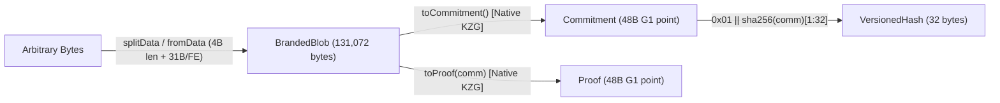

A `Blob` (`BrandedBlob`) is a branded 131,072-byte (`128 KiB`) `Uint8Array` composed of `4,096` 32-byte BLS12-381 scalar field elements, carrying ephemeral rollup data in EIP-4844 (Type `0x03`) transactions.



## Constants & Field Element Layout

Every 32-byte field element must be strictly less than the BLS12-381 scalar field modulus $r$. To guarantee validity for arbitrary payloads, `fromData` leaves byte `0` of each 32-byte element as `0x00` and packs 31 data bytes into bytes `[1..31]`.

| Constant | Value | Meaning |
| --- | --- | --- |
| `Blob.SIZE` | `131072` | Total blob byte size (`4096 * 32`) |
| `Blob.FIELD_ELEMENTS_PER_BLOB` | `4096` | Field elements per blob |
| `Blob.BYTES_PER_FIELD_ELEMENT` | `32` | Bytes per field element |
| `Blob.MAX_PER_TRANSACTION` | `6` | Maximum blobs per transaction |
| `Blob.COMMITMENT_VERSION_KZG` | `0x01` | Versioned hash prefix byte |
| `Blob.GAS_PER_BLOB` | `131072` | Blob gas units per blob ($2^{17}$) |
| `Blob.TARGET_GAS_PER_BLOCK` | `393216` | Target blob gas per block (3 blobs) |
| `MAX_DATA_PER_BLOB` | `126972` | Max usable payload bytes (`4096 * 31 - 4`) |

## Quick Start

```typescript
import { Blob } from '@tevm/voltaire';

const payload = new TextEncoder().encode('L2 rollup batch payload');
const blob = Blob.fromData(payload);

Blob.isValid(blob);         // true (length === 131072)
const recovered = Blob.toData(blob); // exact original payload bytes

// Split large payloads across multiple blobs
const blobs = Blob.splitData(new Uint8Array(200_000));
const joined = Blob.joinData(blobs);
Blob.calculateGas(blobs.length); // blobs.length * 131072

// KZG commitment & versioned hash (native KZG FFI)
const commitment = Blob.toCommitment(blob);         // 48 bytes
const proof = Blob.toProof(blob, commitment);       // 48 bytes
const versionedHash = Blob.toVersionedHash(commitment); // 32 bytes, prefix 0x01
Blob.verify(blob, commitment, proof);               // true
```

Import from `@tevm/voltaire` or `@tevm/voltaire/Blob`.

## API Reference

| Category | Method | Signature |
| --- | --- | --- |
| Construction | `Blob(value)` / `Blob.from` | `(value: number \| Uint8Array) => BrandedBlob & BlobInstance` |
| | `Blob.fromData` | `(data: Uint8Array) => BrandedBlob & BlobInstance` |
| | `Blob.toData` | `(blob: BrandedBlob) => Uint8Array` |
| Multi-blob | `Blob.splitData` | `(data: Uint8Array) => BrandedBlob[]` |
| | `Blob.joinData` | `(blobs: readonly BrandedBlob[]) => Uint8Array` |
| | `Blob.estimateBlobCount` | `(dataSize: number) => number` |
| | `Blob.calculateGas` | `(blobCount: number) => number` |
| KZG & Hashing | `Blob.toCommitment` | `(blob: BrandedBlob) => Commitment` (48 bytes) |
| | `Blob.toProof` | `(blob: BrandedBlob, commitment: Commitment) => Proof` (48 bytes) |
| | `Blob.toVersionedHash` | `(commitment: Commitment) => VersionedHash` (32 bytes) |
| | `Blob.verify` | `(blob: BrandedBlob, commitment: Commitment, proof: Proof) => boolean` |
| Validation | `Blob.isValid` | `(blob: Uint8Array) => boolean` |
| | `Blob.isValidVersion` | `(hash: VersionedHash) => boolean` |
| Sub-namespaces | `Blob.Commitment` | `isValid`, `toVersionedHash` |
| | `Blob.Proof` | `isValid` |
| | `Blob.VersionedHash` | `isValid`, `getVersion`, `version` |

Dependency-injected factories for custom KZG or SHA-256 backends: `ToCommitment`, `ToProof`, `ToVersionedHash`, `Verify`, `VerifyBatch`.

<Warning>
`Blob.toCommitment`, `Blob.toProof`, and `Blob.verify` invoke native c-kzg-4844 bindings and throw in browser/WASM environments without a custom KZG backend. `Blob.verifyBatch` currently validates input dimensions and throws `BlobNotImplementedError`.
</Warning>

## Related

- [Transaction](/primitives/transaction) — EIP-4844 Type `0x03` transactions
- [FeeMarket](/primitives/feemarket) — `BlobBaseFee` and `calculateExcessBlobGas`
- [KZG](/crypto/kzg) — Native KZG trusted setup and polynomial commitments
