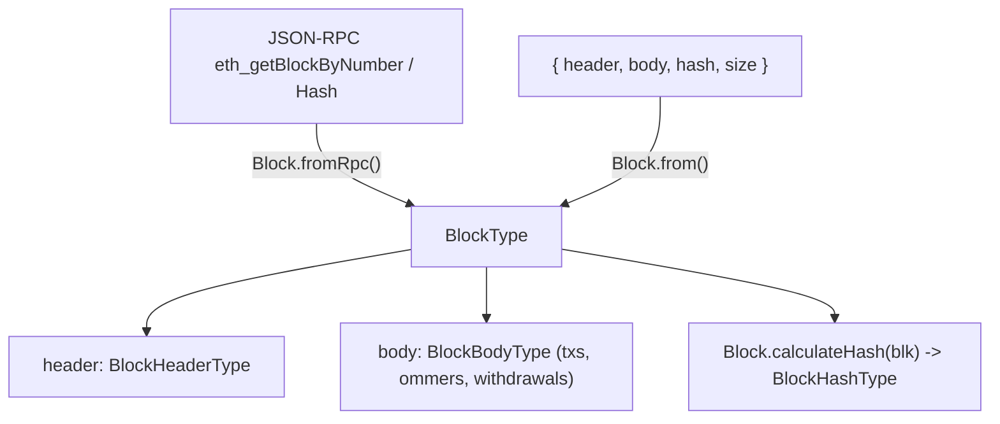

`Block` (`BlockType`) pairs an execution-layer `BlockHeader` and `BlockBody` (transactions, uncles/ommers, and EIP-4895 beacon withdrawals) with its `hash`, `size`, and optional `totalDifficulty`.



## Quick Start

```typescript
import { Block } from '@tevm/voltaire';

// Parse directly from an EIP-1193 / JSON-RPC block response
const block = Block.fromRpc(rpcBlockResponse);

// Recompute canonical header hash: keccak256(RLP(header))
const computedHash = Block.calculateHash(block);
```

Import `Block` from `@tevm/voltaire`.

## Structure

| Field | Type | Description |
| --- | --- | --- |
| `header` | `BlockHeaderType` | Parent hash, roots (`stateRoot`, `transactionsRoot`, `receiptsRoot`), `number`, `gasLimit`, `gasUsed`, `timestamp`, `baseFeePerGas`, `withdrawalsRoot`, `blobGasUsed`, `excessBlobGas`, `parentBeaconBlockRoot` |
| `body` | `BlockBodyType` | Transactions array, ommer headers (empty post-Merge), and withdrawals (post-Shanghai) |
| `hash` | `BlockHashType` | 32-byte Keccak-256 hash of the RLP-encoded header |
| `size` | `Uint256Type` | Encoded block byte size |
| `totalDifficulty` | `Uint256Type \| undefined` | Cumulative PoW difficulty (fixed post-Merge) |

## API Reference

| Method | Signature | Description |
| --- | --- | --- |
| `Block.from` | `(params: { header, body, hash, size, totalDifficulty? }) => BlockType` | Construct a branded `BlockType` from validated components |
| `Block.fromRpc` | `(rpc: RpcBlock) => BlockType` | Parse hex-encoded JSON-RPC block object (`eth_getBlockByNumber`, `eth_getBlockByHash`) |
| `Block.calculateHash` | `(block: BlockType) => BlockHashType` | RLP-encode `block.header` according to active fork fields and hash with Keccak-256 |

## Related

- [BlockHeader](/primitives/block-header) — Execution header fields and RLP hashing
- [BlockBody](/primitives/block-body) — Transactions, uncles, and withdrawals
- [Transaction](/primitives/transaction) — Transactions carried in `body`
- [Receipt](/primitives/receipt) — Post-execution transaction receipts
