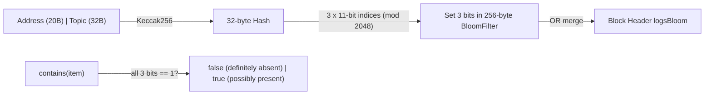

`BloomFilter` (`BloomFilterType`) is a branded `Uint8Array` probabilistic set membership filter supporting Ethereum's 2048-bit (`256`-byte, `k = 3` hash functions) `logsBloom` used in block headers and transaction receipts to skip blocks that cannot contain a given address or event topic.



## Ethereum Logs Bloom Parameters

| Constant | Value | Meaning |
| --- | --- | --- |
| `SIZE` | `256` | Byte length of Ethereum `logsBloom` |
| `BITS` | `2048` | Bit width $m$ (`256 * 8`) |
| `DEFAULT_HASH_COUNT` | `3` | Hash probes $k$ per item |

For each item, Ethereum computes `h = keccak256(item)` and sets the 3 bit indices `((h[2i] << 8) | h[2i+1]) & 0x07ff` for `i = 0, 1, 2`. False negatives are impossible; false positives occur with probability $\approx (1 - e^{-kn/m})^k$.

## Quick Start

```typescript
import { Address, BloomFilter, Hash } from '@tevm/voltaire';
import { BITS, DEFAULT_HASH_COUNT } from '@tevm/voltaire/BloomFilter';

const bloom = BloomFilter(BITS, DEFAULT_HASH_COUNT); // 2048 bits, 3 hashes
const usdc = Address('0xa0b86991c6218b36c1d19d4a2e9eb0ce3606eb48');
const transfer = Hash.keccak256String('Transfer(address,address,uint256)');

bloom.add(usdc);
bloom.add(transfer);

bloom.contains(usdc);     // true
bloom.contains(transfer); // true
bloom.isEmpty();          // false

const hex = bloom.toHex();
const restored = BloomFilter.fromHex(hex, BITS, DEFAULT_HASH_COUNT);

// Bitwise OR two bloom filters (e.g., aggregating receipt blooms into a block bloom)
const combined = BloomFilter.combine(bloom, restored);
BloomFilter.density(combined);
BloomFilter.expectedFalsePositiveRate(combined, 100);
```

Import from `@tevm/voltaire` or `@tevm/voltaire/BloomFilter`.

## API Reference

| Method | Signature | Description |
| --- | --- | --- |
| `BloomFilter` / `create` | `(m: number, k: number) => BloomFilterType` | Allocate empty `m`-bit filter with `k` hash probes |
| `BloomFilter.fromHex` | `(hex: string, m: number, k: number) => BloomFilterType` | Decode hex `logsBloom` into a `BloomFilterType` |
| `add` | `(filter, item: Uint8Array) => void` | Mutate filter in place to record `item` |
| `contains` | `(filter, item: Uint8Array) => boolean` | Return `false` if definitely absent, `true` if possibly present |
| `merge` | `(a, b) => BloomFilterType` | Bitwise OR of two equal-parameter filters |
| `combine` | `(...filters) => BloomFilterType` | Bitwise OR across multiple filters |
| `toHex` | `(filter) => string` | Lowercase `0x`-prefixed hex encoding |
| `isEmpty` | `(filter) => boolean` | True if all bits are zero |
| `density` | `(filter) => number` | Fraction of set bits (`0.0`–`1.0`) |
| `expectedFalsePositiveRate` | `(filter, itemCount: number) => number` | Theoretical false positive rate for `itemCount` entries |
| `hash` / `hashFromKeccak` | Compute single bit index for `(item, seed, m)` |

## Edge Cases

- `merge` and `combine` require matching `(m, k)` parameters and throw on mismatched dimensions.
- `contains(x) === true` does **not** prove `x` was emitted — always verify against the full receipt logs after bloom pre-filtering.

## Related

- [EventLog](/primitives/eventlog) — Log addresses and topics inserted into bloom filters
- [Receipt](/primitives/receipt) — Carries 256-byte `logsBloom`
- [Block](/primitives/block) — Block headers carry the OR-union of all receipt blooms
