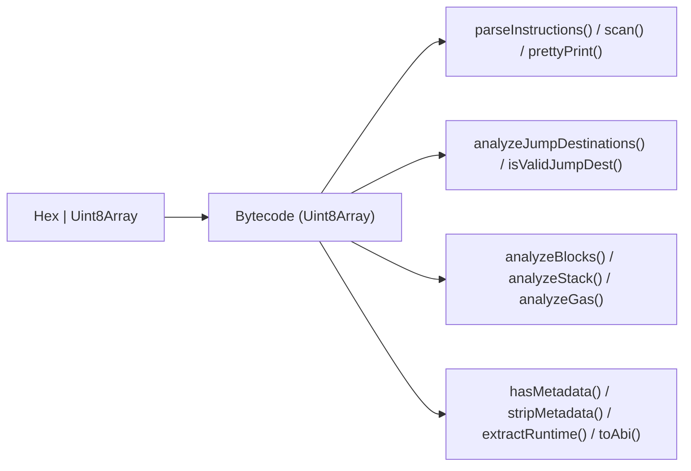

`Bytecode` (`BrandedBytecode`) is a branded `Uint8Array` holding EVM deployment (`initCode`) or runtime bytecode, equipped with instruction scanning, `JUMPDEST` analysis, basic-block decomposition, static stack/gas analysis, Solidity CBOR metadata stripping, and selector-based ABI extraction.



## Quick Start

```typescript
import { Bytecode } from '@tevm/voltaire';

const code = Bytecode('0x608060405260043610601f575b00');

code.size();                     // 14 bytes
code.validate();                 // true (no truncated PUSH immediates)
code.analyzeJumpDestinations();  // Set { 12 }
code.isValidJumpDest(12);        // true (0x5b at byte 12 is not inside PUSH data)
code.prettyPrint();              // human-readable annotated disassembly

// Static analysis
const blocks = code.analyzeBlocks();
const gas = code.analyzeGas();
const stack = code.analyzeStack();

// Strip trailing Solidity CBOR metadata before comparing contract code
const clean = code.stripMetadata();
const codeHash = code.hash();    // 32-byte keccak256
```

Import from `@tevm/voltaire` or `@tevm/voltaire/Bytecode`.

## API Reference

### Construction, Formatting & Hashing

| Method | Signature | Description |
| --- | --- | --- |
| `Bytecode` / `from` | `(value: string \| Uint8Array) => BrandedBytecode` | Wrap raw bytes or `0x` hex |
| `Bytecode.fromHex` | `(hex: string) => BrandedBytecode` | Parse hex bytecode |
| `Bytecode.toHex` | `(code: BrandedBytecode, prefix?: boolean) => string` | Encode to hex (`prefix` defaults to `true`) |
| `Bytecode.size` | `(code: BrandedBytecode) => number` | Byte length |
| `Bytecode.equals` | `(a: BrandedBytecode, b: BrandedBytecode) => boolean` | Byte-wise equality |
| `Bytecode.hash` | `(code: BrandedBytecode) => HashType` | Keccak-256 `EXTCODEHASH` digest (tree-shakeable factory: `Hash`) |

### Instruction Parsing & Disassembly

| Method | Signature | Description |
| --- | --- | --- |
| `parseInstructions` | `(code) => Instruction[]` | Decode into `{ opcode, position, pushData? }` list |
| `scan` | `(code, options?) => Generator<ScannedOp>` | Lazy streaming iterator with optional gas and stack effects |
| `formatInstruction` / `formatInstructions` | Format individual or all instructions as mnemonics |
| `prettyPrint` | `(code, options?) => string` | Multi-line formatted disassembly with PCs and jump targets |
| `getNextPc` | `(code, currentPc) => number` | Advance PC past opcode and `PUSH1`–`PUSH32` immediate bytes |
| `isPush` / `getPushSize` / `isTerminator` | Inspect single opcode bytes |

### Analysis & Metadata

| Method | Signature | Description |
| --- | --- | --- |
| `validate` | `(code) => boolean` | Verify no `PUSH` instruction runs past end of bytecode |
| `analyze` | `(code) => Analysis` | Combined instructions, jump destinations, and validity |
| `analyzeJumpDestinations` | `(code) => ReadonlySet<number>` | Valid `JUMPDEST` (`0x5b`) offsets excluding `PUSH` immediates |
| `isValidJumpDest` | `(code, offset) => boolean` | Check whether `offset` is a legal dynamic jump target |
| `analyzeBlocks` / `getBlock` | Partition bytecode into basic blocks terminated by `JUMP`/`JUMPI`/`STOP`/`RETURN`/`REVERT`/`INVALID`/`SELFDESTRUCT` |
| `analyzeStack` | `(code, options?) => StackAnalysis` | Static stack depth, underflow, and overflow (> 1024) checks |
| `analyzeGas` | `(code, options?) => GasAnalysis` | Static gas cost breakdown per block and instruction |
| `detectFusions` | `(code) => Fusion[]` | Detect common peephole fusion sequences (e.g., `PUSH`+`JUMP`) |
| `hasMetadata` / `stripMetadata` | Detect and remove Solidity CBOR-encoded trailing metadata |
| `extractRuntime` | `(code, offset) => BrandedBytecode` | Slice runtime bytecode out of creation `initCode` |
| `toAbi` | `(code) => BrandedAbi` | Extract function selectors and ABI skeleton from bytecode |

## Edge Cases

- A `0x5b` byte inside a `PUSH1`–`PUSH32` immediate payload is **not** a valid `JUMPDEST`. Always use `analyzeJumpDestinations` or `isValidJumpDest` rather than scanning raw bytes for `0x5b`.
- Solidity appends a 2-byte big-endian length suffix for CBOR metadata (`a26469706673...`); `stripMetadata` validates that suffix before slicing.

## Related

- [Opcode](/primitives/opcode) — Individual EVM opcode constants, stack effects, and gas metadata
- [GasConstants](/primitives/gasconstants) — Fork-aware gas schedule
- [ABI](/primitives/abi) — Contract interface extracted by `toAbi`
