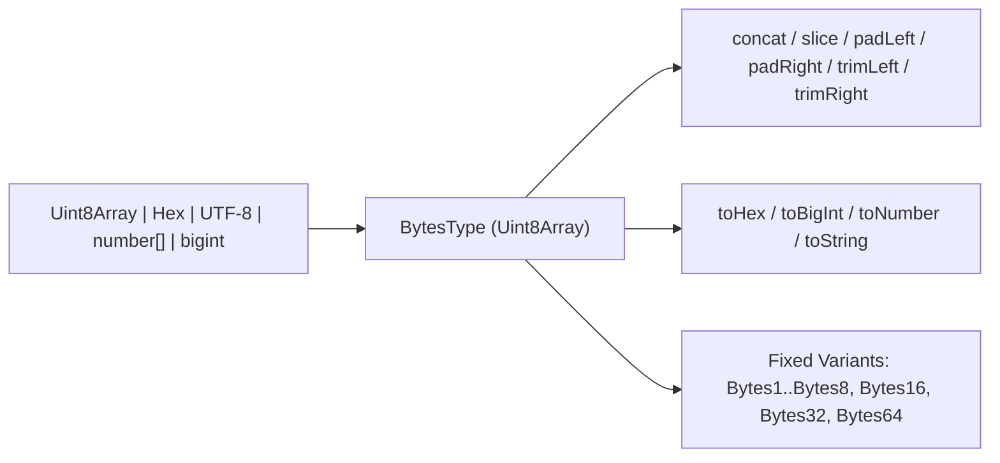

`Bytes` (`BytesType`) is a branded arbitrary-length `Uint8Array` with safe construction, concatenation, padding, trimming, slicing, lexicographic comparison, and integer/hex/UTF-8 conversions.



## Quick Start

```typescript
import { Bytes } from '@tevm/voltaire';

const a = Bytes('0xdead');
const b = Bytes([0xbe, 0xef]);
const merged = Bytes.concat(a, b);

Bytes.toHex(merged);          // "0xdeadbeef"
Bytes.size(merged);           // 4
Bytes.padLeft(merged, 8);     // 0x00000000deadbeef
Bytes.slice(merged, 0, 2);    // Uint8Array([0xde, 0xad])
Bytes.equals(a, Bytes.fromHex('0xdead')); // true
```

Import from `@tevm/voltaire` or `@tevm/voltaire/Bytes`.

## Fixed-Size Variants

`@tevm/voltaire` exports fixed-length branded byte types that enforce exact byte length at construction:

| Type | Byte Length | Common Use |
| --- | --- | --- |
| `Bytes1` .. `Bytes8` | `1`–`8` bytes | Small Solidity `bytesN` values, 4-byte selectors (`Bytes4`), 8-byte nonces |
| `Bytes16` | `16` bytes | UUIDs, 128-bit keys and IVs |
| `Bytes32` | `32` bytes | EVM words, storage slots, `bytes32` parameters ([Bytes32 reference](/primitives/bytes32)) |
| `Bytes64` | `64` bytes | Uncompressed secp256k1 public keys, compact signatures |

## API Reference

### Constructors & Factories

| Method | Signature | Description |
| --- | --- | --- |
| `Bytes` | `(value: Uint8Array \| string \| number[]) => BytesType` | Construct from bytes, `0x` hex, UTF-8 string, or byte array |
| `Bytes.from` | `(value: Uint8Array \| string \| number[]) => BytesType` | Alias for `Bytes(value)` |
| `Bytes.fromHex` | `(hex: string) => BytesType` | Decode `0x`-prefixed hex string |
| `Bytes.fromString` | `(str: string) => BytesType` | Encode UTF-8 string to bytes |
| `Bytes.fromBigInt` | `(value: bigint, size?: number) => BytesType` | Big-endian unsigned integer encoding (optional byte width) |
| `Bytes.fromNumber` | `(value: number, size?: number) => BytesType` | Big-endian non-negative integer encoding |
| `Bytes.zero` | `(size: number) => BytesType` | Allocate `size` zero bytes |
| `Bytes.random` | `(size: number) => BytesType` | Allocate `size` cryptographically random bytes |

### Transformations & Queries

| Method | Signature | Description |
| --- | --- | --- |
| `Bytes.concat` | `(...arrays: BytesType[]) => BytesType` | Join multiple byte arrays into a single buffer |
| `Bytes.slice` | `(bytes: BytesType, start?: number, end?: number) => BytesType` | Byte range slice |
| `Bytes.padLeft` | `(bytes: BytesType, size: number) => BytesType` | Left-pad with `0x00` to `size` bytes |
| `Bytes.padRight` | `(bytes: BytesType, size: number) => BytesType` | Right-pad with `0x00` to `size` bytes |
| `Bytes.trimLeft` | `(bytes: BytesType) => BytesType` | Strip leading `0x00` bytes |
| `Bytes.trimRight` | `(bytes: BytesType) => BytesType` | Strip trailing `0x00` bytes |
| `Bytes.size` | `(bytes: BytesType) => number` | Byte length |
| `Bytes.isEmpty` | `(bytes: BytesType) => boolean` | True if `bytes.length === 0` |
| `Bytes.isBytes` | `(value: unknown) => value is BytesType` | Type guard checking `Uint8Array` |
| `Bytes.assert` | `(value: unknown) => void` | Throw if not valid `BytesType` |
| `Bytes.equals` | `(a: BytesType, b: BytesType) => boolean` | Byte-wise equality |
| `Bytes.compare` | `(a: BytesType, b: BytesType) => number` | Lexicographic comparison (`-1`, `0`, `1`) |
| `Bytes.clone` | `(bytes: BytesType) => BytesType` | Copy into an independent `Uint8Array` |

### Conversions

| Method | Signature | Output |
| --- | --- | --- |
| `Bytes.toHex` | `(bytes: BytesType) => HexType` | Lowercase `0x`-prefixed hex |
| `Bytes.toBigInt` | `(bytes: BytesType) => bigint` | Big-endian unsigned `bigint` |
| `Bytes.toNumber` | `(bytes: BytesType) => number` | Big-endian unsigned safe JS number |
| `Bytes.toString` | `(bytes: BytesType) => string` | Decoded UTF-8 string |

## Edge Cases

- `Bytes.padLeft` and `Bytes.padRight` throw `SizeExceededError` if `bytes.length > size`.
- `Bytes.fromBigInt` and `Bytes.fromNumber` reject negative inputs and values that exceed an explicit `size`.
- `Bytes.toNumber` throws on values above `Number.MAX_SAFE_INTEGER` (`2^53 - 1`); use `Bytes.toBigInt` for larger values.

## Related

- [Bytes32](/primitives/bytes32) — Fixed 32-byte EVM word primitive
- [Hex](/primitives/hex) — `0x`-prefixed hexadecimal string primitive
- [Hash](/primitives/hash) — 32-byte cryptographic digest
