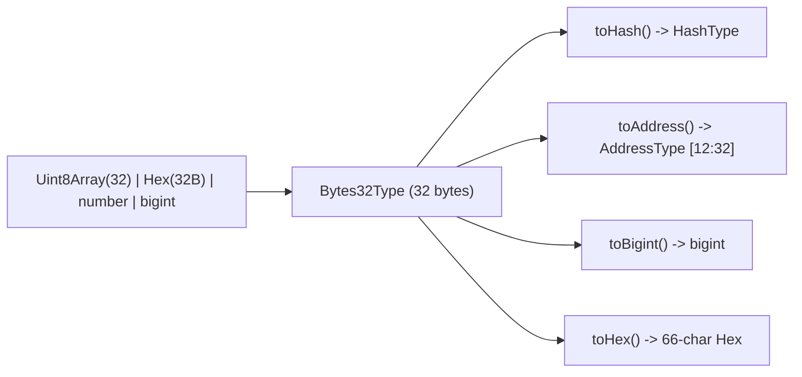

`Bytes32` (`Bytes32Type`) is a branded fixed-length 32-byte `Uint8Array` representing a single 256-bit EVM word, Solidity `bytes32` value, storage slot value, or `CREATE2` salt. Unlike `Hash`, `Bytes32` carries no semantic claim that its contents are a cryptographic digest.



## Quick Start

```typescript
import { Bytes32 } from '@tevm/voltaire';

const word = Bytes32.fromBigint(42n);
Bytes32.toHex(word);
// "0x000000000000000000000000000000000000000000000000000000000000002a"

Bytes32.toBigint(word); // 42n
Bytes32.isZero(word);   // false
Bytes32.size(word);     // 32

// Extract an ABI-padded address from bytes [12:32]
const addr = Bytes32.toAddress(word);
```

Import from `@tevm/voltaire`.

## Layout & Constants

| Constant | Value | Meaning |
| --- | --- | --- |
| `Bytes32.SIZE` | `32` | Fixed byte length (256 bits) |
| `Bytes32.ZERO` | 32 zero bytes | Shared zero word constant |

When encoding integers with `fromNumber` or `fromBigint`, bytes are big-endian and left-padded with `0x00` to 32 bytes. `toAddress` extracts the rightmost 20 bytes (`[12:32]`).

## API Reference

### Constructors & Factories

| Method | Signature | Description |
| --- | --- | --- |
| `Bytes32` | `(value: Bytes32Like) => Bytes32Type` | Construct from 32-byte `Uint8Array`, 64-char `0x` hex, `bigint`, or `number` |
| `Bytes32.from` | `(value: Bytes32Like) => Bytes32Type` | Alias for `Bytes32(value)` |
| `Bytes32.fromBytes` | `(bytes: Uint8Array) => Bytes32Type` | Wrap an exact 32-byte `Uint8Array` |
| `Bytes32.fromHex` | `(hex: string) => Bytes32Type` | Parse 64-char `0x`-prefixed hex |
| `Bytes32.fromNumber` | `(value: number) => Bytes32Type` | Left-pad unsigned integer to 32 big-endian bytes |
| `Bytes32.fromBigint` | `(value: bigint) => Bytes32Type` | Left-pad unsigned 256-bit `bigint` to 32 big-endian bytes |
| `Bytes32.zero` | `() => Bytes32Type` | Allocate a fresh 32-byte zeroed `Bytes32Type` |

### Conversions & Operations

| Method | Signature | Description |
| --- | --- | --- |
| `Bytes32.toHex` | `(b: Bytes32Type) => HexType` | Lowercase 66-char `0x` hex string |
| `Bytes32.toUint8Array` | `(b: Bytes32Type) => Uint8Array` | Raw 32-byte `Uint8Array` |
| `Bytes32.toBigint` | `(b: Bytes32Type) => bigint` | Big-endian unsigned 256-bit integer |
| `Bytes32.toHash` | `(b: Bytes32Type) => HashType` | Rebrand as 32-byte `HashType` |
| `Bytes32.toAddress` | `(b: Bytes32Type) => AddressType` | Extract rightmost 20 bytes (`[12:32]`) |
| `Bytes32.equals` | `(a: Bytes32Type, b: Bytes32Type) => boolean` | Byte-wise equality |
| `Bytes32.compare` | `(a: Bytes32Type, b: Bytes32Type) => number` | Lexicographic comparison (`-1`, `0`, `1`) |
| `Bytes32.clone` | `(b: Bytes32Type) => Bytes32Type` | Copy into a new 32-byte buffer |
| `Bytes32.size` | `(b: Bytes32Type) => 32` | Always returns `32` |
| `Bytes32.isZero` | `(b: Bytes32Type) => boolean` | True if all 32 bytes are `0x00` |

<Note>
Notice method casing: `Bytes32.fromBigint` and `Bytes32.toBigint` use lowercase `i`, whereas `Bytes.fromBigInt` and `Hex.fromBigInt` use capital `I`.
</Note>

## Edge Cases

- `fromBytes` and `fromHex` throw `InvalidLengthError` if the input is not exactly 32 bytes.
- `fromBigint` rejects negative values and values `>= 2n ** 256n`.
- `Bytes32.ZERO` is a shared constant; use `Bytes32.zero()` or `Bytes32.clone()` when mutating bytes.

## Related

- [Bytes](/primitives/bytes) — Variable-length byte arrays and `Bytes1`–`Bytes64`
- [Hash](/primitives/hash) — 32-byte cryptographic digests
- [Uint256](/primitives/uint256) — 256-bit unsigned integer arithmetic
