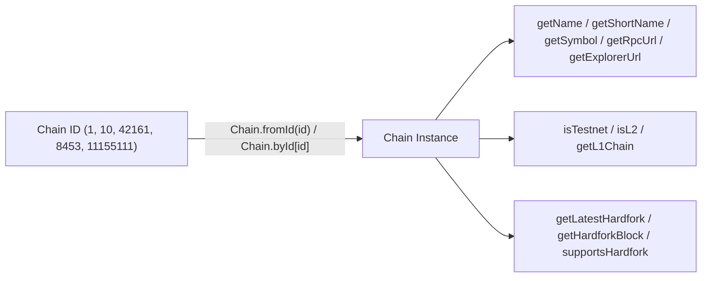

`Chain` wraps EVM network definitions (sourced from `@tevm/chains`) with EIP-155 chain ID lookups, RPC/WebSocket/explorer URLs, L1/L2 and testnet classification, block time and gas limit metadata, and per-chain hardfork activation block queries.



## Quick Start

```typescript
import { Chain, Hardfork } from '@tevm/voltaire';

const mainnet = Chain.fromId(1)!;
Chain.getName(mainnet);          // "Ethereum Mainnet"
Chain.getSymbol(mainnet);        // "ETH"
Chain.getBlockTime(mainnet);     // 12
Chain.getGasLimit(mainnet);      // 30_000_000n
Chain.isTestnet(mainnet);        // false
Chain.isL2(mainnet);             // false
Chain.supportsHardfork(mainnet, Hardfork.CANCUN); // true

const optimism = Chain.fromId(10)!;
Chain.isL2(optimism);            // true
Chain.getL1Chain(optimism);      // Ethereum Mainnet (chainId 1)
```

Import from `@tevm/voltaire` or `@tevm/voltaire/Chain`.

## API Reference

| Category | Method | Description |
| --- | --- | --- |
| Construction & Lookup | `Chain(chain)` / `Chain.from(chain)` | Wrap a chain definition object |
| | `Chain.fromId(id)` | Lookup chain by EIP-155 numeric ID (`undefined` if unknown) |
| | `Chain.byId` | Direct map of chain ID -> chain definition |
| Identity & Endpoints | `getName(c)`, `getShortName(c)`, `getSymbol(c)` | Human-readable names and native currency symbol |
| | `getRpcUrl(c)`, `getWebsocketUrl(c)`, `getExplorerUrl(c)` | Default HTTP RPC, WebSocket, and block explorer URLs |
| Classification | `isTestnet(c)` | True for test networks (Sepolia, Holesky, etc.) |
| | `isL2(c)` | True for L2 rollups (Optimism, Arbitrum, Base, etc.) |
| | `getL1Chain(c)` | Return settlement L1 `Chain` for an L2 |
| Hardforks & Blocks | `getLatestHardfork(c)` | Latest active `HardforkType` on chain |
| | `getHardforkBlock(c, fork)` | Activation block number for `fork` |
| | `supportsHardfork(c, fork)` | Whether `fork` is active on `c` |
| | `getBlockTime(c)`, `getGasLimit(c)` | Target block interval (seconds) and block gas limit |

Metadata constants exported from `@tevm/voltaire/Chain`: `CHAIN_METADATA`, `DEFAULT_METADATA`.

## Related

- [Hardfork](/primitives/hardfork) — Chronological protocol upgrade identifiers
- [ChainId](/primitives/chain-id) — Branded EIP-155 chain ID scalar
- [Transaction](/primitives/transaction) — EIP-155 / EIP-2718 `chainId` replay protection
