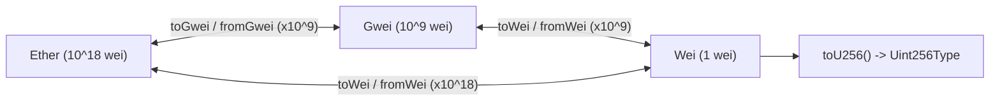

`Denomination` exports three distinct branded `bigint` types — `Wei`, `Gwei`, and `Ether` — so gas prices, transaction values, and balances cannot be mixed across scales without an explicit conversion.



## Scale Table

| Type | Wei Equivalent | Precision | Primary Use |
| --- | --- | --- | --- |
| `Wei` | `1` | Base atomic unit | Transaction `value`, balances, EVM `CALLVALUE` |
| `Gwei` | `10^9` (`1_000_000_000n`) | $10^{-9}$ ETH | Gas prices (`baseFeePerGas`, `maxFeePerGas`, priority fees) |
| `Ether` | `10^18` (`1_000_000_000_000_000_000n`) | Whole ETH | Whole-ether denomination display and accounting |

## Quick Start

```typescript
import { Wei, Gwei, Ether } from '@tevm/voltaire';

const oneEth = Ether(1n);
const inWei = Ether.toWei(oneEth);       // 1_000_000_000_000_000_000n (Wei)
const inGwei = Ether.toGwei(oneEth);     // 1_000_000_000n (Gwei)

const gasPrice = Gwei(25n);
const gasPriceWei = Gwei.toWei(gasPrice); // 25_000_000_000n (Wei)

// Convert to Uint256 for EVM / ABI encoding
const u256Value = Wei.toU256(inWei);
```

Import from `@tevm/voltaire` or `@tevm/voltaire/Denomination`.

## API Reference

### `Wei`

| Method | Signature | Description |
| --- | --- | --- |
| `Wei` / `Wei.from` | `(value: bigint \| number \| string) => Wei` | Construct branded `Wei` |
| `Wei.fromGwei` | `(gwei: Gwei) => Wei` | Multiply by `10^9` |
| `Wei.fromEther` | `(ether: Ether) => Wei` | Multiply by `10^18` |
| `Wei.toGwei` | `(wei: Wei) => Gwei` | Integer divide by `10^9` (truncates sub-gwei remainder) |
| `Wei.toEther` | `(wei: Wei) => Ether` | Integer divide by `10^18` (truncates sub-ether remainder) |
| `Wei.toU256` | `(wei: Wei) => Uint256Type` | Convert to `Uint256Type` |

### `Gwei`

| Method | Signature | Description |
| --- | --- | --- |
| `Gwei` / `Gwei.from` | `(value: bigint \| number \| string) => Gwei` | Construct branded `Gwei` |
| `Gwei.fromWei` | `(wei: Wei) => Gwei` | Integer divide by `10^9` |
| `Gwei.fromEther` | `(ether: Ether) => Gwei` | Multiply by `10^9` |
| `Gwei.toWei` | `(gwei: Gwei) => Wei` | Multiply by `10^9` |
| `Gwei.toEther` | `(gwei: Gwei) => Ether` | Integer divide by `10^9` |
| `Gwei.toU256` | `(gwei: Gwei) => Uint256Type` | Convert to `Uint256Type` |

### `Ether`

| Method | Signature | Description |
| --- | --- | --- |
| `Ether` / `Ether.from` | `(value: bigint \| number \| string) => Ether` | Construct branded `Ether` |
| `Ether.fromWei` | `(wei: Wei) => Ether` | Integer divide by `10^18` |
| `Ether.fromGwei` | `(gwei: Gwei) => Ether` | Integer divide by `10^9` |
| `Ether.toWei` | `(ether: Ether) => Wei` | Multiply by `10^18` |
| `Ether.toGwei` | `(ether: Ether) => Gwei` | Multiply by `10^9` |
| `Ether.toU256` | `(ether: Ether) => Uint256Type` | Convert to `Uint256Type` |

<Warning>
Downward conversions (`Wei.toGwei`, `Wei.toEther`, `Gwei.toEther`) perform integer division and truncate fractional remainders. Keep calculations in `Wei` until final display.
</Warning>

## Related

- [FeeMarket](/primitives/feemarket) — EIP-1559 and EIP-4844 gas fee calculations
- [Uint256](/primitives/uint256) — 256-bit unsigned integer arithmetic
- [Transaction](/primitives/transaction) — Transaction `value`, `maxFeePerGas`, and `maxPriorityFeePerGas`
