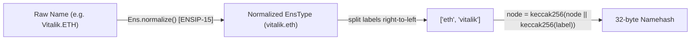

`Ens` implements Ethereum Name Service (ENS) name handling: ENSIP-15 normalization and homograph protection (backed by `@adraffy/ens-normalize`), display beautification, `labelhash`, and recursive EIP-137 `namehash`.



## EIP-137 Namehash Algorithm

Starting from the 32-byte zero hash `node = 0x00...00`:
- For an empty name `""`, return `0x00...00`.
- Normalize the name per ENSIP-15, split on `.`, and fold from right to left:

$$\text{namehash}(l_1 . l_2 \dots l_k) = \text{keccak256}\bigl(\text{namehash}(l_2 \dots l_k) \mathbin{\|} \text{keccak256}(\text{utf8}(l_1))\bigr)$$

## Quick Start

```typescript
import { Ens, Hex } from '@tevm/voltaire';

const normalized = Ens.normalize('Vitalik.ETH'); // "vitalik.eth"
const pretty = Ens.beautify('vitalik.eth');      // Display form preserving emoji presentation

const ethLabel = Ens.labelhash('eth');
// 0x4f5b812789fc606be1b3b16908db13fc7a9adf7ca72641f84d75b47069d3d7f0

const node = Ens.namehash('vitalik.eth');
Hex.fromBytes(node);
// "0xee6c4522aab0003e8d14cd40a6af439055fd2577951148c14b6cea9a53475835"

Ens.isValid('alice.eth'); // true
```

Import from `@tevm/voltaire` or `@tevm/voltaire/Ens`.

## API Reference

| Function | Signature | Description |
| --- | --- | --- |
| `Ens.from` | `(name: string) => EnsType` | Brand an ENS name string |
| `Ens.normalize` | `(name: string \| EnsType) => EnsType` | ENSIP-15 Unicode normalization; throws on disallowed or confusable characters |
| `Ens.beautify` | `(name: string \| EnsType) => EnsType` | Produce canonical display form (e.g., emoji variation selectors) |
| `Ens.namehash` | `(name: string \| EnsType) => Uint8Array` | Compute 32-byte EIP-137 recursive namehash |
| `Ens.labelhash` | `(label: string \| EnsType) => Uint8Array` | Compute 32-byte `keccak256(utf8(label))` for a single label |
| `Ens.validate` | `(name: string) => void` | Throw if `name` fails ENSIP-15 normalization |
| `Ens.isValid` | `(name: string) => boolean` | Return `true` if `name` is valid per ENSIP-15 |
| `Ens.is` | `(value: unknown) => value is EnsType` | Runtime type guard |
| `Ens.toString` | `(name: EnsType) => string` | Convert branded `EnsType` to plain string |

Tree-shakeable factories: `Namehash({ keccak256 })` and `Labelhash({ keccak256 })`.

## Security Notes

Always pass untrusted user input through `Ens.normalize` before computing `namehash` or displaying domains. Zero-width characters, mixed scripts, and disallowed Unicode code points throw during normalization rather than silently hashing to a different lookalike node.

## Related

- [Hash](/primitives/hash) — 32-byte Keccak-256 digests
- [Address](/primitives/address) — Resolved 20-byte account addresses
- [SIWE](/primitives/siwe) — Authentication messages binding Ethereum accounts
