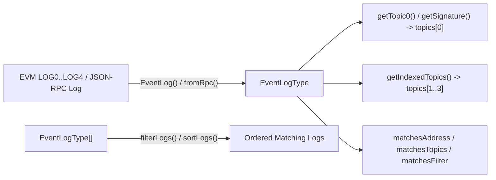

An `EventLog` (`EventLogType`) represents an EVM log entry emitted by `LOG0`–`LOG4`, carrying the emitting contract `address`, 0–4 32-byte `topics`, raw `data` bytes, and optional block/transaction position metadata (`blockNumber`, `transactionHash`, `logIndex`, `removed`).



## Quick Start

```typescript
import { Address, EventLog, Hash } from '@tevm/voltaire';

const transferTopic = Hash.keccak256String('Transfer(address,address,uint256)');
const usdc = Address('0xa0b86991c6218b36c1d19d4a2e9eb0ce3606eb48');

const log = EventLog({
  address: usdc,
  topics: [transferTopic],
  data: new Uint8Array(32),
});

EventLog.getTopic0(log);               // transferTopic
EventLog.matchesAddress(log, usdc);    // true
EventLog.matchesTopics(log, [transferTopic, null]); // true (null = wildcard)
EventLog.isRemoved(log);               // false

// Parse JSON-RPC eth_getLogs entries and sort canonically
const parsed = rpcLogs.map(EventLog.fromRpc);
const sorted = EventLog.sortLogs(parsed);
```

Import from `@tevm/voltaire` or `@tevm/voltaire/EventLog`.

## Log Anatomy

| Field | Type | Constraints |
| --- | --- | --- |
| `address` | `AddressType` | 20-byte emitting contract address |
| `topics` | `readonly HashType[]` | 0–4 entries of 32 bytes each (`topics[0]` is event signature hash for non-anonymous events) |
| `data` | `Uint8Array` | ABI-encoded non-indexed event parameters |
| `blockNumber` | `bigint \| undefined` | Block height where log was emitted |
| `blockHash` | `HashType \| undefined` | 32-byte block hash |
| `transactionHash` | `HashType \| undefined` | 32-byte transaction hash |
| `transactionIndex` | `number \| undefined` | Position of transaction in block |
| `logIndex` | `number \| undefined` | Position of log in block |
| `removed` | `boolean \| undefined` | `true` if log was reverted by a chain reorganization |

## API Reference

| Category | Methods | Description |
| --- | --- | --- |
| Construction & RPC | `EventLog(params)`, `from`, `create`, `fromRpc`, `toRpc`, `clone` / `copy` | Construct, convert JSON-RPC logs, or deep-copy |
| Topics | `getTopic0` / `getSignature`, `getIndexedTopics` / `getIndexed` | Extract event signature topic (`topics[0]`) and indexed args (`topics[1:]`) |
| Matching | `matchesAddress`, `matchesTopics`, `matchesFilter` | Match single address/array, EIP-1474 topic filters (`null` wildcard, array OR), or full filter |
| Collections | `filterLogs(logs, filter)`, `sortLogs(logs)` | Filter log arrays and sort by `(blockNumber, logIndex)` |
| Reorg | `isRemoved` / `wasRemoved` | Check `removed === true` |

## Topic Filter Semantics

Topic filters follow JSON-RPC `eth_getLogs` rules:
- `null` at position `i` matches any topic value (wildcard).
- A single `HashType` at position `i` requires exact match with `topics[i]`.
- An array `[h1, h2]` at position `i` matches if `topics[i]` equals `h1` OR `h2`.
- Multiple positions are combined with logical AND.

## Related

- [ABI](/primitives/abi) — Decode raw logs into typed parameters via `abi.parseLogs()`
- [BloomFilter](/primitives/bloomfilter) — 2048-bit block/receipt log bloom filters
- [Receipt](/primitives/receipt) — Transaction receipts containing `logs` and `logsBloom`
