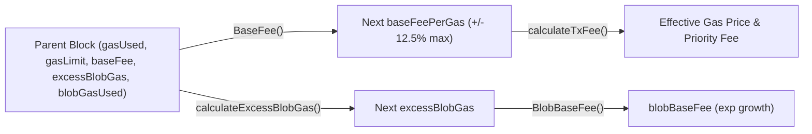

`FeeMarket` implements Ethereum's EIP-1559 execution gas fee market and EIP-4844 blob gas fee market: deterministic next-block `baseFeePerGas`, exponential `blobBaseFee` via `fakeExponential`, excess blob gas tracking, transaction inclusion checks, and multi-block projections.



## Protocol Constants

### EIP-1559 (`FeeMarket.Eip1559`)

| Constant | Value | Meaning |
| --- | --- | --- |
| `MIN_BASE_FEE` | `7n` wei | Floor for base fee |
| `BASE_FEE_CHANGE_DENOMINATOR` | `8n` | Max $\pm 12.5\%$ ($1/8$) change per block |
| `ELASTICITY_MULTIPLIER` | `2n` | `gasTarget = gasLimit / 2` |

### EIP-4844 (`FeeMarket.Eip4844`)

| Constant | Value | Meaning |
| --- | --- | --- |
| `MIN_BLOB_BASE_FEE` | `1n` wei | Floor for blob gas price |
| `BLOB_BASE_FEE_UPDATE_FRACTION` | `3338477n` | Exponential update denominator |
| `BLOB_GAS_PER_BLOB` | `131072n` | Gas per blob ($2^{17}$) |
| `TARGET_BLOB_GAS_PER_BLOCK` | `393216n` | Target (3 blobs) |
| `MAX_BLOBS_PER_BLOCK` | `6n` | Max blobs per block |
| `MAX_BLOB_GAS_PER_BLOCK` | `786432n` | Max blob gas (`6 * 131072`) |

## Quick Start

```typescript
import { FeeMarket } from '@tevm/voltaire';

// Next block EIP-1559 base fee (full 30M block increases base fee by 12.5%)
const nextBaseFee = FeeMarket.BaseFee(
  30_000_000n,      // parentGasUsed
  30_000_000n,      // parentGasLimit (target = 15M)
  10_000_000_000n,  // parentBaseFee (10 gwei)
); // 11_250_000_000n (11.25 gwei)

// Next block excess blob gas and exponential blob base fee
const excess = FeeMarket.calculateExcessBlobGas(0n, 786_432n); // 393216n
const blobBaseFee = FeeMarket.BlobBaseFee(excess);

// Effective transaction fee & inclusion check
const fee = FeeMarket.calculateTxFee({
  maxFeePerGas: 30_000_000_000n,
  maxPriorityFeePerGas: 2_000_000_000n,
  baseFee: nextBaseFee,
});
FeeMarket.canIncludeTx({
  maxFeePerGas: 30_000_000_000n,
  maxPriorityFeePerGas: 2_000_000_000n,
  baseFee: nextBaseFee,
}); // true
```

Import from `@tevm/voltaire` or `@tevm/voltaire/FeeMarket`.

## API Reference

| Method | Purpose |
| --- | --- |
| `FeeMarket.BaseFee(parentGasUsed, parentGasLimit, parentBaseFee)` | Next block `baseFeePerGas` (wei) |
| `FeeMarket.BlobBaseFee(excessBlobGas)` | Current `blobBaseFee` via `fakeExponential(1, excessBlobGas, 3338477)` |
| `FeeMarket.calculateExcessBlobGas(parentExcess, parentBlobGasUsed)` | `max(0, parentExcess + parentBlobGasUsed - TARGET_BLOB_GAS_PER_BLOCK)` |
| `FeeMarket.calculateTxFee(params)` | Compute `effectiveGasPrice`, `priorityFee`, and `baseFee` breakdown |
| `FeeMarket.calculateBlobTxFee(params)` | Compute execution + blob fee totals for EIP-4844 transactions |
| `FeeMarket.canIncludeTx(params)` | Check `maxFeePerGas >= baseFee` (and blob cap if blob tx) |
| `FeeMarket.nextState(state)` | Advance full `FeeMarketType` state by one block |
| `FeeMarket.projectBaseFees(state, blocks, utilization)` | Project future base fees over `blocks` at target utilization |
| `FeeMarket.validateState(state)` / `validateTxFeeParams(params)` | Validate fee invariants |
| `FeeMarket.weiToGwei(wei)` / `gweiToWei(gwei)` | Scale helpers |

State helper namespace `FeeMarket.State`: `next`, `getBlobBaseFee`, `getGasTarget`, `isAboveGasTarget`, `isAboveBlobGasTarget`.

## Related

- [Denomination](/primitives/denomination) — Branded `Wei`, `Gwei`, and `Ether` units
- [Blob](/primitives/blob) — EIP-4844 blob payloads and gas constants
- [Transaction](/primitives/transaction) — EIP-1559 and EIP-4844 transaction types
