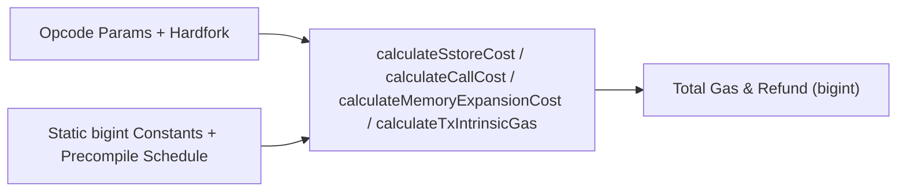

`GasConstants` exports exact `bigint` EVM gas constants from the Ethereum Yellow Paper and subsequent EIPs (EIP-150, EIP-2200, EIP-2929, EIP-3529, EIP-3860, EIP-1153, EIP-4844) together with dynamic gas and refund calculators.



## Core Gas Constants

| Constant | Gas (`bigint`) | Scope |
| --- | --- | --- |
| `Jumpdest` | `1n` | `JUMPDEST` |
| `QuickStep` | `2n` | `ADDRESS`, `CALLER`, `GAS`, `CHAINID`, `PUSH0` |
| `FastestStep` | `3n` | `ADD`, `SUB`, `MLOAD`, `MSTORE`, `PUSH1`–`32`, `DUP`, `SWAP` |
| `FastStep` | `5n` | `MUL`, `DIV`, `SDIV`, `MOD`, `SMOD` |
| `MidStep` | `8n` | `ADDMOD`, `MULMOD`, `SIGNEXTEND` |
| `SlowStep` | `10n` | `JUMPI` |
| `ExtStep` | `20n` | `BLOCKHASH` |
| `Keccak256Base` / `Keccak256Word` | `30n` / `6n` | `KECCAK256` base + per 32-byte word |
| `WarmStorageRead` / `Sload` | `100n` | Warm `SLOAD` / warm account access (EIP-2929) |
| `ColdSload` | `2100n` | Cold `SLOAD` (EIP-2929) |
| `ColdAccountAccess` | `2600n` | Cold `BALANCE`, `EXTCODE*`, `CALL` family (EIP-2929) |
| `SstoreSet` / `SstoreReset` / `SstoreClear` | `20000n` / `5000n` / `5000n` | Zero-to-nonzero, overwrite, and clear writes |
| `SstoreSentry` | `2300n` | Minimum remaining gas required before `SSTORE` |
| `SstoreRefund` | `4800n` | Storage clearing refund (EIP-3529; capped at 20% of tx gas) |
| `LogBase` / `LogTopic` / `LogData` | `375n` / `375n` / `8n` | `LOG0`–`LOG4` base, per topic, per data byte |

## Quick Start

```typescript
import { GasConstants } from '@tevm/voltaire';

// Memory expansion cost from 0 bytes to 1024 bytes (32 words)
const mem = GasConstants.calculateMemoryExpansionCost(0n, 1024n);

// EIP-2200 / EIP-2929 SSTORE cost & refund
const sstore = GasConstants.calculateSstoreCost({
  originalValue: 0n,
  currentValue: 0n,
  newValue: 1n,
  isCold: true,
});

// Transaction intrinsic gas (21,000 base + calldata zero/non-zero + access list)
const intrinsic = GasConstants.calculateTxIntrinsicGas(
  new Uint8Array([0x00, 0xaa, 0xbb]),
  false,
);

// Precompile gas formulas
GasConstants.Precompile;
```

Import from `@tevm/voltaire` or `@tevm/voltaire/GasConstants`.

## Dynamic Calculators & Fork Queries

| Category | Functions |
| --- | --- |
| Memory & Copy | `calculateMemoryExpansionCost` / `memoryExpansionCost`, `calculateCopyCost` / `copyCost` |
| Hashing & Logs | `calculateKeccak256Cost` / `keccak256Cost`, `calculateLogCost` / `logCost` |
| Storage & Calls | `calculateSstoreCost` / `sstoreCost`, `calculateCallCost` / `callCost`, `calculateCreateCost` / `createCost` |
| Transactions & Refunds | `calculateTxIntrinsicGas` / `txIntrinsicGas`, `calculateMaxRefund` / `maxRefund`, `getSstoreRefund`, `getSelfdestructRefund` |
| Fork-dependent Costs | `getColdSloadCost(fork)`, `getColdAccountAccessCost(fork)` |
| Feature Checks | `hasEIP1153(fork)`, `hasEIP2929(fork)`, `hasEIP3529(fork)`, `hasEIP3860(fork)`, `hasEIP4844(fork)` |
| Precompiles | `GasConstants.Precompile` (ECRECOVER, SHA256, RIPEMD160, Identity, ModExp, BN254, Blake2f, KZG) |

## Memory Expansion Formula

For $w = \lceil \text{byteSize} / 32 \rceil$ words:

$$\text{cost}(w) = 3w + \left\lfloor \frac{w^2}{512} \right\rfloor$$

Expansion gas is $\text{cost}(w_{\text{new}}) - \text{cost}(w_{\text{old}})$ when $w_{\text{new}} > w_{\text{old}}$, else `0n`.

## Related

- [Opcode](/primitives/opcode) — Static opcode metadata
- [Hardfork](/primitives/hardfork) — Protocol upgrade activation ordering
- [AccessList](/primitives/accesslist) — EIP-2930 pre-warming gas deltas
