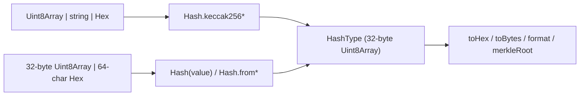

A `Hash` (`HashType`) is a branded 32-byte `Uint8Array` representing a 256-bit cryptographic digest: block hashes, transaction hashes, state roots, storage keys, event topic hashes, and Keccak-256 outputs.



## Quick Start

```typescript
import { Hash } from '@tevm/voltaire';

const h = Hash('0x' + 'ab'.repeat(32));
Hash.toHex(h);        // "0xabab...abab" (66 chars)
Hash.format(h);       // "0xabab...abab" (shortened display)
Hash.isZero(h);       // false

const digest = Hash.keccak256String('Transfer(address,address,uint256)');
const root = Hash.merkleRoot([h, digest]);
```

Import from `@tevm/voltaire` or `@tevm/voltaire/Hash`.

## Layout & Constants

| Constant | Value | Meaning |
| --- | --- | --- |
| `Hash.SIZE` | `32` | Fixed byte length (256 bits, 64 hex nibbles) |
| `Hash.ZERO` | `0x00...00` (32 zero bytes) | Zero hash sentinel |

Every `Hash` instance inherits from `Uint8Array.prototype` and carries `length === 32`.

## API Reference

### Constructors & Hashing

| Method | Signature | Description |
| --- | --- | --- |
| `Hash` | `(value: string \| Uint8Array) => HashType` | Construct from 32-byte `Uint8Array` or 64-char `0x` hex |
| `Hash.from` | `(value: string \| Uint8Array) => HashType` | Alias for `Hash(value)` |
| `Hash.fromHex` | `(hex: string) => HashType` | Parse `0x`-prefixed 64-nibble hex string |
| `Hash.fromBytes` | `(bytes: Uint8Array) => HashType` | Wrap a 32-byte `Uint8Array` |
| `Hash.keccak256` | `(data: Uint8Array) => HashType` | Compute Keccak-256 of raw bytes |
| `Hash.keccak256String` | `(str: string) => HashType` | Compute Keccak-256 of UTF-8 encoded string |
| `Hash.keccak256Hex` | `(hex: string) => HashType` | Compute Keccak-256 of decoded hex bytes |
| `Hash.random` | `() => HashType` | Generate 32 cryptographically random bytes |

### Conversions & Inspection

| Method | Signature | Description |
| --- | --- | --- |
| `Hash.toHex` | `(hash: HashType) => string` | Lowercase `0x`-prefixed 66-char hex string |
| `Hash.toBytes` | `(hash: HashType) => Uint8Array` | Raw 32-byte `Uint8Array` |
| `Hash.toString` | `(hash: HashType) => string` | Same as `toHex` (also available as `hash.toString()`) |
| `Hash.format` | `(hash: HashType, prefixLen?: number, suffixLen?: number) => string` | Abbreviated hex string for logs/UI |
| `Hash.isHash` | `(value: unknown) => value is HashType` | Type guard verifying 32-byte `Uint8Array` |
| `Hash.isValidHex` | `(hex: string) => boolean` | Check whether string is valid 32-byte hex |
| `Hash.assert` | `(value: unknown) => void` | Throw if `value` is not a valid 32-byte hash |
| `Hash.equals` | `(a: HashType, b: HashType) => boolean` | Constant-length 32-byte equality check |
| `Hash.isZero` | `(hash: HashType) => boolean` | True if all 32 bytes are `0x00` |
| `Hash.clone` | `(hash: HashType) => HashType` | Copy into a new 32-byte `HashType` |
| `Hash.slice` | `(hash: HashType, start?: number, end?: number) => Uint8Array` | Sub-byte slice |

### Combining & Merkle Trees

| Method | Signature | Description |
| --- | --- | --- |
| `Hash.concat` | `(...hashes: HashType[]) => HashType` | Concatenate input hashes and return `keccak256(concatenated)` |
| `Hash.merkleRoot` | `(leaves: HashType[]) => HashType` | Compute binary Keccak-256 Merkle root over `leaves` |

Instance methods on `Hash.prototype`: `toBytes()`, `toString()`, `equals(other)`, `isZero()`, `clone()`, `slice(start, end)`, `format()`.

### Tree-Shakeable Crypto Factories

Importing from `@tevm/voltaire/Hash` exposes dependency-injected factories (`_Keccak256Factory`, `_Keccak256HexFactory`, `_Keccak256StringFactory`, `_MerkleRootFactory`, `_ConcatFactory`) that accept `{ keccak256 }` for custom WASM or native backends.

## Errors & Edge Cases

- `Hash.fromBytes` and `Hash.fromHex` throw `InvalidLengthError` when byte length is not `32`.
- `Hash.fromHex` throws `InvalidFormatError` on missing `0x` prefix or non-hex characters.
- `Hash.merkleRoot([])` returns `Hash.ZERO`; odd-length tree levels duplicate the final node before hashing.

## Related

- [Bytes32](/primitives/bytes32) — Unhashed fixed 32-byte values (storage words, salts)
- [Keccak256](/crypto/keccak256) — Standalone Keccak-256 hashing (TS, WASM, Native)
- [Address](/primitives/address) — 20-byte addresses derived from Keccak-256 digests
