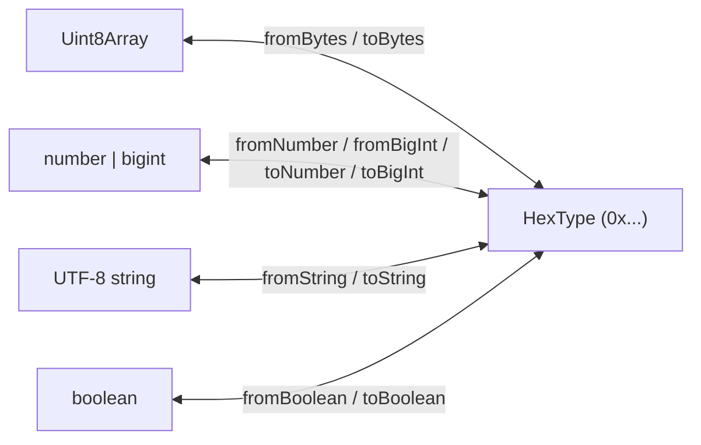

`Hex` (`HexType`) is a branded `0x`-prefixed hexadecimal string (`0x${string}`) with utilities for byte, integer, UTF-8, and boolean conversion, byte-indexed slicing, padding, trimming, and bitwise XOR.



## Quick Start

```typescript
import { Hex } from '@tevm/voltaire';

const h = Hex('0x1234');
Hex.size(h);             // 2 (bytes)
Hex.toBytes(h);          // Uint8Array([0x12, 0x34])
Hex.pad(h, 4);           // "0x00001234"
Hex.trim('0x00001234');  // "0x1234"
Hex.concat('0x12', '0x34'); // "0x1234"
Hex.xor('0xff00', '0x0ff0'); // "0xf0f0"
```

Import from `@tevm/voltaire` or `@tevm/voltaire/Hex`.

## Format Rules

| Property | Rule |
| --- | --- |
| Prefix | Always `0x` |
| Alphabet | `[0-9a-fA-F]` (canonical outputs are lowercase) |
| Length | Even number of hex digits for byte operations (`2 * N` chars after `0x` = `N` bytes) |
| Empty value | `'0x'` (`Hex.size('0x') === 0`) |

Sized type helper: `Sized<N>` brands a `HexType` whose byte length is statically known to be `N` bytes (e.g., `Hex.fromBoolean(true)` returns `Sized<1>`).

## API Reference

### Constructors

| Method | Signature | Example |
| --- | --- | --- |
| `Hex` | `(value: string \| Uint8Array) => HexType` | `Hex('0x1234')` |
| `Hex.from` | `(value: string \| Uint8Array) => HexType` | Alias for `Hex(value)` |
| `Hex.fromBytes` | `(value: Uint8Array) => HexType` | `Hex.fromBytes(new Uint8Array([0xde, 0xad]))` -> `'0xdead'` |
| `Hex.fromNumber` | `(value: number, size?: number) => HexType` | `Hex.fromNumber(255, 2)` -> `'0x00ff'` |
| `Hex.fromBigInt` | `(value: bigint, size?: number) => HexType` | `Hex.fromBigInt(255n, 32)` -> 32-byte hex |
| `Hex.fromString` | `(value: string) => HexType` | `Hex.fromString('hi')` -> `'0x6869'` |
| `Hex.fromBoolean` | `(value: boolean) => Sized<1>` | `Hex.fromBoolean(true)` -> `'0x01'` |
| `Hex.zero` | `(size: number) => HexType` | `Hex.zero(4)` -> `'0x00000000'` |
| `Hex.random` | `(size: number) => HexType` | Cryptographically random `size`-byte hex |

### Conversions

| Method | Signature | Behavior |
| --- | --- | --- |
| `Hex.toBytes` | `(hex: string) => Uint8Array` | Decode hex pairs into bytes; rejects odd length |
| `Hex.toNumber` | `(hex: string) => number` | Parse unsigned integer; throws if exceeding `Number.MAX_SAFE_INTEGER` |
| `Hex.toBigInt` | `(hex: string) => bigint` | Parse arbitrary-precision unsigned `bigint` (`'0x'` -> `0n`) |
| `Hex.toString` | `(hex: string) => string` | Decode bytes as UTF-8 string |
| `Hex.toBoolean` | `(hex: string) => boolean` | `'0x01'` -> `true`, `'0x00'` -> `false` |

### Manipulation & Validation

| Method | Signature | Behavior |
| --- | --- | --- |
| `Hex.isHex` | `(value: unknown) => value is HexType` | Type guard checking `0x` prefix and valid hex chars |
| `Hex.validate` | `(value: string) => HexType` | Return validated `HexType` or throw `InvalidFormatError` |
| `Hex.size` | `(hex: string) => number` | Byte length (`(hex.length - 2) / 2`) |
| `Hex.isSized` | `(hex: string, size: number) => boolean` | Check exact byte length |
| `Hex.assertSize` | `(hex: string, size: number) => void` | Throw if byte length differs from `size` |
| `Hex.concat` | `(...hexes: string[]) => HexType` | Concatenate hex payloads under one `0x` prefix |
| `Hex.slice` | `(hex: string, start: number, end?: number) => HexType` | Byte-indexed slice (not character-indexed) |
| `Hex.pad` | `(hex: string, size: number) => HexType` | Left-pad with `00` bytes to `size` bytes |
| `Hex.padRight` | `(hex: string, size: number) => HexType` | Right-pad with `00` bytes to `size` bytes |
| `Hex.trim` | `(hex: string) => HexType` | Strip leading zero bytes |
| `Hex.equals` | `(a: string, b: string) => boolean` | Case-insensitive equality |
| `Hex.xor` | `(a: string, b: string) => HexType` | Byte-wise XOR of equal-length hex strings |
| `Hex.clone` | `(hex: HexType) => HexType` | Return copy of hex string |

## Errors & Edge Cases

| Error | Condition |
| --- | --- |
| `InvalidFormatError` | Missing `0x` prefix or characters outside `0-9`, `a-f`, `A-F` |
| `InvalidLengthError` | Odd number of hex digits passed to `toBytes`, `slice`, or `xor`; mismatched lengths in `xor` |
| `InvalidSizeError` / `SizeExceededError` | Input exceeds target byte `size` in `pad`, `padRight`, `fromNumber`, or `fromBigInt` |

## Related

- [Bytes](/primitives/bytes) — Dynamic byte arrays (`Uint8Array`)
- [Bytes32](/primitives/bytes32) — Fixed 32-byte words
- [Base64](/primitives/base64) — RFC 4648 Base64 encoding
