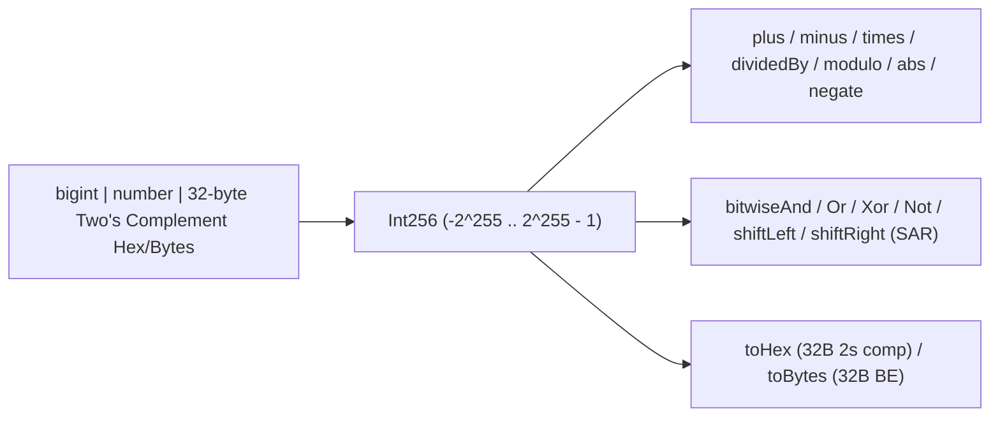

`Int256` (`BrandedInt256`) is a branded `bigint` constrained to $[-2^{255}, 2^{255} - 1]$ with two's complement 32-byte serialization and EVM-compatible signed arithmetic.



## Quick Start

```typescript
import { Int256 } from '@tevm/voltaire';

const a = Int256(-100n);
const b = Int256(30n);

Int256.plus(a, b);           // -70n
Int256.dividedBy(a, b);      // -3n (truncates toward zero, matching EVM SDIV)
Int256.modulo(a, b);         // -10n (sign of dividend, matching EVM SMOD)
Int256.abs(a);               // 100n
Int256.toHex(Int256(-1n));   // "0xffffffffffffffffffffffffffffffffffffffffffffffffffffffffffffffff"
```

Import `Int256` (and narrower signed widths `Int8`, `Int16`, `Int32`, `Int64`, `Int128`) from `@tevm/voltaire`.

## Two's Complement Layout & Constants

Bit 255 is the sign bit (`0` for non-negative, `1` for negative). A negative value $x$ serializes as $x + 2^{256}$ across 32 big-endian bytes.

| Constant | Value |
| --- | --- |
| `Int256.BITS` | `256` |
| `Int256.SIZE` | `32` (bytes) |
| `Int256.MODULO` | $2^{256}$ |
| `Int256.MIN` | $-2^{255}$ (`-57896044618658097711785492504343953926634992332820282019728792003956564819968n`) |
| `Int256.MAX` | $2^{255} - 1$ (`57896044618658097711785492504343953926634992332820282019728792003956564819967n`) |
| `Int256.ZERO` | `0n` |
| `Int256.ONE` | `1n` |
| `Int256.NEG_ONE` | `-1n` |

## API Reference

| Category | Methods |
| --- | --- |
| Constructors | `Int256(v)`, `from`, `fromBigInt`, `fromNumber`, `fromHex`, `fromBytes` |
| Validation | `isValid`, `isZero`, `isNegative`, `isPositive`, `sign` (`-1 \| 0 \| 1`) |
| Conversions | `toHex`, `toBytes`, `toBigInt`, `toNumber`, `toString` |
| Arithmetic | `plus`, `minus`, `times`, `dividedBy`, `modulo`, `abs`, `negate` |
| Bitwise | `bitwiseAnd`, `bitwiseOr`, `bitwiseXor`, `bitwiseNot`, `shiftLeft`, `shiftRight` (arithmetic sign-extending right shift) |
| Comparison | `equals`, `lessThan`, `greaterThan`, `minimum`, `maximum` |
| Bit metrics | `bitLength`, `leadingZeros`, `popCount` |

## Signed Edge Cases (EVM Parity)

| Operation | Result / Behavior |
| --- | --- |
| `Int256.dividedBy(Int256.MIN, Int256.NEG_ONE)` | Throws overflow error (unlike unsigned, $-(-2^{255}) = 2^{255}$ exceeds `MAX`) |
| `Int256.abs(Int256.MIN)` / `Int256.negate(Int256.MIN)` | Throws overflow error (`-MIN > MAX`) |
| `Int256.dividedBy(-7n, 2n)` | `-3n` (truncation toward zero, matching Solidity and EVM `SDIV`) |
| `Int256.modulo(-7n, 2n)` | `-1n` (sign follows dividend, matching EVM `SMOD`) |
| `Int256.shiftRight(-8n, 1n)` | `-4n` (sign-extending arithmetic right shift, matching EVM `SAR`) |

## Related

- [Uint256](/primitives/uint256) — Unsigned 256-bit integers
- [Uint Overview](/primitives/uint) — Full unsigned width family
- [ABI](/primitives/abi) — Encoding signed `intN` parameters
