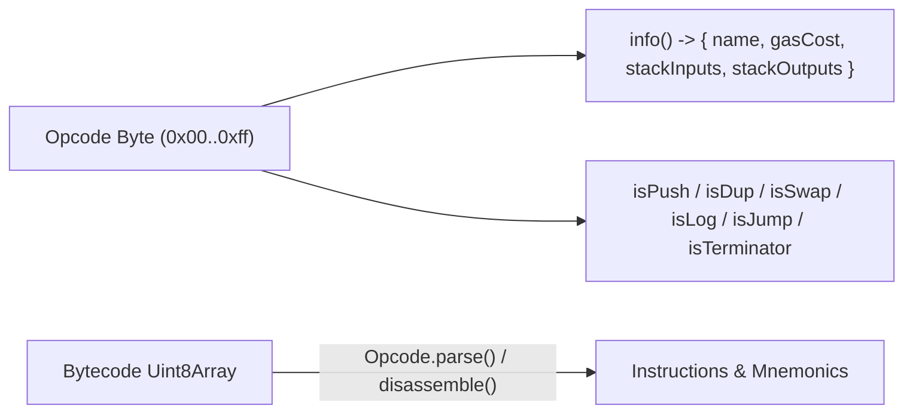

`Opcode` (`BrandedOpcode`) defines every EVM instruction byte from `STOP` (`0x00`) through `SELFDESTRUCT` (`0xff`), including post-Cancun opcodes (`PUSH0`, `TLOAD`, `TSTORE`, `MCOPY`, `BLOBHASH`, `BLOBBASEFEE`), along with stack I/O tables, base gas costs, push-size queries, and bytecode disassembly.



## Quick Start

```typescript
import { Opcode } from '@tevm/voltaire';

Opcode.ADD;                  // 0x01
Opcode.PUSH1;                // 0x60
Opcode.MCOPY;                // 0x5e
Opcode.TSTORE;               // 0x5d

Opcode.getName(Opcode.SSTORE);        // "SSTORE"
Opcode.getGasCost(Opcode.ADD);        // 3
Opcode.getStackInput(Opcode.ADD);     // 2
Opcode.getStackOutput(Opcode.ADD);    // 1
Opcode.getStackEffect(Opcode.ADD);    // -1
Opcode.getPushSize(Opcode.PUSH32);    // 32

// Disassemble raw bytecode
const lines = Opcode.disassemble(new Uint8Array([0x60, 0x01, 0x60, 0x02, 0x01, 0x00]));
// ["0000: PUSH1 0x01", "0002: PUSH1 0x02", "0004: ADD", "0005: STOP"]
```

Import from `@tevm/voltaire` or `@tevm/voltaire/Opcode`.

## Opcode Range Map

| Range | Group | Examples |
| --- | --- | --- |
| `0x00`–`0x0b` | Stop & Arithmetic | `STOP`, `ADD`, `MUL`, `SUB`, `DIV`, `SDIV`, `MOD`, `SMOD`, `ADDMOD`, `MULMOD`, `EXP`, `SIGNEXTEND` |
| `0x10`–`0x1d` | Comparison & Bitwise | `LT`, `GT`, `SLT`, `SGT`, `EQ`, `ISZERO`, `AND`, `OR`, `XOR`, `NOT`, `BYTE`, `SHL`, `SHR`, `SAR` |
| `0x20` | Keccak | `KECCAK256` |
| `0x30`–`0x3f` | Environment | `ADDRESS`, `BALANCE`, `CALLER`, `CALLDATALOAD`, `EXTCODECOPY`, `RETURNDATASIZE`, `EXTCODEHASH` |
| `0x40`–`0x4a` | Block Context | `BLOCKHASH`, `TIMESTAMP`, `PREVRANDAO`, `CHAINID`, `BASEFEE`, `BLOBHASH`, `BLOBBASEFEE` |
| `0x50`–`0x5f` | Stack, Memory & Storage | `POP`, `MLOAD`, `MSTORE`, `SLOAD`, `SSTORE`, `JUMP`, `JUMPI`, `JUMPDEST`, `TLOAD`, `TSTORE`, `MCOPY`, `PUSH0` |
| `0x60`–`0x7f` | Push Immediate | `PUSH1` (`0x60`) .. `PUSH32` (`0x7f`) |
| `0x80`–`0x8f` | Duplicate | `DUP1` (`0x80`) .. `DUP16` (`0x8f`) |
| `0x90`–`0x9f` | Swap | `SWAP1` (`0x90`) .. `SWAP16` (`0x9f`) |
| `0xa0`–`0xa4` | Logging | `LOG0` .. `LOG4` |
| `0xf0`–`0xff` | System & Halting | `CREATE`, `CALL`, `CALLCODE`, `RETURN`, `DELEGATECALL`, `CREATE2`, `STATICCALL`, `REVERT`, `INVALID`, `SELFDESTRUCT` |

## API Reference

| Category | Methods |
| --- | --- |
| Metadata | `info(op)`, `getName(op)` / `name(op)`, `getCategory(op)`, `getDescription(op)`, `getGasCost(op)`, `getStackInput(op)`, `getStackOutput(op)`, `getStackEffect(op)` |
| Predicates | `isValid(op)` / `isValidOpcode(op)`, `isPush(op)`, `isDup(op)`, `isSwap(op)`, `isLog(op)`, `isJump(op)`, `isJumpDestination(op)`, `isTerminator(op)` / `isTerminating(op)` |
| Immediate & Index Helpers | `getPushSize(op)` / `pushBytes(op)`, `pushOpcode(n)`, `dupPosition(op)`, `swapPosition(op)`, `logTopics(op)` |
| Bytecode Parsing | `parse(bytes)`, `disassemble(bytes)`, `format(inst)`, `jumpDests(bytes)`, `isValidJumpDest(bytes, offset)` |

## Related

- [Bytecode](/primitives/bytecode) — CFG basic-block, stack, and gas analysis
- [GasConstants](/primitives/gasconstants) — Dynamic and hardfork-specific gas formulas
- [Hardfork](/primitives/hardfork) — Which fork introduced each opcode
