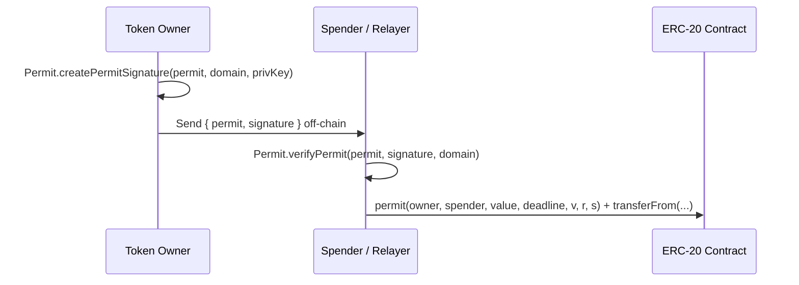

`Permit` implements EIP-2612 off-chain ERC-20 `permit(owner, spender, value, deadline, v, r, s)` signatures over EIP-712 typed data, enabling single-transaction approvals and meta-transaction relays without a prior `approve` call.



## Quick Start

```typescript
import { Address, Permit, Uint256 } from '@tevm/voltaire';
import { PrivateKey } from '@tevm/voltaire/PrivateKey';

const privateKey = PrivateKey.from('0x' + '11'.repeat(32));
const owner = Address.fromPrivateKey(privateKey);

const permit: Permit.PermitType = {
  owner,
  spender: Address('0x742d35cc6634c0532925a3b844bc9e7595f0beb0'),
  value: Uint256.from(1_000_000n),
  nonce: Uint256.from(0n),
  deadline: Uint256.from(1_900_000_000n),
};

const domain: Permit.PermitDomainType = {
  name: 'USD Coin',
  version: '2',
  chainId: 1 as any,
  verifyingContract: Address('0xa0b86991c6218b36c1d19d4a2e9eb0ce3606eb48'),
};

const signature = Permit.createPermitSignature(permit, domain, privateKey);
const isValid = Permit.verifyPermit(permit, signature, domain); // true
```

Import `Permit` from `@tevm/voltaire`.

## Types & EIP-712 Schema

### `PermitType`

| Field | Solidity Type | TypeScript Type |
| --- | --- | --- |
| `owner` | `address` | `AddressType` |
| `spender` | `address` | `AddressType` |
| `value` | `uint256` | `Uint256Type` |
| `nonce` | `uint256` | `Uint256Type` |
| `deadline` | `uint256` | `Uint256Type` |

### `PermitDomainType`

| Field | Type | Description |
| --- | --- | --- |
| `name` | `string` | Token `name()` used in contract's `DOMAIN_SEPARATOR` |
| `version` | `string` | Contract EIP-712 version (commonly `"1"` or `"2"`) |
| `chainId` | `ChainIdType` | Target chain ID (prevents cross-chain replay) |
| `verifyingContract` | `AddressType` | ERC-20 token contract address |

## API Reference

| Export | Signature | Description |
| --- | --- | --- |
| `Permit.PERMIT_TYPES` | `readonly` EIP-712 `Permit` type definition | Primary type schema for `EIP712.signTypedData` |
| `Permit.createPermitSignature` | `(permit: PermitType, domain: PermitDomainType, privateKey: Uint8Array) => Uint8Array` | Sign EIP-2612 permit with EIP-712 |
| `Permit.verifyPermit` | `(permit: PermitType, signature: Uint8Array, domain: PermitDomainType) => boolean` | Recover EIP-712 signer and verify equality with `permit.owner` |
| `Permit.KnownTokens` | Pre-configured EIP-712 domains for major mainnet tokens (e.g., USDC, DAI) |

## Security Notes

- Always verify `block.timestamp <= deadline` on-chain and query `token.nonces(owner)` live before signing; stale nonces invalidate permits silently.
- Tokens like DAI implement a non-standard `bool allowed` permit layout rather than EIP-2612's `uint256 value`. Verify contract ABI before submitting.

## Related

- [EIP-712](/crypto/eip712) — Generic structured typed-data hashing and recovery
- [Signature](/primitives/signature) — Splitting `(v, r, s)` for Solidity `permit()` calls
- [Address](/primitives/address) — Account and verifying contract addresses
