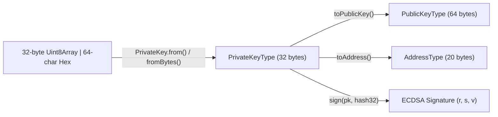

`PrivateKey` (`PrivateKeyType`) is a branded 32-byte `Uint8Array` representing a valid secp256k1 scalar $k \in [1, N - 1]$ for deriving uncompressed public keys, 20-byte Ethereum addresses, and signing 32-byte digests.



## Quick Start

```typescript
import { Hash } from '@tevm/voltaire';
import { PrivateKey } from '@tevm/voltaire/PrivateKey';

const hexKey = '0x' + '11'.repeat(32);
const pk = PrivateKey.from(hexKey);          // Branded 32-byte Uint8Array

const pubKey = PrivateKey.toPublicKey(hexKey); // 64-byte uncompressed PublicKeyType
const address = PrivateKey.toAddress(hexKey);  // 20-byte AddressType

const digest = Hash.keccak256String('hello ethereum');
const signature = PrivateKey.sign(hexKey, digest);
```

Import from `@tevm/voltaire/PrivateKey`.

## Valid Scalar Range

| Property | Value |
| --- | --- |
| Byte width | `32` bytes (`256` bits) |
| Lower bound | `1` (all-zero key is invalid) |
| Upper bound | $N - 1$, where $N = \text{0xfffffffffffffffffffffffffffffffebaaedce6af48a03bbfd25e8cd0364141}$ |

## API Reference

| Method | Signature | Description |
| --- | --- | --- |
| `PrivateKey.from` | `(value: string \| Uint8Array) => PrivateKeyType` | Parse 32-byte hex string or `Uint8Array` and validate scalar range |
| `PrivateKey.fromBytes` | `(bytes: Uint8Array) => PrivateKeyType` | Construct from exact 32-byte `Uint8Array` |
| `PrivateKey.toHex` | `(privateKey: string) => string` | Normalize to lowercase `0x`-prefixed 66-char hex |
| `PrivateKey.toPublicKey` | `(privateKey: string) => PublicKeyType` | Derive 64-byte uncompressed secp256k1 public key |
| `PrivateKey.toAddress` | `(privateKey: string) => AddressType` | Derive 20-byte Ethereum address (`keccak256(pubKey)[12:32]`) |
| `PrivateKey.sign` | `(privateKey: string, hash: HashType) => Signature` | Sign 32-byte digest with RFC 6979 deterministic secp256k1 ECDSA |

Tree-shakeable low-level exports from `@tevm/voltaire/PrivateKey`: `Sign({ secp256k1Sign })`, `_toHex`, `_toPublicKey`, `_toAddress`, `_sign` (operate directly on `PrivateKeyType` byte buffers).

<Warning>
Never log, serialize to client storage, or commit private keys. Zero out sensitive `Uint8Array` buffers (`pk.fill(0)`) once signing completes in long-lived server processes.
</Warning>

## Related

- [PublicKey](/primitives/public-key) — 64-byte uncompressed and 33-byte compressed secp256k1 public keys
- [Signature](/primitives/signature) — Signature serialization and EIP-2 low-`s` canonicalization
- [HDWallet](/crypto/hdwallet) — BIP-32/BIP-44 hierarchical key derivation
- [Keystore](/crypto/keystore) — Encrypted Web3 Secret Storage v3 keyfiles
