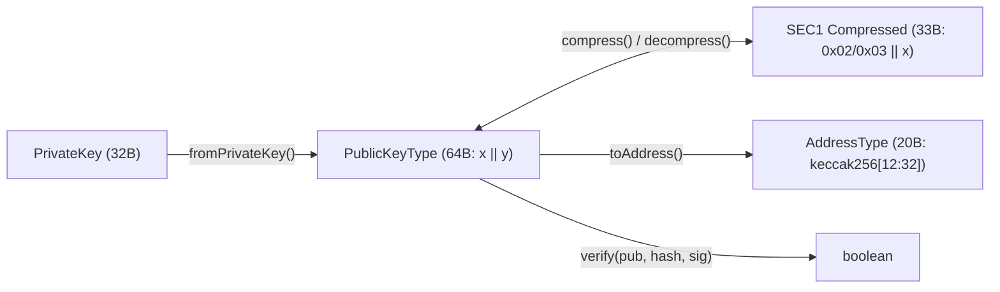

`PublicKey` (`PublicKeyType`) is a branded 64-byte `Uint8Array` storing an uncompressed secp256k1 affine point $(x, y)$ without the `0x04` prefix, supporting SEC1 33-byte compression/decompression, Ethereum address derivation, and ECDSA verification.



## Key Formats

| Format | Length | Prefix | Layout |
| --- | --- | --- | --- |
| Ethereum uncompressed (`PublicKeyType`) | `64` bytes | None | `x (32B BE) \|\| y (32B BE)` |
| SEC1 uncompressed (accepted on input) | `65` bytes | `0x04` | `0x04 \|\| x (32B) \|\| y (32B)` |
| SEC1 compressed | `33` bytes | `0x02` (even `y`) or `0x03` (odd `y`) | `prefix (1B) \|\| x (32B)` |

Decompression recovers $y = \pm \sqrt{x^3 + 7} \pmod p$ and selects the root whose least-significant bit matches the `0x02`/`0x03` parity prefix.

## Quick Start

```typescript
import { PublicKey } from '@tevm/voltaire/PublicKey';
import { PrivateKey } from '@tevm/voltaire/PrivateKey';

const priv = PrivateKey.from('0x' + '11'.repeat(32));
const pub = PublicKey.fromPrivateKey(priv); // 64 bytes

const compressed = PublicKey.compress(pub);       // 33 bytes (0x02 or 0x03 prefix)
PublicKey.isCompressed(compressed);               // true

const restored = PublicKey.decompress(compressed); // 64 bytes
const hex = PublicKey.toHex('0x' + Buffer.from(pub).toString('hex'));
const address = PublicKey.toAddress(hex);
```

Import from `@tevm/voltaire/PublicKey`.

## API Reference

| Method | Signature | Description |
| --- | --- | --- |
| `PublicKey.from` | `(value: string \| Uint8Array) => PublicKeyType` | Parse 64-byte uncompressed (or 65-byte `0x04`-prefixed) key |
| `PublicKey.fromPrivateKey` | `(privateKey: PrivateKeyType) => PublicKeyType` | Compute $k \cdot G$ on secp256k1 |
| `PublicKey.compress` | `(publicKey: string \| Uint8Array) => Uint8Array` | Compress 64-byte key to 33-byte SEC1 format |
| `PublicKey.decompress` | `(compressed: Uint8Array) => PublicKeyType` | Decompress 33-byte SEC1 key to 64-byte uncompressed point |
| `PublicKey.isCompressed` | `(bytes: Uint8Array) => boolean` | Return `true` iff length is `33` and byte `0` is `0x02` or `0x03` |
| `PublicKey.toHex` | `(publicKey: string) => string` | Lowercase `0x`-prefixed 128-nibble hex |
| `PublicKey.toAddress` | `(publicKey: string) => AddressType` | Derive 20-byte Ethereum address (`keccak256(pubKey)[12:32]`) |
| `PublicKey.verify` | `(publicKey, hash, signature) => boolean` | Verify secp256k1 signature against 32-byte digest |

Tree-shakeable exports from `@tevm/voltaire/PublicKey`: `Verify({ secp256k1Verify })`, `_toHex`, `_toAddress`, `_verify`, `_compress`, `_decompress`, `_isCompressed`.

## Related

- [PrivateKey](/primitives/private-key) — 32-byte secp256k1 signing keys
- [Address](/primitives/address) — 20-byte accounts derived from uncompressed public keys
- [StealthAddress](/primitives/stealthaddress) — ERC-5564 compressed spending/viewing public keys
