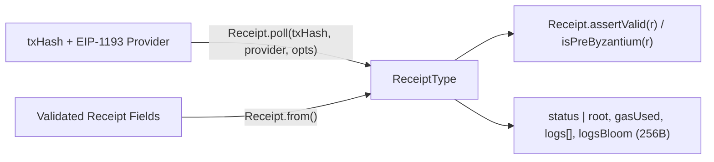

`Receipt` (`ReceiptType`) represents the post-execution outcome of an Ethereum transaction: execution status (or pre-Byzantium state root), cumulative and per-transaction gas used, effective gas price, created contract address, emitted `EventLog` entries, and the 256-byte `logsBloom` filter.



## Quick Start

```typescript
import { Receipt } from '@tevm/voltaire';

// Poll an EIP-1193 provider until confirmed with 2 block confirmations
const receipt = await Receipt.poll(txHash, provider, {
  interval: 1000,
  timeout: 120_000,
  confirmations: 2,
});

Receipt.assertValid(receipt);

if (!Receipt.isPreByzantium(receipt)) {
  // Post-Byzantium receipts carry `status` (1 = success, 0 = revert)
  console.log(receipt.status, receipt.gasUsed, receipt.logs.length);
}
```

Import `Receipt` from `@tevm/voltaire`.

## Structure

| Field | Type | Notes |
| --- | --- | --- |
| `transactionHash` | `TransactionHashType` | 32-byte transaction hash |
| `transactionIndex` | `TransactionIndexType` | Index within block |
| `blockHash` / `blockNumber` | `BlockHashType` / `BlockNumberType` | Including block |
| `from` / `to` | `AddressType` / `AddressType \| null` | `to` is `null` on contract deployment |
| `contractAddress` | `AddressType \| null` | Deployed contract address when `to === null` |
| `cumulativeGasUsed` | `Uint256Type` | Total gas used in block up to and including this tx |
| `gasUsed` | `Uint256Type` | Gas consumed by this transaction alone |
| `effectiveGasPrice` | `Uint256Type` | Actual wei per gas paid |
| `logs` | `readonly EventLogType[]` | Ordered execution logs |
| `logsBloom` | `Uint8Array` | 256-byte (2048-bit) bloom filter of `logs` |
| `status` | `TransactionStatusType \| undefined` | Post-Byzantium (EIP-658): `1` success, `0` revert |
| `root` | `HashType \| undefined` | Pre-Byzantium intermediate state root (mutually exclusive with `status`) |
| `type` | `'legacy' \| 'eip2930' \| 'eip1559' \| 'eip4844' \| 'eip7702'` | Transaction envelope type |
| `blobGasUsed` / `blobGasPrice` | `Uint256Type \| undefined` | Present on EIP-4844 blob transactions |

## API Reference

| Method | Signature | Description |
| --- | --- | --- |
| `Receipt.from` | `(value: ReceiptLike) => ReceiptType` | Validate and brand a receipt object |
| `Receipt.assertValid` | `(receipt: ReceiptType) => void` | Assert invariants (`logsBloom` is 256 bytes, `status` XOR `root`, `gasUsed <= cumulativeGasUsed`) |
| `Receipt.isPreByzantium` | `(receipt: ReceiptType) => boolean` | True when receipt carries `root` instead of `status` |
| `Receipt.poll` | `(txHash: string, provider, options?: { interval?; timeout?; confirmations? }) => Promise<ReceiptType>` | Poll `eth_getTransactionReceipt` until mined and confirmed |

## Related

- [Transaction](/primitives/transaction) — Input transactions producing receipts
- [EventLog](/primitives/eventlog) — Individual entries in `receipt.logs`
- [BloomFilter](/primitives/bloomfilter) — 256-byte `logsBloom` structure
