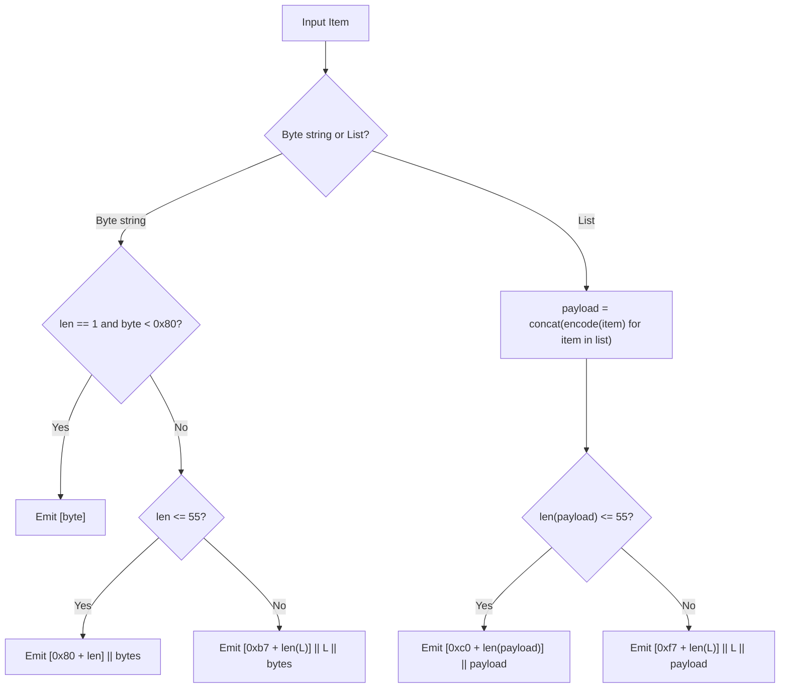

Recursive Length Prefix (RLP), defined in Appendix B of the Ethereum Yellow Paper, serializes arbitrarily nested arrays of binary data. RLP encodes **structure only** — it carries no type tags for integers, strings, or booleans. Higher-level protocols (transactions, block headers, trie nodes) define how each byte string is interpreted.

## Encoding Decision Tree



Where `L` is the minimal big-endian byte representation of the byte length with **no leading zero bytes**.

## Integer Encoding Convention

Ethereum encodes unsigned integers in RLP as minimal big-endian byte strings:

| Integer | Byte Representation | RLP Output |
| --- | --- | --- |
| `0` | `[]` (empty — **never** `[0x00]`) | `0x80` |
| `1` | `[0x01]` | `0x01` |
| `127` | `[0x7f]` | `0x7f` |
| `128` | `[0x80]` | `0x81 0x80` |
| `256` | `[0x01, 0x00]` | `0x82 0x01 0x00` |
| `1024` | `[0x04, 0x00]` | `0x82 0x04 0x00` |

Encoding `0` as `[0x00]` produces `0x00` instead of `0x80`, which changes transaction hashes and `CREATE` addresses.

## Canonical Decoding Rules

Consensus hashes (block hashes, transaction hashes, state roots) require a unique byte encoding for every structure. A decoder must reject all four non-canonical forms:

1. **Over-encoded single byte:** `[0x81, 0x05]` must be rejected because `0x05 < 0x80` must encode as `[0x05]`.
2. **Long prefix for short payload:** `[0xb8, 0x02, 0xaa, 0xbb]` must be rejected because length `2 <= 55` must use `[0x82, 0xaa, 0xbb]`.
3. **Leading zero in length:** `[0xb9, 0x00, 0x38, ...]` must be rejected because length `56` (`0x38`) requires 1 length byte (`0xb8 0x38`), not 2.
4. **Trailing garbage:** Non-stream decoding rejects extra bytes after the root item finishes.

```typescript
import { Rlp } from '@tevm/voltaire';

// Canonical single byte 0x7f
Rlp.isCanonical(new Uint8Array([0x7f]));       // true
// Non-canonical: 0x7f wrapped in short-string header 0x81
Rlp.isCanonical(new Uint8Array([0x81, 0x7f])); // false
```

## Where Ethereum Uses RLP

- **Legacy & EIP-2718 Transactions:** Typed transactions prefix a 1-byte type discriminator (`0x01`, `0x02`, `0x03`, `0x04`) before an RLP list of transaction fields.
- **Block Headers & Bodies:** Block hash is `keccak256(rlp(headerFields))`.
- **`CREATE` Contract Address:** `keccak256(rlp([sender, nonce]))[12:32]`.
- **Merkle Patricia Trie Nodes:** Branch, extension, and leaf nodes serialize as RLP lists; nodes `< 32` bytes embed inline, nodes `>= 32` bytes embed by `keccak256(rlp(node))`.

## Related

- [RLP Reference](/primitives/rlp) — Complete encoding/decoding API
- [SSZ](/primitives/ssz) — Consensus-layer fixed-offset alternative to RLP
- [Transaction](/primitives/transaction) — RLP-serialized Ethereum transactions
