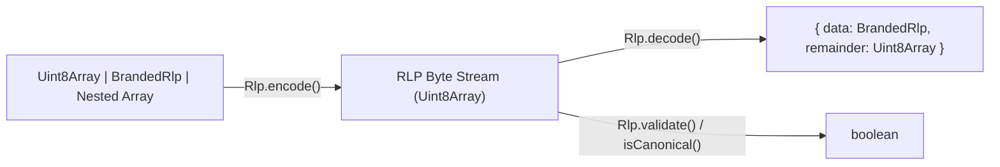

`Rlp` implements Ethereum's Recursive Length Prefix (RLP) serialization over two recursive primitives: byte strings (`Uint8Array`) and nested lists (`BrandedRlp[]`). Decoding enforces Ethereum Yellow Paper canonicality rules, rejecting non-minimal lengths and leading zero length bytes.



## Quick Start

```typescript
import { Rlp } from '@tevm/voltaire';

// Encode a byte string
const bytes = Rlp.encode(new Uint8Array([0x01, 0x02, 0x03]));
// Uint8Array([0x83, 0x01, 0x02, 0x03])

// Encode nested lists (e.g., [sender, nonce])
const list = Rlp.encode([
  new Uint8Array([0xde, 0xad]),
  new Uint8Array([]), // empty bytes -> 0x80 (integer 0 in RLP)
]);

// Decode back to structured BrandedRlp
const { data, remainder } = Rlp.decode(list);
// data = { type: 'list', value: [{ type: 'bytes', value: ... }, ...] }
// remainder.length === 0
```

Import from `@tevm/voltaire` or `@tevm/voltaire/Rlp`.

## Prefix Byte Ranges

| First Byte | Kind | Payload Length |
| --- | --- | --- |
| `0x00`–`0x7f` | Single byte | `1` byte (the byte itself) |
| `0x80`–`0xb7` | Short string | `byte - 0x80` (`0`–`55` bytes; `0x80` is empty bytes) |
| `0xb8`–`0xbf` | Long string | Next `byte - 0xb7` bytes (`1`–`8` bytes) give big-endian length (`>= 56`) |
| `0xc0`–`0xf7` | Short list | `byte - 0xc0` (`0`–`55` payload bytes; `0xc0` is empty list) |
| `0xf8`–`0xff` | Long list | Next `byte - 0xf7` bytes (`1`–`8` bytes) give big-endian payload length (`>= 56`) |

## Representation

```typescript
type BrandedRlp =
  | { type: 'bytes'; value: Uint8Array }
  | { type: 'list'; value: BrandedRlp[] };

type Encodable = Uint8Array | BrandedRlp | Encodable[];
```

## API Reference

### Encoding

| Method | Signature | Description |
| --- | --- | --- |
| `Rlp` / `Rlp.from` | `(value: Uint8Array \| BrandedRlp \| BrandedRlp[]) => BrandedRlp` | Construct tagged `BrandedRlp` tree |
| `Rlp.encode` | `(input: Encodable) => Uint8Array` | Encode bytes, lists, or `BrandedRlp` recursively |
| `Rlp.encodeBytes` | `(bytes: Uint8Array) => Uint8Array` | Encode a single byte string |
| `Rlp.encodeList` | `(items: readonly Encodable[]) => Uint8Array` | Encode a list of encodable items |
| `Rlp.encodeArray` | `(items: readonly Encodable[]) => Uint8Array` | Encode array as RLP list |
| `Rlp.encodeObject` | `(obj: Record<string, Encodable>) => Uint8Array` | Encode object key-value entries |
| `Rlp.encodeVariadic` | `(...items: Encodable[]) => Uint8Array` | Encode variadic arguments as a list |
| `Rlp.encodeBatch` | `(items: readonly Encodable[]) => Uint8Array[]` | Batch encode multiple top-level items |
| `Rlp.getEncodedLength` | `(input: Encodable) => number` | Compute exact output byte size without allocating payload |

### Decoding & Inspection

| Method | Signature | Description |
| --- | --- | --- |
| `Rlp.decode` | `(bytes: Uint8Array, stream?: boolean) => { data: BrandedRlp; remainder: Uint8Array }` | Decode RLP stream; rejects trailing bytes unless `stream = true` |
| `Rlp.decodeValue` | `(bytes: Uint8Array) => BrandedRlp` | Decode single complete RLP value |
| `Rlp.decodeArray` | `(bytes: Uint8Array) => BrandedRlp[]` | Decode top-level RLP list |
| `Rlp.decodeObject` | `(bytes: Uint8Array) => Record<string, Uint8Array>` | Decode RLP-encoded key-value map |
| `Rlp.decodeBatch` | `(items: readonly Uint8Array[]) => BrandedRlp[]` | Batch decode byte arrays |
| `Rlp.validate` | `(bytes: Uint8Array) => boolean` | Check whether bytes are valid canonical RLP |
| `Rlp.isCanonical` | `(bytes: Uint8Array) => boolean` | Verify minimal length prefixing and zero-free lengths |
| `Rlp.getLength` | `(bytes: Uint8Array) => number` | Read total encoded byte length from prefix |
| `Rlp.isList` / `Rlp.isString` | `(bytes: Uint8Array) => boolean` | Inspect prefix byte category |
| `Rlp.isData` / `Rlp.isBytesData` / `Rlp.isListData` | `(value: unknown) => boolean` | Type guards for `BrandedRlp` |
| `Rlp.flatten` | `(data: BrandedRlp) => BrandedRlp[]` | Flatten nested list into leaf byte nodes |
| `Rlp.equals` | `(a: BrandedRlp, b: BrandedRlp) => boolean` | Deep structural equality |
| `Rlp.toRaw` / `Rlp.toJSON` / `Rlp.fromJSON` | Convert between `BrandedRlp`, raw nested arrays, and JSON |

## Errors & Canonicality Checks

Encoding throws `RlpEncodingError`; decoding throws `RlpDecodingError` on:
- Truncated input (`InputTooShort`) or unexpected trailing bytes (`InvalidRemainder`)
- Single byte `< 0x80` wrapped with `0x81` prefix (`NonCanonicalSize`)
- Long prefix used for length `< 56` (`NonCanonicalSize`)
- Leading `0x00` byte in multi-byte length field (`LeadingZeros`)
- Nesting exceeding maximum recursion depth (`RecursionDepthExceeded`)

## Related

- [RLP Fundamentals](/primitives/rlp/fundamentals) — Yellow Paper specification and integer encoding rules
- [Transaction](/primitives/transaction) — EIP-2718 typed transactions wrapping RLP payloads
- [Trie](/primitives/trie) — Merkle Patricia Trie nodes encoded in RLP
