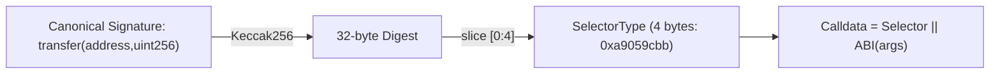

`Selector` (`SelectorType`) is a branded 4-byte `Uint8Array` (`length === 4`) representing the first 4 bytes of `keccak256(canonicalSignature)` used to dispatch EVM contract calls and identify custom revert errors.



## Quick Start

```typescript
import { Selector } from '@tevm/voltaire';

const transfer = Selector.fromSignature('transfer(address,uint256)');
Selector.toHex(transfer); // "0xa9059cbb"

const fromHex = Selector.fromHex('0xa9059cbb');
Selector.equals(transfer, fromHex); // true

// Standard revert selectors
const errSel = Selector.fromSignature('Error(string)'); // 0x08c379a0
const panicSel = Selector.fromSignature('Panic(uint256)'); // 0x4e487b71
```

Import `Selector` from `@tevm/voltaire`.

## Layout & Constant

| Property | Value |
| --- | --- |
| Byte length | `4` (`Selector.SIZE` / `SIZE = 4`) |
| Hex length | `10` chars (`0x` + 8 hex digits) |
| Collision space | $2^{32}$ (~4.29 billion values; birthday bound $\approx 2^{16}$) |

## API Reference

| Method | Signature | Description |
| --- | --- | --- |
| `Selector.from` | `(value: SelectorType \| string \| Uint8Array) => SelectorType` | Construct from 4-byte `Uint8Array` or 8-nibble `0x` hex string |
| `Selector.fromHex` | `(hex: string) => SelectorType` | Parse `0x`-prefixed 4-byte hex string |
| `Selector.fromSignature` | `(signature: string) => SelectorType` | Compute `keccak256(utf8(signature))[0:4]` |
| `Selector.toHex` | `(selector: SelectorType) => string` | Lowercase `0x`-prefixed 10-char hex string |
| `Selector.equals` | `(a: SelectorType, b: SelectorType) => boolean` | Byte-wise 4-byte equality |

## Edge Cases

- `fromSignature` hashes the string verbatim: use canonical Solidity types without spaces or names (`uint256`, not `uint`; `transfer(address,uint256)`, not `transfer(address to, uint256 amount)`).
- `from` and `fromHex` throw `InvalidLengthError` when byte length is not `4`.

## Related

- [ABI](/primitives/abi) — Full calldata encoding, decoding, and `hasSelectorCollisions`
- [ABI Fundamentals](/primitives/abi/fundamentals) — Canonical signature rules
- [Bytes](/primitives/bytes) — General fixed-width byte types (`Bytes4`)
