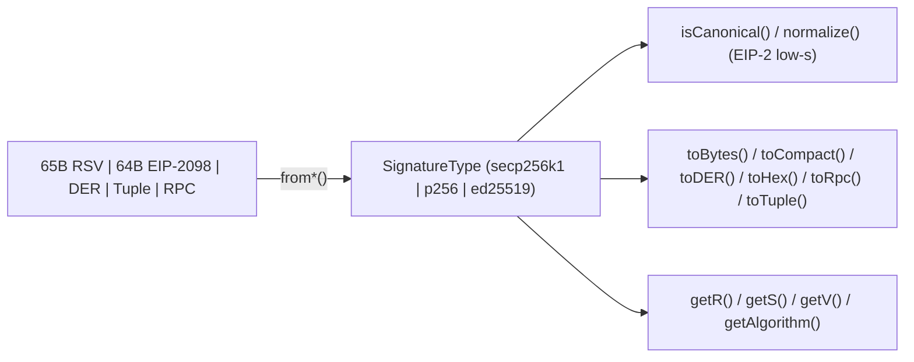

`Signature` (`SignatureType`) is a branded cryptographic signature supporting `secp256k1`, `p256` (secp256r1 / WebAuthn), and `ed25519`, with lossless conversion across 65-byte `(r, s, v)`, EIP-2098 64-byte compact `(r, vs)`, ASN.1 DER, hex, and RPC tuple formats, plus EIP-2 low-`s` canonicalization.



## Wire Formats (secp256k1)

| Format | Length | Layout | Standard |
| --- | --- | --- | --- |
| Standard RSV | `65` bytes | `r (32B) \|\| s (32B) \|\| v (1B: 27/28 or 0/1)` | Ethereum RPC / `ecrecover` |
| Compact (EIP-2098) | `64` bytes | `r (32B) \|\| ((yParity << 255) \| s) (32B)` | EIP-2098 (requires low-`s`) |
| ASN.1 DER | `70`–`72` bytes | `0x30 len 0x02 rLen r 0x02 sLen s` | X.690 / WebAuthn / OpenSSL |

## Quick Start

```typescript
import { Signature } from '@tevm/voltaire';

const sig = Signature.fromSecp256k1(rBytes, sBytes, 27);

// Check and enforce EIP-2 low-s malleability protection
if (!Signature.isCanonical(sig)) {
  const canonical = Signature.normalize(sig);
  Signature.isCanonical(canonical); // true
}

// Convert between 65-byte RSV, 64-byte EIP-2098 compact, and DER
const compact = Signature.toCompact(sig); // 64 bytes
const restored = Signature.fromCompact(compact, 'secp256k1');
const der = Signature.toDER(sig);
const hex = Signature.toHex(sig);
```

Import from `@tevm/voltaire` or `@tevm/voltaire/Signature`.

## API Reference

| Category | Methods | Description |
| --- | --- | --- |
| Constructors | `from`, `fromBytes`, `fromHex`, `fromSecp256k1(r, s, v)`, `fromP256(r, s)`, `fromEd25519(sig)`, `fromCompact(bytes, algo)`, `fromDER(der, algo)`, `fromRpc(rpc)`, `fromTuple(tuple)` | Construct validated `SignatureType` |
| Serialization | `toBytes`, `toCompact`, `toDER`, `toHex`, `toRpc`, `toTuple` | Convert to wire or JSON-RPC formats |
| Components | `getAlgorithm`, `getR`, `getS`, `getV` | Read algorithm tag and `(r, s, v)` components |
| Malleability & Verification | `isCanonical(sig)`, `normalize(sig)`, `verify(sig, messageHash, publicKey)` | EIP-2 low-`s` check, normalization ($s' = N - s$, flip $v$), and verification |
| Guards & Equality | `is`, `isSignature`, `equals` | Runtime type guards and constant-length equality |

## Malleability Rule (EIP-2)

Every ECDSA signature $(r, s, v)$ on secp256k1 has a twin $(r, N - s, v \oplus 1)$ that verifies against the same digest and key. Ethereum rejects high-`s` signatures ($s > N/2$) in transactions and EIP-7702 authorizations. `Signature.normalize` maps any high-`s` signature to its unique low-`s` canonical form.

## Related

- [PrivateKey](/primitives/private-key) — 32-byte signing keys
- [PublicKey](/primitives/public-key) — 64-byte / 33-byte verification keys
- [Secp256k1](/crypto/secp256k1) — Low-level elliptic curve signing and recovery
