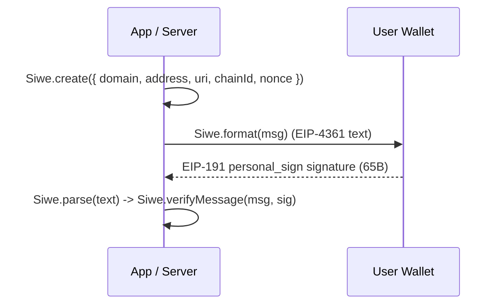

`Siwe` (`SiweMessageType`) implements EIP-4361 (Sign-In with Ethereum): structured message creation, strict ABNF parsing and serialization, temporal window validation (`expirationTime`, `notBefore`), EIP-191 message hashing, and secp256k1 signer verification.



## Quick Start

```typescript
import { Address, Siwe } from '@tevm/voltaire';

const msg = Siwe({
  domain: 'app.example.com',
  address: Address('0x742d35cc6634c0532925a3b844bc9e7595f0beb0'),
  statement: 'Sign in to Example App.',
  uri: 'https://app.example.com/login',
  chainId: 1,
  nonce: Siwe.generateNonce(),
  expirationTime: new Date(Date.now() + 10 * 60_000).toISOString(),
});

const text = msg.format();         // EIP-4361 plaintext for wallet signing
const parsed = Siwe.parse(text);   // Round-trip parse
const hash = msg.getMessageHash(); // EIP-191 keccak256("\x19Ethereum Signed Message:\n" + len + text)

// Validate temporal & field constraints, plus cryptographic signature
const result = Siwe.verifyMessage(parsed, signature);
if (result.valid) {
  // Authenticated session
}
```

Import from `@tevm/voltaire` or `@tevm/voltaire/Siwe`.

## EIP-4361 Message Fields

| Field | Required | Format / Rule |
| --- | --- | --- |
| `domain` | Yes | RFC 3986 authority (`app.example.com`) |
| `address` | Yes | `AddressType` (formatted EIP-55 checksummed in wire text) |
| `uri` | Yes | RFC 3986 URI |
| `version` | Auto (`"1"`) | Must equal `"1"` |
| `chainId` | Yes | EIP-155 positive integer chain ID |
| `nonce` | Auto | $\ge 8$ alphanumeric chars (generated via `Siwe.generateNonce()`) |
| `issuedAt` | Auto | RFC 3339 ISO-8601 timestamp |
| `statement` | No | Single-line human-readable assertion (no newlines) |
| `expirationTime` / `notBefore` | No | RFC 3339 timestamps checked by `validate` / `verifyMessage` |
| `requestId` | No | Application-specific correlation ID |
| `resources` | No | Array of RFC 3986 URIs |

## API Reference

| Method | Signature | Description |
| --- | --- | --- |
| `Siwe` / `Siwe.create` | `(params: CreateParams) => SiweMessageType` | Construct message with auto `version: "1"`, `nonce`, and `issuedAt` |
| `Siwe.parse` | `(text: string) => SiweMessageType` | Parse EIP-4361 message string; throws `SiweParseError` on malformed input |
| `Siwe.format` | `(msg: SiweMessageType) => string` | Serialize message into canonical EIP-4361 signing text |
| `Siwe.generateNonce` | `(length?: number) => string` | Generate cryptographically random alphanumeric nonce (`>= 8` chars) |
| `Siwe.getMessageHash` | `(msg: SiweMessageType) => Uint8Array` | Compute EIP-191 `personal_sign` digest |
| `Siwe.validate` | `(msg, options?: { now?: Date }) => ValidationResult` | Validate schema, `nonce`, `notBefore`, and `expirationTime` |
| `Siwe.verify` | `(msg, signature: Signature) => boolean` | Cryptographically verify recovered address matches `msg.address` |
| `Siwe.verifyMessage` | `(msg, signature, options?: { now?: Date }) => ValidationResult` | Run both `validate` and `verify` |

Tree-shakeable factories: `GetMessageHash`, `Verify`, `VerifyMessage`.
Error classes: `SiweParseError`, `InvalidSiweMessageError`, `MissingFieldError`, `InvalidFieldError`, `InvalidNonceLengthError`.

## Related

- [Signature](/primitives/signature) — Signature normalization and encoding
- [Address](/primitives/address) — EIP-55 checksummed addresses in SIWE headers
- [EIP-712](/crypto/eip712) — Structured typed-data signing alternative
