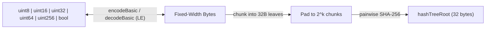

`Ssz` implements Ethereum Consensus Layer Simple Serialize (SSZ) primitives: little-endian fixed-width basic type encoding/decoding and 32-byte chunk SHA-256 `hashTreeRoot` Merkleization.



## Quick Start

```typescript
import { Ssz } from '@tevm/voltaire';

// Little-endian fixed-width encoding
const slotBytes = Ssz.encodeBasic(10_000_000n, 'uint64'); // 8 bytes LE
const slot = Ssz.decodeBasic(slotBytes, 'uint64');       // 10000000n

const flag = Ssz.encodeBasic(true, 'bool');              // Uint8Array([1])
Ssz.decodeBasic(flag, 'bool');                           // true

// Compute 32-byte SHA-256 Merkle root over arbitrary data
const root = await Ssz.hashTreeRoot(new Uint8Array(64)); // 32-byte Uint8Array
```

Import `Ssz` from `@tevm/voltaire`.

## Basic Type Wire Layout

Unlike execution-layer ABI and RLP (big-endian), SSZ encodes all unsigned integers in **little-endian** byte order with fixed widths and no length prefixes:

| Type | Byte Width | Endianness | Return Type on Decode |
| --- | --- | --- | --- |
| `'uint8'` | `1` byte | — | `number` |
| `'uint16'` | `2` bytes | Little-endian | `number` |
| `'uint32'` | `4` bytes | Little-endian | `number` |
| `'uint64'` | `8` bytes | Little-endian | `bigint` |
| `'uint256'` | `32` bytes | Little-endian | `bigint` |
| `'bool'` | `1` byte (`0x00` or `0x01`) | — | `boolean` |

## API Reference

| Method | Signature | Description |
| --- | --- | --- |
| `Ssz.encodeBasic` | `(value: number \| bigint \| boolean, type: BasicType) => Uint8Array` | Encode basic type in SSZ little-endian layout |
| `Ssz.decodeBasic` | `(bytes: Uint8Array, type: BasicType) => number \| bigint \| boolean` | Decode fixed-width SSZ bytes; validates exact length and boolean `0`/`1` |
| `Ssz.hashTreeRoot` | `(data: Uint8Array) => Promise<Uint8Array>` | Partition into 32-byte right-zero-padded chunks, pad leaf count to next power of 2 with zero chunks, hash pairs bottom-up with SHA-256 |

## Edge Cases & Errors

- `encodeBasic` throws `RangeError` for out-of-range or non-integer values on `uint8`, `uint16`, and `uint32`, and `Error` for unsupported type names.
- `decodeBasic` throws `Error` if byte length does not match the type width, or if a `bool` byte is neither `0x00` nor `0x01`.
- `hashTreeRoot(new Uint8Array(0))` returns 32 zero bytes.

## Related

- [RLP](/primitives/rlp) — Execution-layer variable-length serialization
- [SHA256](/crypto/sha256) — Consensus-layer hash function
- [Blob](/primitives/blob) — EIP-4844 consensus/execution data blobs
