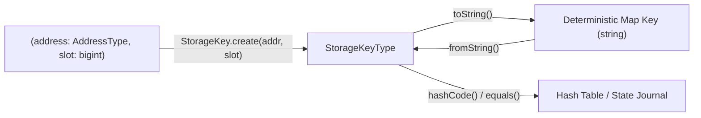

`State` exports the `StorageKey` (`StorageKeyType`) primitive — an immutable composite key pairing a 20-byte contract `AddressType` with a 256-bit `bigint` storage `slot` for state databases, EVM execution journals, and EIP-2929 warm-storage tracking.



## Quick Start

```typescript
import { Address, StorageKey } from '@tevm/voltaire';

const contract = Address('0x742d35cc6634c0532925a3b844bc9e7595f0beb0');
const key = StorageKey.create(contract, 0n);

// Serialize for JavaScript Map / Set lookup
const mapKey = StorageKey.toString(key);
const parsed = StorageKey.fromString(mapKey);

StorageKey.equals(key, parsed!); // true
StorageKey.hashCode(key);        // 32-bit hash integer
```

Import `StorageKey` or `State` from `@tevm/voltaire` or `@tevm/voltaire/State`.

## Structure

| Field | Type | Meaning |
| --- | --- | --- |
| `address` | `AddressType` | 20-byte contract account address |
| `slot` | `bigint` | 256-bit unsigned storage slot index ($0 \le \text{slot} < 2^{256}$) |

## API Reference

| Method | Signature | Description |
| --- | --- | --- |
| `StorageKey.create` | `(address: AddressType, slot: bigint) => StorageKeyType` | Construct composite storage key |
| `StorageKey.from` | `(value: StorageKeyLike) => StorageKeyType` | Normalize `{ address, slot }` or existing `StorageKeyType` |
| `StorageKey.is` | `(value: unknown) => value is StorageKeyType` | Runtime type guard |
| `StorageKey.equals` | `(a: StorageKeyLike, b: StorageKeyLike) => boolean` | Compare both 20-byte address and 256-bit slot |
| `StorageKey.toString` | `(key: StorageKeyLike) => string` | Canonical string key suitable for JS `Map` and `Set` |
| `StorageKey.fromString` | `(str: string) => StorageKeyType \| undefined` | Parse canonical string key back into `StorageKeyType` |
| `StorageKey.hashCode` | `(key: StorageKeyLike) => number` | Fast numeric hash code for custom hash maps |

## Related

- [Trie](/primitives/trie) — Merkle Patricia Trie storing Ethereum account & storage state
- [BinaryTree](/primitives/binarytree) — EIP-7864 unified binary state tree
- [AccessList](/primitives/accesslist) — EIP-2930 pre-warmed `(address, storageKeys)` entries
