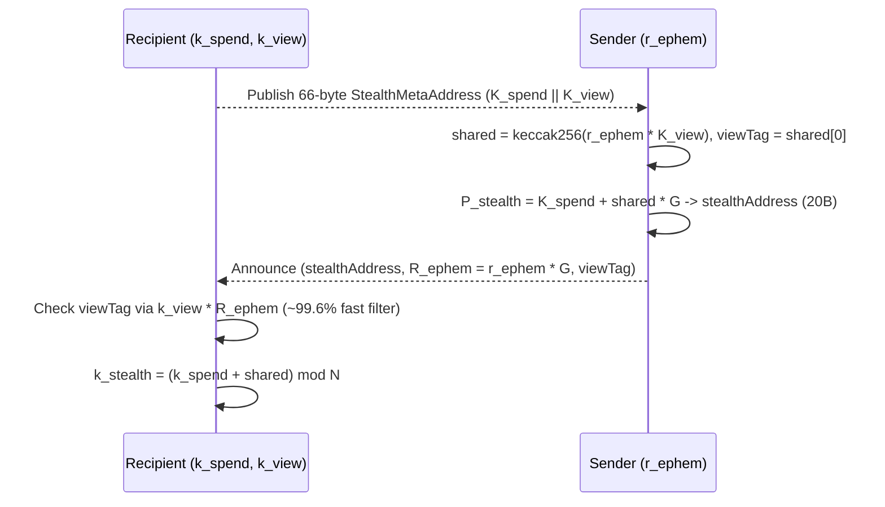

`StealthAddress` implements ERC-5564 (Scheme ID `1`, secp256k1 with view tags): non-interactive stealth address derivation allowing a sender to pay a fresh one-time Ethereum address that only the recipient can detect and spend from.



## Byte Layouts

| Artifact | Byte Size | Structure |
| --- | --- | --- |
| `StealthMetaAddress` | `66` bytes | `spendingPubKey (33B compressed) \|\| viewingPubKey (33B compressed)` |
| `EphemeralPublicKey` | `33` bytes | SEC1 compressed secp256k1 point (`0x02`/`0x03 \|\| x`) |
| `ViewTag` | `1` byte | First byte of `keccak256(ECDH shared secret)` — filters 255/256 non-matching announcements |
| `stealthAddress` | `20` bytes | Standard Ethereum `AddressType` derived from stealth public key |

## Quick Start

```typescript
import { Secp256k1, StealthAddress } from '@tevm/voltaire';

// 1. Recipient publishes a 66-byte meta-address (spending + viewing compressed pubkeys)
const spendingPriv = crypto.getRandomValues(new Uint8Array(32));
const viewingPriv = crypto.getRandomValues(new Uint8Array(32));
const spendingPub = StealthAddress.compressPublicKey(Secp256k1.derivePublicKey(spendingPriv));
const viewingPub = StealthAddress.compressPublicKey(Secp256k1.derivePublicKey(viewingPriv));

const metaAddress = StealthAddress.generateMetaAddress(spendingPub, viewingPub);

// 2. Sender derives a one-time stealth address + announcement data
const ephemeralPriv = crypto.getRandomValues(new Uint8Array(32));
const { stealthAddress, ephemeralPublicKey, viewTag } =
  StealthAddress.generateStealthAddress(metaAddress, ephemeralPriv);

// 3. Recipient scans announcements using viewingPriv + spendingPub (no spending key online)
const check = StealthAddress.checkStealthAddress(
  viewingPriv,
  ephemeralPublicKey,
  viewTag,
  spendingPub,
  stealthAddress,
);

if (check.isForRecipient && check.stealthPrivateKey) {
  // 4. Combine with offline spendingPriv to control funds
  const spendKey = StealthAddress.computeStealthPrivateKey(
    spendingPriv,
    check.stealthPrivateKey,
  );
}
```

Import `StealthAddress` from `@tevm/voltaire`.

## API Reference

| Function | Description |
| --- | --- |
| `generateMetaAddress(spendingPub, viewingPub)` | Concatenate two 33-byte compressed keys into a 66-byte `StealthMetaAddress` |
| `parseMetaAddress(metaAddress)` | Split 66-byte meta-address into `{ spendingPublicKey, viewingPublicKey }` |
| `generateStealthAddress(metaAddress, ephemeralPrivKey)` | Derive `{ stealthAddress, ephemeralPublicKey, viewTag }` |
| `checkStealthAddress(viewingPrivKey, ephemeralPubKey, viewTag, spendingPubKey, stealthAddress)` | Fast view-tag filter and full stealth ownership check |
| `computeStealthPrivateKey(spendingPrivKey, hashedSharedSecret)` | Compute $(k_{\text{spend}} + s) \bmod N$ to spend funds |
| `computeViewTag(sharedSecretHash)` | Extract 1-byte view tag (`hash[0]`) |
| `parseAnnouncement(announcement)` | Parse ERC-5564 announcement metadata |
| `compressPublicKey(pub64)` / `decompressPublicKey(pub33)` | Convert between 64-byte and 33-byte SEC1 secp256k1 points |

## Security Properties

- **Key separation:** A watch-only scanner holding `viewingPrivKey` and `spendingPubKey` detects incoming payments without ability to spend them.
- **View tag speedup:** Rejecting mismatched 1-byte `viewTag` skips the elliptic-curve point addition for 255 of every 256 announcements (~6x faster scanning).

## Related

- [PublicKey](/primitives/public-key) — SEC1 33-byte key compression
- [Secp256k1](/crypto/secp256k1) — Underlying curve arithmetic
- [Address](/primitives/address) — 20-byte recipient stealth addresses
