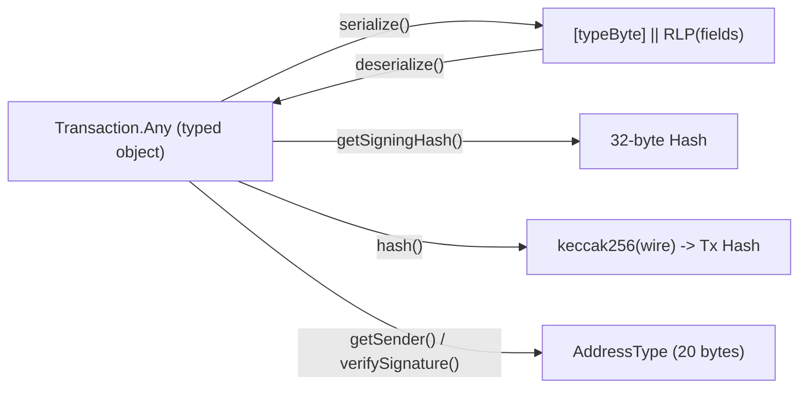

`Transaction` is a discriminated union (`Transaction.Any`) and codec covering all five Ethereum transaction formats: Legacy (Type `0x00`), EIP-2930 (Type `0x01`), EIP-1559 (Type `0x02`), EIP-4844 (Type `0x03`), and EIP-7702 (Type `0x04`).



## Transaction Types

| Type | Prefix Byte | EIP | Key Additions |
| --- | --- | --- | --- |
| `Legacy` | None (`>= 0xc0` RLP list) | Frontier / EIP-155 | `gasPrice`, `v` (`27`/`28` or `chainId * 2 + 35 + yParity`) |
| `EIP2930` | `0x01` | EIP-2930 | `chainId`, `accessList`, `yParity` (`0`/`1`) |
| `EIP1559` | `0x02` | EIP-1559 | `maxFeePerGas`, `maxPriorityFeePerGas` |
| `EIP4844` | `0x03` | EIP-4844 | `maxFeePerBlobGas`, `blobVersionedHashes` (cannot have `to: null`) |
| `EIP7702` | `0x04` | EIP-7702 | `authorizationList` (EOA code delegation; cannot have `to: null`) |

## Quick Start

```typescript
import { Address, Transaction } from '@tevm/voltaire';

const tx: Transaction.EIP1559 = {
  type: Transaction.Type.EIP1559,
  chainId: 1n,
  nonce: 0n,
  maxPriorityFeePerGas: 1_500_000_000n,
  maxFeePerGas: 30_000_000_000n,
  gasLimit: 21_000n,
  to: Address('0x742d35cc6634c0532925a3b844bc9e7595f0beb0'),
  value: 1_000_000_000_000_000_000n,
  data: new Uint8Array(),
  accessList: [],
  yParity: 0,
  r: new Uint8Array(32),
  s: new Uint8Array(32),
};

const raw = Transaction.serialize(tx);
const decoded = Transaction.deserialize(raw);
const signingHash = Transaction.getSigningHash(tx);
const effectivePrice = Transaction.getGasPrice(tx, 15_000_000_000n);
```

Import from `@tevm/voltaire` or `@tevm/voltaire/Transaction`. Type-specific sub-namespaces are exposed as `Transaction.Legacy`, `Transaction.EIP2930`, `Transaction.EIP1559`, `Transaction.EIP4844`, and `Transaction.EIP7702`.

## API Reference

### Serialization, Hashing & RPC

| Function | Signature | Description |
| --- | --- | --- |
| `Transaction.serialize` | `(tx: Any) => Uint8Array` | Encode to EIP-2718 envelope (`[type] \|\| RLP`) or Legacy RLP |
| `Transaction.deserialize` | `(bytes: Uint8Array) => Any` | Detect type byte and decode into typed object |
| `Transaction.detectType` | `(bytes: Uint8Array) => Type` | Inspect leading byte (`0x01`–`0x04` or Legacy `>= 0xc0`) |
| `Transaction.hash` | `(tx: Any) => HashType` | Compute `keccak256(serialize(tx))` |
| `Transaction.getSigningHash` | `(tx: Any) => HashType` | Compute pre-signature digest (`keccak256([type] \|\| RLP(unsigned))`) |
| `Transaction.getSender` | `(tx: Any) => AddressType` | Recover 20-byte sender address via secp256k1 `ecrecover` |
| `Transaction.verifySignature` | `(tx: Any) => boolean` | Validate `(r, s, v/yParity)` bounds and recoverability |
| `Transaction.fromRpc` / `toRpc` | Convert between JSON-RPC hex objects and typed `Transaction.Any` |

### Inspection, Validation & Immutable Builders

| Category | Functions |
| --- | --- |
| Inspection | `format`, `getGasPrice(tx, baseFee?)`, `hasAccessList`, `getAccessList`, `getChainId`, `getRecipient`, `isSigned`, `isContractCreation`, `isContractCall`, `getBlobCount`, `getBlobVersionedHashes`, `getAuthorizationCount`, `getAuthorizations` |
| Type guards | `isLegacy`, `isEIP2930`, `isEIP1559`, `isEIP4844`, `isEIP7702` |
| Validation | `assertSigned`, `validateChainId`, `validateGasLimit`, `validateGasPrice`, `validateNonce`, `validateValue` |
| Builders | `withNonce(tx, n)`, `withGasLimit(tx, g)`, `withGasPrice(tx, p)`, `withData(tx, d)`, `replaceWith(tx, opts?)` |

## Effective Gas Price Formula

For EIP-1559, EIP-4844, and EIP-7702 transactions given block `baseFee`:

$$\text{effectiveGasPrice} = \min(\text{maxFeePerGas},\ \text{baseFee} + \text{maxPriorityFeePerGas})$$

## Related

- [AccessList](/primitives/accesslist) — EIP-2930 warm storage access lists
- [Blob](/primitives/blob) — EIP-4844 blob payloads and versioned hashes
- [Authorization](/primitives/authorization) — EIP-7702 delegation tuples
- [FeeMarket](/primitives/feemarket) — EIP-1559 and EIP-4844 fee calculations
- [Receipt](/primitives/receipt) — Execution receipts and logs
