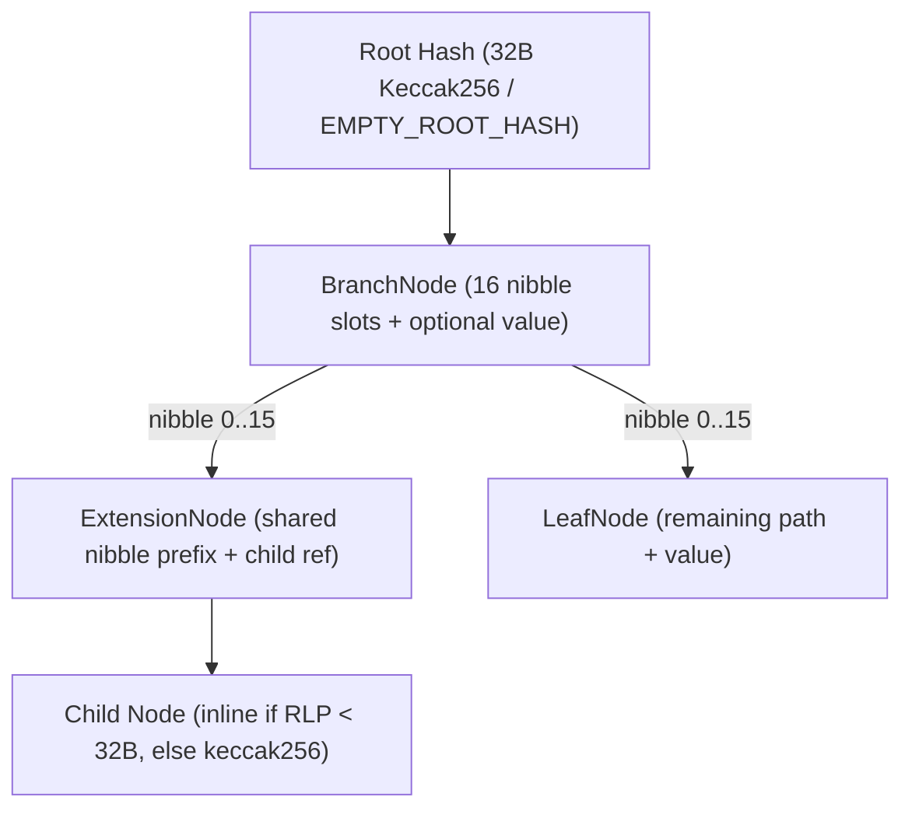

`Trie` (`TrieType`) implements Ethereum's Yellow Paper Appendix D Modified Merkle Patricia Trie (MPT): an immutable radix-16 key-value trie backing Ethereum's state root, transaction root, receipt root, and contract storage roots, complete with Merkle proof generation and stateless verification.



## Quick Start

```typescript
import { Trie } from '@tevm/voltaire';

const enc = new TextEncoder();
let trie = Trie.init();

trie = Trie.put(trie, enc.encode('do'), enc.encode('verb'));
trie = Trie.put(trie, enc.encode('dog'), enc.encode('puppy'));

const val = Trie.get(trie, enc.encode('dog')); // Uint8Array("puppy")
const root = Trie.rootHash(trie);              // 32-byte MPT root hash

// Generate and statelessly verify a Merkle proof
const proof = Trie.prove(trie, enc.encode('dog'));
const check = Trie.verify(root, enc.encode('dog'), proof.proof);
// check = { value: Uint8Array("puppy"), valid: true }

// Delete key
trie = Trie.del(trie, enc.encode('do'));
```

Import from `@tevm/voltaire` or `@tevm/voltaire/Trie`.

## Node Types & Hex-Prefix (HP) Encoding

| Node | Fields | RLP Structure |
| --- | --- | --- |
| `EmptyNode` | None | `0x80` (`EMPTY_ROOT_HASH = keccak256(0x80)`) |
| `LeafNode` | `nibbles`, `value` | `[encodePath(nibbles, true), value]` |
| `ExtensionNode` | `nibbles`, `child` | `[encodePath(nibbles, false), childRef]` |
| `BranchNode` | `children[16]`, `value` | 17-element list `[c0..c15, value]` |

Hex-prefix first nibble flags:

| Flag | Node Type | Path Length Parity |
| --- | --- | --- |
| `0x0` | Extension | Even (padded with `0x00`) |
| `0x1` | Extension | Odd (first path nibble in low nibble) |
| `0x2` | Leaf | Even (padded with `0x20`) |
| `0x3` | Leaf | Odd (first path nibble in low nibble) |

Child references embed raw RLP inline when `rlp(child).length < 32`, and store `keccak256(rlp(child))` otherwise.

## API Reference

| Method | Signature | Description |
| --- | --- | --- |
| `Trie.init` | `() => TrieType` | Create empty trie (root = `EMPTY_ROOT_HASH`) |
| `Trie.put` | `(trie, key: Uint8Array, value: Uint8Array) => TrieType` | Insert or update key-value pair (returns new trie) |
| `Trie.get` | `(trie, key: Uint8Array) => Uint8Array \| null` | Lookup value by key |
| `Trie.del` | `(trie, key: Uint8Array) => TrieType` | Remove key and compact branch/extension nodes |
| `Trie.clear` | `(trie) => TrieType` | Reset trie to empty |
| `Trie.rootHash` | `(trie) => Uint8Array` | Compute 32-byte Keccak-256 root (`0x56e81f17...` when empty) |
| `Trie.prove` | `(trie, key: Uint8Array) => TrieProof` | Generate RLP node proof path for inclusion or exclusion |
| `Trie.verify` | `(rootHash, key, proof) => { value: Uint8Array \| null; valid: boolean }` | Statelessly verify inclusion (`value !== null`) or non-inclusion (`value === null`) |
| `Trie.hashNode` | `(node: TrieNode) => Uint8Array` | RLP-encode and conditionally Keccak-256 hash a node |
| `Trie.keyToNibbles` / `nibblesToKey` | Convert bytes to/from 4-bit nibbles |
| `Trie.encodePath` / `decodePath` | Hex-prefix (compact) path encoding/decoding |
| `Trie.commonPrefixLength` | `(a, b) => number` | Shared nibble prefix length |

Dependency-injected factories for custom crypto/RLP backends: `HashNode`, `Put`, `Del`, `RootHash`, `Prove`, `Verify`.

## Related

- [RLP](/primitives/rlp) — Node serialization format
- [BinaryTree](/primitives/binarytree) — EIP-7864 unified BLAKE3 binary state tree
- [State](/primitives/state) — `(address, slot)` storage keys
