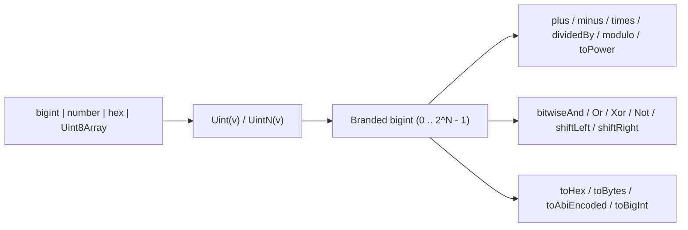

Voltaire models unsigned fixed-width integers as branded `bigint` values (`Uint8`, `Uint16`, `Uint32`, `Uint64`, `Uint128`, and `Uint` / `Uint256`). Every constructor validates range bounds on creation (`0` to `2^N - 1`), and arithmetic matches EVM modular semantics modulo $2^N$.



## Width Family

| Export | Bits | Bytes | Range | Constant `MAX` |
| --- | --- | --- | --- | --- |
| `Uint8` | `8` | `1` | `0` .. `255` | `255` |
| `Uint16` | `16` | `2` | `0` .. `65,535` | `65535` |
| `Uint32` | `32` | `4` | `0` .. `4,294,967,295` | `4294967295` |
| `Uint64` | `64` | `8` | `0n` .. `2^64 - 1` | `18446744073709551615n` |
| `Uint128` | `128` | `16` | `0n` .. `2^128 - 1` | `340282366920938463463374607431768211455n` |
| `Uint` / `Uint256` | `256` | `32` | `0n` .. `2^256 - 1` | `(1n << 256n) - 1n` |

## Quick Start

```typescript
import { Uint, Uint256, Uint64 } from '@tevm/voltaire';

const a = Uint(100n);
const b = Uint.fromHex('0x14');
const sum = Uint.plus(a, b);           // 120n (Uint256Type)
const abi = Uint.toAbiEncoded(sum);    // 32-byte big-endian Uint8Array

// Namespace alias Uint256 exposes the same 256-bit functions plus helpers
const g = Uint256.gcd(Uint(48n), Uint(18n)); // 6n
const total = Uint256.sum(a, b, sum);        // 240n

// Narrower widths enforce tighter bounds
const gasLimit = Uint64(30_000_000n);
```

Import from `@tevm/voltaire` or `@tevm/voltaire/Uint`.

## `Uint` vs `Uint256` Exports

- `Uint` is a callable constructor (`Uint(value)`) with static methods (`Uint.plus`, `Uint.toHex`, etc.) and constants (`MAX`, `MIN`, `ZERO`, `ONE`, `SIZE`).
- `Uint256` is the full 256-bit namespace from `@tevm/voltaire/Uint` (`Uint256.from`, `Uint256.plus`, plus variadic `sum`, `product`, `min`, `max`, `gcd`, `lcm`, `isPowerOf2`, `clone`).
- All arithmetic, bitwise, comparison, and conversion functions share the same `Uint256Type` branded `bigint`.

## API Summary (`Uint` / `Uint256`)

| Category | Methods |
| --- | --- |
| Constructors | `from`, `fromHex`, `fromBigInt`, `fromNumber`, `fromBytes`, `fromAbiEncoded`, `tryFrom` |
| Conversions | `toHex(u, padded?)`, `toBytes(u, size?)`, `toAbiEncoded(u)`, `toBigInt(u)`, `toNumber(u)`, `toString(u, radix?)` |
| Arithmetic | `plus`, `minus`, `times`, `dividedBy`, `modulo`, `toPower` |
| Bitwise | `bitwiseAnd`, `bitwiseOr`, `bitwiseXor`, `bitwiseNot`, `shiftLeft`, `shiftRight` |
| Comparison | `equals`, `notEquals`, `lessThan`, `lessThanOrEqual`, `greaterThan`, `greaterThanOrEqual`, `isZero`, `minimum`, `maximum` |
| Bit inspection | `bitLength`, `leadingZeros`, `popCount`, `isPowerOf2` |
| Aggregates (`Uint256`) | `sum`, `product`, `min`, `max`, `gcd`, `lcm`, `clone` |

## Wrapping & Division Semantics

- `plus`, `minus`, `times`, and `toPower` wrap modulo $2^{256}$ to match EVM opcodes (`ADD`, `SUB`, `MUL`, `EXP`).
- `dividedBy` and `modulo` throw on division by zero.
- `from*` throws `IntegerUnderflowError` on negative values and `IntegerOverflowError` on values `> MAX`; `tryFrom` returns `undefined` instead of throwing.

## Related

- [Uint256 Reference](/primitives/uint256) — Detailed 256-bit EVM word reference
- [Int256](/primitives/int256) — Signed 256-bit two's complement integers
- [Denomination](/primitives/denomination) — Branded `Wei`, `Gwei`, and `Ether` units
