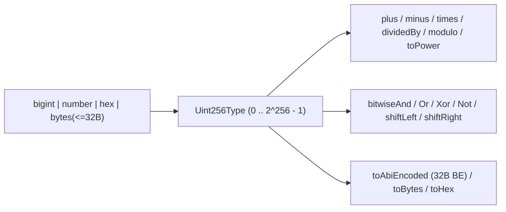

`Uint256` (`Uint256Type`) is a branded `bigint` constrained to $[0, 2^{256} - 1]$ — the native unsigned word type of the Ethereum Virtual Machine.



## Quick Start

```typescript
import { Uint256 } from '@tevm/voltaire';

const price = Uint256.from(1_000_000_000_000_000_000n); // 1e18
const qty = Uint256.fromNumber(3);
const total = Uint256.times(price, qty);

Uint256.toHex(total);          // "0x29a2241af62c0000"
Uint256.toHex(total, true);    // 64-nibble zero-padded hex
Uint256.toAbiEncoded(total);   // 32-byte big-endian Uint8Array
Uint256.bitLength(total);      // 62
```

Import `Uint256` (namespace) or `Uint` (callable constructor) from `@tevm/voltaire` or `@tevm/voltaire/Uint`.

## Bounds & Constants

| Constant | Value |
| --- | --- |
| `Uint256.SIZE` | `32` (bytes) |
| `Uint256.MIN` / `Uint256.ZERO` | `0n` |
| `Uint256.ONE` | `1n` |
| `Uint256.MAX` | `115792089237316195423570985008687907853269984665640564039457584007913129639935n` ($2^{256} - 1$) |

## API Reference

### Constructors & Validation

| Method | Signature | Notes |
| --- | --- | --- |
| `Uint256.from` | `(value: bigint \| number \| string) => Uint256Type` | Accepts decimal string, `0x` hex string, `number`, or `bigint` |
| `Uint256.fromHex` | `(hex: string) => Uint256Type` | Parse unsigned `0x` hex (`<= 32` bytes) |
| `Uint256.fromBigInt` | `(value: bigint) => Uint256Type` | Validates `0n <= value <= MAX` |
| `Uint256.fromNumber` | `(value: number) => Uint256Type` | Validates non-negative safe integer |
| `Uint256.fromBytes` | `(bytes: Uint8Array) => Uint256Type` | Big-endian unsigned bytes (`<= 32` bytes) |
| `Uint256.fromAbiEncoded` | `(data: Uint8Array) => Uint256Type` | Requires exact 32-byte big-endian word |
| `Uint256.tryFrom` | `(value: bigint \| number \| string) => Uint256Type \| undefined` | Non-throwing parser |
| `Uint256.isValid` | `(value: unknown) => value is Uint256Type` | Runtime range check |

### Conversions

| Method | Signature | Output |
| --- | --- | --- |
| `Uint256.toHex` | `(u: Uint256Type, padded?: boolean) => string` | `0x` hex; `padded = true` yields 64 hex chars |
| `Uint256.toBytes` | `(u: Uint256Type, size?: number) => Uint8Array` | Big-endian bytes (default minimal or `size`) |
| `Uint256.toAbiEncoded` | `(u: Uint256Type) => Uint8Array` | Exact 32-byte big-endian word |
| `Uint256.toBigInt` | `(u: Uint256Type) => bigint` | Unbranded `bigint` |
| `Uint256.toNumber` | `(u: Uint256Type) => number` | Throws if `> Number.MAX_SAFE_INTEGER` |
| `Uint256.toString` | `(u: Uint256Type, radix?: number) => string` | String in base `radix` (default `10`) |

### Arithmetic, Bitwise & Number Theory

| Group | Methods | Semantics |
| --- | --- | --- |
| Arithmetic | `plus`, `minus`, `times`, `toPower` | Wrapping modulo $2^{256}$ |
| Division | `dividedBy`, `modulo` | Truncating unsigned division; throws on zero divisor |
| Bitwise | `bitwiseAnd`, `bitwiseOr`, `bitwiseXor`, `bitwiseNot`, `shiftLeft`, `shiftRight` | Masked to 256 bits (`bitwiseNot(0n) === MAX`) |
| Comparison | `equals`, `notEquals`, `lessThan`, `lessThanOrEqual`, `greaterThan`, `greaterThanOrEqual`, `isZero`, `minimum`, `maximum` | Standard unsigned order |
| Bit metrics | `bitLength`, `leadingZeros`, `popCount`, `isPowerOf2` | 256-bit width (`leadingZeros(0n) === 256`) |
| Aggregates | `sum(...xs)`, `product(...xs)`, `min(...xs)`, `max(...xs)`, `gcd(a, b)`, `lcm(a, b)`, `clone(u)` | Variadic reductions and Euclidean GCD/LCM |

## Edge Cases

- `Uint256.minus(0n, 1n)` wraps to `Uint256.MAX`.
- `Uint256.plus(Uint256.MAX, 1n)` wraps to `0n`.
- `Uint256.shiftLeft(x, 256n)` and `Uint256.shiftRight(x, 256n)` yield `0n`.
- `Uint256.fromAbiEncoded` throws `InvalidLengthError` if input length is not `32`.

## Related

- [Uint Overview](/primitives/uint) — Full `Uint8`–`Uint256` family
- [Int256](/primitives/int256) — Signed 256-bit two's complement arithmetic
- [Denomination](/primitives/denomination) — `Wei`, `Gwei`, and `Ether` conversions
