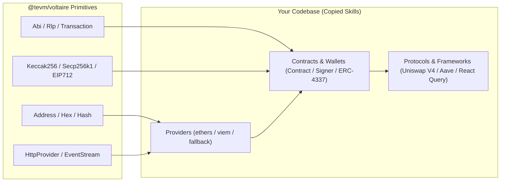

Skills are copyable TypeScript modules built on Voltaire primitives. Copy a Skill into your repository, read every line, and modify it directly instead of working around an opaque dependency.

## Choosing a Skill

| Need | Skill | Primitives Used |
| --- | --- | --- |
| Migrate from ethers v6 | [ethers-provider](/skills/ethers-provider), [ethers-contract](/skills/ethers-contract), [ethers-signer](/skills/ethers-signer) | `Address`, `Abi`, `Hex`, `Transaction`, `Secp256k1`, `HttpProvider` |
| Migrate from viem | [viem-publicclient](/skills/viem-publicclient), [viem-walletclient](/skills/viem-walletclient), [viem-contract](/skills/viem-contract) | `Address`, `Abi`, `Hex`, `HttpProvider`, `EIP712` |
| Browser wallet (`window.ethereum`) | [eip1193-provider](/skills/eip1193-provider) | `provider` (`EIP1193Provider`), `Hex` |
| Resilient RPC transport | [fallback-provider](/skills/fallback-provider), [batched-provider](/skills/batched-provider), [websocket-provider](/skills/websocket-provider) | `HttpProvider`, `WebSocketProvider`, `utils` |
| Typed contract calls and logs | [Contract Pattern](/contract), [multicall](/skills/multicall), [event-indexer](/skills/event-indexer) | `Abi`, `Address`, `Hex`, `EventStream`, `BlockStream` |
| Keys, nonces, and signatures | [wallet-generation](/skills/wallet-generation), [nonce-manager](/skills/nonce-manager), [permit](/skills/permit), [siwe-authentication](/skills/siwe-authentication) | `Bip39`, `HDWallet`, `Secp256k1`, `EIP712`, `Siwe` |
| Frontend state management | [react-query](/skills/react-query), [vue](/skills/vue), [effect-ts](/skills/effect-ts) | `provider`, `Abi`, `Address` |
| DeFi and L2 protocols | [uniswap-v4](/skills/uniswap-v4), [aave-v3](/skills/aave-v3), [safe](/skills/safe), [op-stack](/skills/op-stack), [arbitrum](/skills/arbitrum) | `Abi`, `Address`, `Transaction`, `EIP712` |

## Provider Skills

Drop-in replacements for ethers, viem, and transport-level middleware.

<CardGroup cols={2}>
  <Card title="ethers-provider" icon="cube" href="/skills/ethers-provider">
    ethers v6 compatible `JsonRpcProvider`
  </Card>
  <Card title="viem-publicclient" icon="cube" href="/skills/viem-publicclient">
    viem compatible `PublicClient` for read operations
  </Card>
  <Card title="viem-walletclient" icon="cube" href="/skills/viem-walletclient">
    viem compatible `WalletClient` for signing
  </Card>
  <Card title="viem-testclient" icon="cube" href="/skills/viem-testclient">
    viem compatible `TestClient` for local testing
  </Card>
  <Card title="batched-provider" icon="layer-group" href="/skills/batched-provider">
    JSON-RPC request batching over a single HTTP call
  </Card>
  <Card title="eip1193-provider" icon="window" href="/skills/eip1193-provider">
    Browser wallet wrapper (`window.ethereum`)
  </Card>
  <Card title="websocket-provider" icon="plug" href="/skills/websocket-provider">
    Real-time pub/sub subscriptions over WebSocket
  </Card>
  <Card title="fallback-provider" icon="rotate" href="/skills/fallback-provider">
    Multi-endpoint RPC failover and circuit breaking
  </Card>
</CardGroup>

## Contract Skills

Typed ABI encoding, decoding, and contract call wrappers.

<CardGroup cols={2}>
  <Card title="ethers-contract" icon="file-contract" href="/skills/ethers-contract">
    ethers v6 compatible `Contract` wrapper
  </Card>
  <Card title="viem-contract" icon="file-contract" href="/skills/viem-contract">
    viem compatible `getContract` pattern
  </Card>
  <Card title="ethers-interface" icon="brackets-curly" href="/skills/ethers-interface">
    ethers v6 compatible `Interface` for ABI encoding
  </Card>
</CardGroup>

## Wallet Skills

Key derivation, transaction signing, nonce tracking, and account abstraction.

<CardGroup cols={2}>
  <Card title="ethers-signer" icon="key" href="/skills/ethers-signer">
    ethers v6 compatible `Signer`
  </Card>
  <Card title="ethers-hdwallet" icon="wallet" href="/skills/ethers-hdwallet">
    BIP-32/39/44 hierarchical deterministic derivation
  </Card>
  <Card title="viem-account" icon="user" href="/skills/viem-account">
    viem compatible `Account` abstraction
  </Card>
  <Card title="nonce-manager" icon="list-ol" href="/skills/nonce-manager">
    Concurrent transaction nonce management
  </Card>
  <Card title="erc4337" icon="shield" href="/skills/erc4337">
    ERC-4337 Account Abstraction (`UserOperation`)
  </Card>
</CardGroup>

## Framework Skills

Direct integrations with frontend and functional state libraries.

<CardGroup cols={2}>
  <Card title="react-query" icon="react" href="/skills/react-query">
    TanStack Query hooks without wagmi overhead
  </Card>
  <Card title="vue" icon="vuejs" href="/skills/vue">
    Vue 3 reactive composables
  </Card>
  <Card title="effect-ts" icon="sparkles" href="/skills/effect-ts">
    Typed error channels and services with Effect.ts
  </Card>
</CardGroup>

## Utility Skills

Reusable Ethereum application patterns.

<CardGroup cols={2}>
  <Card title="multicall" icon="layer-group" href="/skills/multicall">
    Batch contract reads via Multicall3
  </Card>
  <Card title="permit" icon="stamp" href="/skills/permit">
    ERC-2612 and Permit2 off-chain approvals
  </Card>
  <Card title="event-indexer" icon="database" href="/skills/event-indexer">
    Historical backfill and live event indexing
  </Card>
</CardGroup>

## Task Skills

Focused recipes for single operations.

<CardGroup cols={2}>
  <Card title="Wallet Generation" icon="wallet" href="/skills/wallet-generation">
    Generate mnemonics and derive BIP-44 keys
  </Card>
  <Card title="Send ETH & Tokens" icon="paper-plane" href="/skills/send-eth-tokens">
    Construct, sign, and broadcast value and ERC-20 transfers
  </Card>
  <Card title="Contract Interaction" icon="file-contract" href="/skills/contract-interaction">
    Read state and send contract transactions
  </Card>
  <Card title="Sign & Verify Messages" icon="signature" href="/skills/sign-verify-messages">
    EIP-191 personal sign and address recovery
  </Card>
  <Card title="Event Listening" icon="bell" href="/skills/event-listening">
    Filter and stream contract logs
  </Card>
  <Card title="EIP-712 Typed Data" icon="file-signature" href="/skills/eip712-typed-data">
    Structured data hashing and signing
  </Card>
  <Card title="SIWE Authentication" icon="user-check" href="/skills/siwe-authentication">
    Sign-In with Ethereum message parsing and verification
  </Card>
  <Card title="Gas Estimation" icon="gas-pump" href="/skills/gas-estimation">
    EIP-1559 fee calculation and buffers
  </Card>
  <Card title="ENS Resolution" icon="globe" href="/skills/ens-resolution">
    Forward and reverse ENS lookups
  </Card>
  <Card title="Transaction Simulation" icon="play" href="/skills/transaction-simulation">
    Dry-run state transitions via `eth_call`
  </Card>
</CardGroup>

## Protocol, Tooling, and L2 Skills

| Category | Skills |
| --- | --- |
| **DeFi & Markets** | [Uniswap V4](/skills/uniswap-v4), [Aave V3](/skills/aave-v3), [Curve](/skills/curve), [Lido](/skills/lido), [EigenLayer](/skills/eigenlayer), [Pendle](/skills/pendle), [Polymarket](/skills/polymarket) |
| **Infrastructure & Identity** | [Safe](/skills/safe), [ENS](/skills/ens), [Chainlink](/skills/chainlink), [LayerZero](/skills/layerzero), [Seaport](/skills/seaport), [Farcaster](/skills/farcaster) |
| **L2 Networks** | [Arbitrum](/skills/arbitrum), [OP Stack](/skills/op-stack), [Tempo](/skills/tempo) |
| **Solidity Tooling** | [Foundry](/skills/foundry), [Hardhat](/skills/hardhat) |

## Using Skills

1. **Copy directly**: Open any Skill page, copy the implementation file into your project (for example `src/eth/Contract.ts`), and adapt error handling, retries, or caching.
2. **Generate with MCP**: Connect the [Voltaire MCP Server](/model-context-protocol) so your coding agent composes custom Skills tailored to your ABIs and providers.
3. **Read the design rationale**: See [Skills Philosophy](/concepts/skills) for why Voltaire exports primitives while leaving higher-level wrappers in user space.
