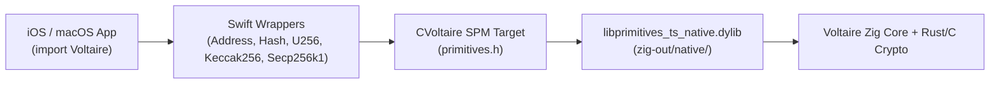

`Voltaire` (`packages/voltaire-swift`) provides native Swift 5.9 value types over Voltaire's Zig C ABI (`CVoltaire` linking `libprimitives_ts_native`), targeting macOS 12+ and iOS 15+.



## Requirements

- macOS 12+ or iOS 15+
- Swift 5.9+
- Zig 0.15+ (to compile `libprimitives_ts_native`)

## Build and Test

Build the Zig native library from the repository root first, then build and test the Swift package:

```bash
# 1. Build the native C ABI dynamic library into zig-out/native/
zig build build-ts-native -Dwith-c-api=true

# 2. Build and test the Swift package
cd packages/voltaire-swift
swift build
swift test
```

## Quick Example

```swift
import Voltaire

// 20-byte Ethereum address with EIP-55 checksum
let addr = try Address(hex: "0xd8dA6BF26964aF9D7eEd9e03E53415D37aA96045")
print(addr.checksumHex)  // 0xd8dA6BF26964aF9D7eEd9e03E53415D37aA96045
print(addr.isZero)       // false

// Keccak-256 hashing
let digest = Keccak256.hash("hello world")
print(digest.hex)

// 256-bit unsigned integer and fixed 32-byte value
let amount = try U256(hex: "0x01")
let slot = try Bytes32(hex: "0x" + String(repeating: "00", count: 32))

// secp256k1 key generation and address derivation
let privateKey = try PrivateKey.generate()
let publicKey = try privateKey.publicKey()
let compressed = try publicKey.compressed()  // 33 bytes (SEC1)
let derivedAddress = try publicKey.address()
print(compressed.count, derivedAddress.checksumHex)

// Signature canonicalization and recovery
let msgHash = Keccak256.hash("hello")
let sig = try Signature(compact: rBytes + sBytes)
let canonical = sig.normalized()
let recovered = try canonical.recoverAddress(messageHash: msgHash)
```

## Type Surface

| Type | Representation | Key Operations |
| --- | --- | --- |
| `Address` | 20 bytes | `init(hex:)`, `init(bytes:)`, `.zero`, `.hex`, `.checksumHex`, `.bytes`, `.isZero`, `isValidChecksum(_:)` |
| `Hash` | 32 bytes | `init(hex:)`, `init(bytes:)`, `.zero`, `.hex`, `.bytes` |
| `Bytes32` | 32 bytes | `init(hex:)`, `init(bytes:)`, `.zero`, `.hex`, `.bytes` |
| `U256` | 32 bytes (big-endian) | `init(hex:)`, `init(bytes:)`, `.zero`, `.hex`, `.bytes` |
| `Hex` | Namespace | `Hex.encode(_:)`, `Hex.decode(_:)` |
| `Keccak256` | Namespace | `Keccak256.hash(_:)` (`String`, `[UInt8]`, `Data`) |
| `PrivateKey` | 32 bytes | `generate()`, `init(bytes:)`, `.publicKey()`, `.bytes` |
| `PublicKey` | 64 bytes (`x \|\| y`) | `init(uncompressed:)`, `.compressed()`, `.address()` |
| `Signature` | `r` (32) + `s` (32) + `v` (1) | `init(compact:)`, `init(r:s:v:)`, `.serialize(includeV:)`, `.isCanonical`, `.normalized()`, `.recoverPublicKey(messageHash:)`, `.recoverAddress(messageHash:)` |

## Documentation

<CardGroup cols={2}>
  <Card title="Getting Started" icon="rocket" href="/swift/getting-started">
    Build the native Zig dylib and link `Voltaire` with SwiftPM.
  </Card>
  <Card title="Xcode Integration" icon="apple" href="/swift/getting-started-xcode">
    Add the package and dynamic library search paths in Xcode.
  </Card>
  <Card title="Address" icon="location-dot" href="/swift/primitives/address">
    20-byte addresses and EIP-55 checksum validation.
  </Card>
  <Card title="Keccak256" icon="shield-halved" href="/swift/crypto/keccak256">
    Keccak-256 hashing over strings, byte arrays, and `Data`.
  </Card>
  <Card title="Hash & Bytes32" icon="hashtag" href="/swift/primitives/hash">
    32-byte hashes and fixed-width byte containers.
  </Card>
  <Card title="U256 & Hex" icon="binary" href="/swift/primitives/u256">
    256-bit unsigned integers and hex encoding.
  </Card>
  <Card title="Keys & Signatures" icon="key" href="/swift/primitives/signature">
    `PrivateKey`, `PublicKey`, low-s canonicalization, and `ecrecover`.
  </Card>
  <Card title="Errors & Troubleshooting" icon="triangle-exclamation" href="/swift/support/errors">
    `VoltaireError` cases and dylib rpath diagnostics.
  </Card>
</CardGroup>
