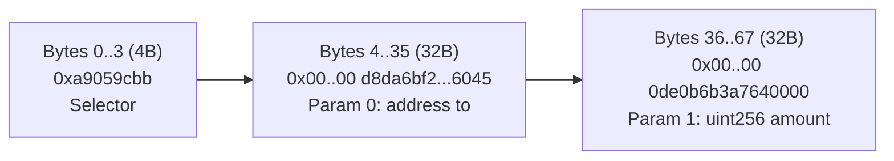
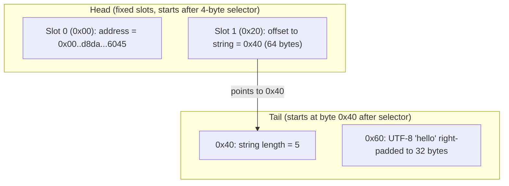

**Scenario:** A block explorer hands you this raw hex blob from a mainnet transaction's `input` field:

```text
0xa9059cbb000000000000000000000000d8da6bf26964af9d7eed9e03e53415d37aa960450000000000000000000000000000000000000000000000000de0b6b3a7640000
```

To most developers, that looks like noise. In five minutes, you will read it at a glance — and encode/decode both static and dynamic ABI payloads with Voltaire.

## Dissecting the 68 Bytes

The Ethereum ABI packs everything into **32-byte words** preceded by a **4-byte function selector**:



| Offset | Length | Hex | Meaning |
| --- | --- | --- | --- |
| `0x00` | 4 bytes | `a9059cbb` | First 4 bytes of `Keccak256("transfer(address,uint256)")` |
| `0x04` | 32 bytes | `0000...d8da6bf2...6045` | `address` left-padded with 12 zero bytes |
| `0x24` | 32 bytes | `0000...0de0b6b3a7640000` | `uint256` big-endian (`1_000_000_000_000_000_000` = 1e18) |

<Accordion title="Check your understanding: Why does transfer(address,uint256) have NO spaces or parameter names?">
The ABI specification hashes the **canonical signature** — function name + parenthesized, comma-separated canonical types (`uint256`, never `uint`; no spaces, no parameter names). `transfer(address to, uint256 amount)` hashes to the wrong 4 bytes and your transaction will hit the fallback or revert.
</Accordion>

## What Happens When a Type Has Variable Length?

Fixed types (`address`, `uint256`, `bool`, `bytes32`) sit inline in the **head**. Dynamic types (`string`, `bytes`, `T[]`) cannot fit in 32 bytes, so the head stores a **byte offset pointer** into the **tail**:



Notice the padding asymmetry that trips people up in hand-rolled decoders:
- **Numbers & addresses** are **left-padded** with zeros (`0000...abcd`).
- **`bytes` & `string`** are **right-padded** with zeros (`68656c6c6f0000...`).

## Step-by-Step: Encode, Decode, and Parse Logs

<Steps>
  <Step title="Verify the selector and encode static calldata">
    ```typescript
    import { Abi, Hex } from '@tevm/voltaire';
    import { Keccak256 } from '@tevm/voltaire/Keccak256';

    const erc20 = Abi([
      {
        type: 'function',
        name: 'transfer',
        stateMutability: 'nonpayable',
        inputs: [
          { type: 'address', name: 'to' },
          { type: 'uint256', name: 'amount' },
        ],
        outputs: [{ type: 'bool' }],
      },
      {
        type: 'event',
        name: 'Transfer',
        inputs: [
          { type: 'address', name: 'from', indexed: true },
          { type: 'address', name: 'to', indexed: true },
          { type: 'uint256', name: 'value', indexed: false },
        ],
      },
    ] as const);

    const selector = Hex.fromBytes(Keccak256.selector('transfer(address,uint256)'));
    console.log('Selector:', selector); // 0xa9059cbb

    const calldata = erc20.encode('transfer', [
      '0xd8dA6BF26964aF9D7eEd9e03E53415D37aA96045',
      1_000_000_000_000_000_000n,
    ]);
    console.log('Encoded:', Hex.fromBytes(calldata));
    // Matches the 68-byte hex blob from the top of the tutorial!
    ```
  </Step>

  <Step title="Decode raw calldata without knowing which function was called">
    When indexing transactions, you have the contract ABI and raw `input` bytes. `abi.decodeData` matches the 4-byte selector automatically:

    ```typescript
    const decoded = erc20.decodeData(calldata);
    console.log('Function:', decoded.functionName); // "transfer"
    console.log('Args:    ', decoded.args);
    // ["0xd8da6bf26964af9d7eed9e03e53415d37aa96045", 1000000000000000000n]
    ```
  </Step>

  <Step title="Encode and inspect dynamic head/tail parameters">
    Use `Abi.encodeParameters` and `Abi.decodeParameters` directly when working with raw ABI parameter tuples (constructors, `abi.encode`, multicall payloads):

    ```typescript
    const params = [
      { type: 'address', name: 'sender' },
      { type: 'string', name: 'memo' },
    ] as const;

    const encoded = Abi.encodeParameters(params, [
      '0xd8dA6BF26964aF9D7eEd9e03E53415D37aA96045',
      'hello',
    ]);

    // 4 words x 32 bytes = 128 bytes:
    // word 0: address | word 1: offset 0x40 | word 2: length 5 | word 3: "hello"
    console.log('Total bytes:', encoded.length); // 128

    const [sender, memo] = Abi.decodeParameters(params, encoded);
    console.log({ sender, memo });
    ```
  </Step>

  <Step title="Decode an ERC-20 Transfer event log">
    Events split fields across two places:
    - **`indexed` parameters** go into `topics[1..3]` (with `topics[0]` = `Keccak256("Transfer(address,address,uint256)")`).
    - **Non-indexed parameters** are ABI-encoded into `data`.

    ```typescript
    const transferTopic = Hex.fromBytes(
      Keccak256.topic('Transfer(address,address,uint256)'),
    );

    const [parsed] = erc20.parseLogs([
      {
        topics: [
          transferTopic,
          '0x000000000000000000000000742d35cc6634c0532925a3b844bc9e7595f51e3e',
          '0x000000000000000000000000d8da6bf26964af9d7eed9e03e53415d37aa96045',
        ],
        data: '0x0000000000000000000000000000000000000000000000000de0b6b3a7640000',
      },
    ]);

    console.log(parsed.eventName, parsed.args);
    // "Transfer" { from: "0x742d...", to: "0xd8da...", value: 1000000000000000000n }
    ```
  </Step>
</Steps>

## What You Built

- Decoded a 68-byte ERC-20 transfer manually by splitting selector + 32-byte words.
- Visualized how ABI head offsets point into dynamic tail slots.
- Encoded/decoded function calldata, standalone parameter tuples, and indexed `Transfer` event logs using `Abi`.

**Next tutorial:** [Tutorial 3: Building a Gasless Permit Relayer](/tutorials/signing-and-eip712)
