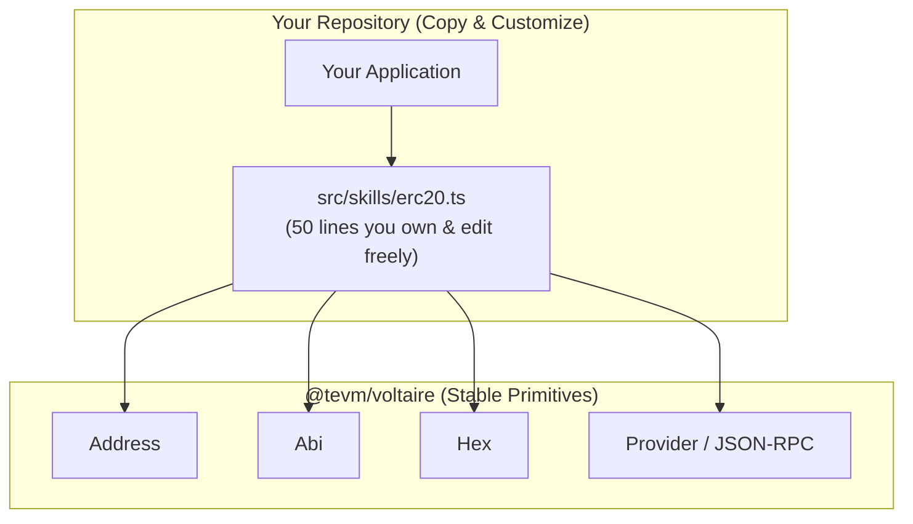

**Scenario:** You need to read ERC-20 balances and metadata across 3 RPC providers, attach your app's own tracing headers, and decode custom revert errors. In a monolithic SDK, every one of those tweaks means fighting plugin hooks or waiting on an upstream PR.

## The Voltaire Pattern: Primitives + Copyable Skills

Voltaire splits Ethereum engineering into two layers:



Primitives (`Address`, `Abi`, `Hex`, `Keccak256`, `Transaction`) are spec-defined and rarely change — they belong in `node_modules`. Higher-level wrappers (retry policies, contract helpers, React hooks) vary wildly from app to app — they belong in **your** codebase as a **Skill**.

## Step-by-Step: Build Your Own Typed ERC-20 Skill

<Steps>
  <Step title="Define the minimal ERC-20 ABI once">
    Create `src/skills/erc20.ts`. Keep only the functions your app actually calls — zero dead ABI bloat.

    ```typescript
    import { Address, Hex } from '@tevm/voltaire';
    import { Abi } from '@tevm/voltaire/Abi';
    import type { AddressType } from '@tevm/voltaire/Address';

    const erc20Abi = Abi([
      {
        type: 'function',
        name: 'balanceOf',
        stateMutability: 'view',
        inputs: [{ type: 'address', name: 'account' }],
        outputs: [{ type: 'uint256' }],
      },
      {
        type: 'function',
        name: 'decimals',
        stateMutability: 'view',
        inputs: [],
        outputs: [{ type: 'uint8' }],
      },
      {
        type: 'function',
        name: 'symbol',
        stateMutability: 'view',
        inputs: [],
        outputs: [{ type: 'string' }],
      },
    ] as const);
    ```
  </Step>

  <Step title="Add a tiny EIP-1193 eth_call helper">
    Accept any standard EIP-1193 provider (`window.ethereum`, `HttpProvider`, or a mock in tests):

    ```typescript
    export interface Eip1193Provider {
      request(args: { method: string; params?: unknown[] }): Promise<unknown>;
    }

    export function createErc20(token: AddressType, provider: Eip1193Provider) {
      async function call<T>(fn: 'balanceOf' | 'decimals' | 'symbol', args: unknown[] = []): Promise<T> {
        const data = erc20Abi.encode(fn, args);
        const raw = (await provider.request({
          method: 'eth_call',
          params: [{ to: token.toHex(), data: Hex.fromBytes(data) }, 'latest'],
        })) as string;

        const [result] = erc20Abi.decode(fn, Hex.toBytes(raw));
        return result as T;
      }

      return {
        address: token,
        balanceOf: (account: AddressType) => call<bigint>('balanceOf', [account.toHex()]),
        decimals: () => call<number>('decimals'),
        symbol: () => call<string>('symbol'),
      };
    }
    ```
  </Step>

  <Step title="Use it with full compile-time safety">
    ```typescript
    import { Address } from '@tevm/voltaire';
    import { HttpProvider } from '@tevm/voltaire/provider';
    import { createErc20 } from './skills/erc20.js';

    const provider = new HttpProvider('https://eth.llamarpc.com');
    const usdc = createErc20(
      Address('0xA0b86991c6218b36c1d19D4a2e9Eb0cE3606eB48'),
      provider,
    );

    const holder = Address('0xd8dA6BF26964aF9D7eEd9e03E53415D37aA96045');
    const [symbol, decimals, balance] = await Promise.all([
      usdc.symbol(),
      usdc.decimals(),
      usdc.balanceOf(holder),
    ]);

    console.log(`${symbol} balance: ${Number(balance) / 10 ** decimals}`);
    ```
  </Step>

  <Step title="Tailor it in 10 seconds (or let your AI agent do it)">
    Need an in-memory cache for `decimals()` and `symbol()` (they never change)? Edit 4 lines directly inside `src/skills/erc20.ts`. Need Effect.ts typed errors, retries, and circuit breakers out of the box? Check out [voltaire-effect](https://github.com/evmts/voltaire/tree/main/packages/voltaire-effect).

    You can also connect Voltaire's [MCP server](/concepts/ai-and-mcp) so Claude Code, Cursor, or Codex can generate custom Skills from any contract ABI in your project.
  </Step>
</Steps>

## What You Built

- A 40-line, dependency-free, branded-type ERC-20 reader backed by `@tevm/voltaire`.
- Complete control over transport, caching, error handling, and logging — with zero framework lock-in.

## Where to Go Next

<CardGroup cols={2}>
  <Card title="Browse Prebuilt Skills" icon="wand-magic-sparkles" href="/skills/index">
    Copy tested implementations for providers, multicall, permits, Uniswap v4, Aave v3, Safe, and React Query.
  </Card>
  <Card title="API Reference" icon="book" href="/primitives/address">
    Explore the full K&R reference for all Voltaire primitives, crypto modules, and EVM instructions.
  </Card>
</CardGroup>
